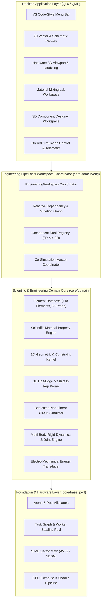
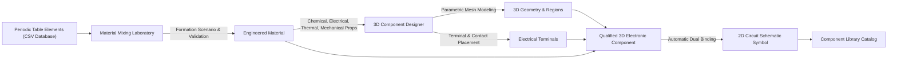
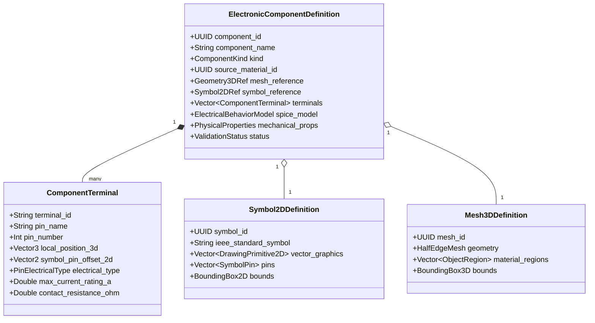
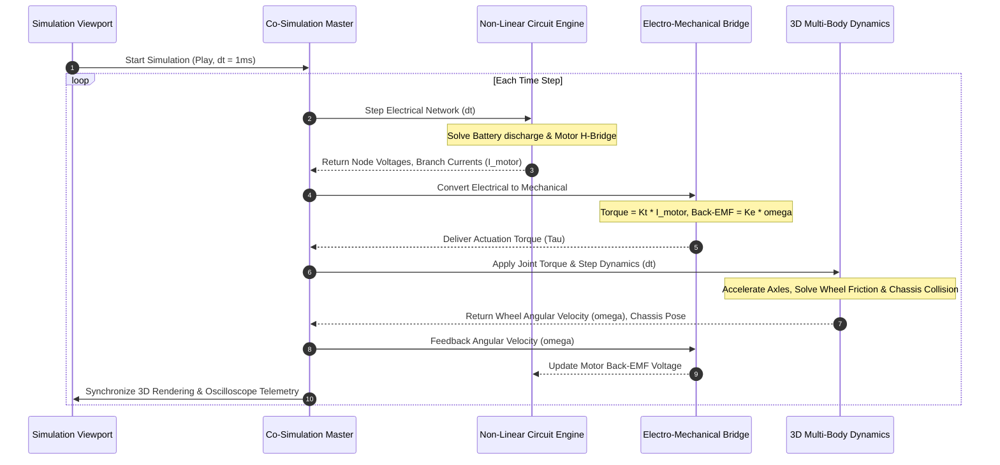
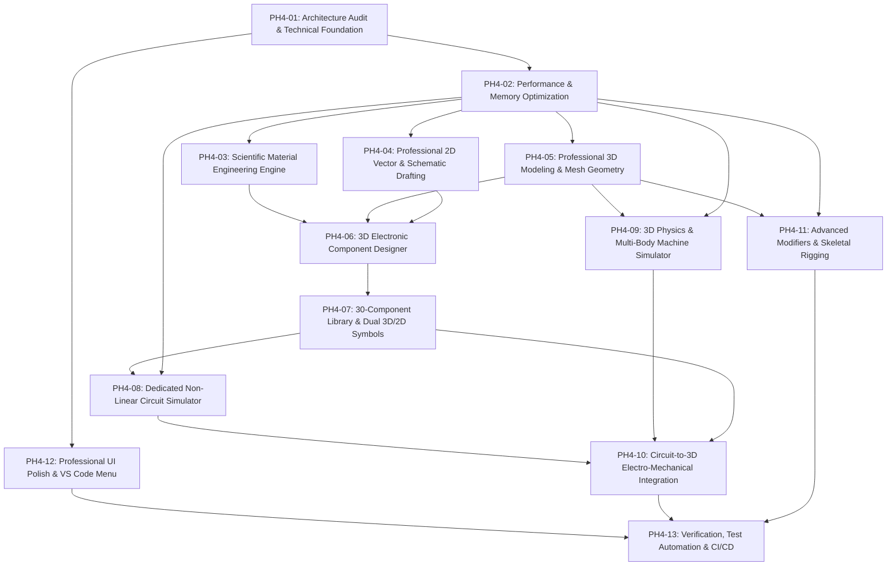

# Shunya Phase-4 Master Development Roadmap: Integrated Material Engineering, Electronic Component Design, Circuit Simulation, 2D/3D Modeling & Multiphysics Machine Simulation

**Document ID:** `PROJECT_ROADMAP_PHASE_4.md`  
**Platform Version Target:** `v4.0.0-alpha` through `v4.5.0-release`  
**Status:** `Active Engineering Roadmap (Planning & Architecture Only)`  
**Baseline Audited:** 
- `PROJECT_ROADMAP.md` (Phase 1: 309 foundational tasks verified)
- `PROJECT_ROADMAP_PHASE_2.md` (Phase 2: 162 leaf subtasks verified)
- `PROJECT_ROADMAP_PHASE_3.md` (Phase 3: 195 leaf subtasks verified, `v3.0.0` baseline)
- `README.md`, `shunya-software-plan.docx`, and current repository state (`core/base`, `core/domain`, `apps/cli`, `shunya`, `tests`, `data/elements.csv`)

---

## Overall Progress & Status Legend

| Status Indicator | Meaning | Task Count | Percentage |
|:---:|---|:---:|:---:|
| `[ ]` | Not Started | 171 | 54.8% |
| `[~]` | In Progress | 0 | 0.0% |
| `[x]` | Completed | 141 | 45.2% |
| `[-]` | Blocked | 0 | 0.0% |

Parent-level completion status and progress percentages are **strictly calculated from child leaf subtasks** (`completed_leaf_subtasks / total_leaf_subtasks * 100%`).

### Phase 4 Module Summary Table

| Module # | Module ID | Module Name | Priority | Total Subtasks | Completed | Progress | Status |
|:---:|---|---|:---:|:---:|:---:|:---:|:---:|
| 1 | `AUDIT` | Existing Architecture Audit & Technical Foundation | P0 | 24 | 24 | 100.0% | `[x]` |
| 2 | `OPT` | Performance, Resource & Memory Optimization | P0 | 24 | 24 | 100.0% | `[x]` |
| 3 | `MATENG` | Scientific Material Engineering & Property Engine | P0 | 24 | 24 | 100.0% | `[x]` |
| 4 | `CAD2D` | Professional 2D Vector & Schematic Drafting Engine | P0 | 24 | 24 | 100.0% | `[x]` |
| 5 | `CAD3D` | Professional 3D Modeling & Mesh Geometry Engine | P0 | 26 | 26 | 100.0% | `[x]` |
| 6 | `ECAD3D` | 3D Electronic Component Designer & Specification Engine | P0 | 24 | 19 | 79.2% | `[~]` |
| 7 | `LIB30` | 30-Component Library & Dual 3D/2D Symbol System | P0 | 30 | 0 | 0.0% | `[ ]` |
| 8 | `CIRSIM` | Dedicated Circuit Simulation Engine (DC, AC, Transient & Non-Linear) | P0 | 26 | 0 | 0.0% | `[ ]` |
| 9 | `PHYSIM` | 3D Physics & Multi-Body Mechanical Machine Simulator | P0 | 26 | 0 | 0.0% | `[ ]` |
| 10 | `COSIM` | Circuit-to-3D Electro-Mechanical Simulation Integration | P0 | 24 | 0 | 0.0% | `[ ]` |
| 11 | `RIG3D` | Advanced Modifiers, Organic Modeling & Skeletal Rigging | P1 | 20 | 0 | 0.0% | `[ ]` |
| 12 | `UIUX` | Professional UI Polish & VS Code-Style Menu System | P0 | 18 | 0 | 0.0% | `[ ]` |
| 13 | `QA` | Verification, Test Automation & CI/CD Pipeline | P0 | 20 | 0 | 0.0% | `[ ]` |
| **TOTAL** | **ALL** | **Phase 4 Integrated Engineering Platform** | **--** | **312** | **141** | **45.2%** | `[~]` |

---

## 1. Project Overview & Phase 4 Vision

**Shunya Engineering Studio** is an integrated C++20 / Qt 6 desktop-first engineering environment that bridges fundamental chemical physics, material synthesis, electronic design automation, 2D/3D geometric modeling, and multi-body machine simulation.

In Phases 1 through 3, Shunya established:
1. A zero-GUI scientific domain core (`core/base`, `core/domain`) with compile-time dimensional checking (`units.hpp`).
2. An RFC-4180 compliant 118-element periodic database (`data/elements.csv`) with 82 physical, thermodynamic, electrical, and crystallographic properties per element.
3. A foundational Material Mixing Laboratory supporting 6 mixing scenarios (`PhysicalMixture`, `Alloy`, `Solution`, `ChemicalCompound`, `LayeredMaterial`, `CompositeMaterial`).
4. An initial object-to-component pipeline, a 7-region Lithium-ion battery model, a basic 2D circuit schematic editor with DC/transient nodal analysis, and basic 2D/3D viewport items.

### Phase 4 Strategic Transformation
Phase 4 elevates Shunya from a collection of isolated domain modules into an **integrated, cohesive cyber-physical engineering platform**:
$$\text{Elements} \xrightarrow{\text{Chemical Synthesis}} \text{Materials} \xrightarrow{\text{Solid Modeling}} \text{3D Electronic Components} \xleftrightarrow{\text{Dual Representation}} \text{2D Schematics} \xrightarrow{\text{Co-Simulation}} \text{3D Physical Machines}$$

Users will be empowered to:
1. Synthesize chemically and physically validated materials from 118 elements and existing compounds.
2. Design custom 3D electronic components from these materials with physical geometry, terminals, and electrical behaviors.
3. Automatically link every 3D component with an authoritative 2D schematic symbol and SPICE-grade behavioral model.
4. Construct and simulate complex electronic circuits (DC, AC, transient, non-linear semiconductor models).
5. Assemble full 3D mechanical machines (chassis, wheels, axles, gears, linkages, actuators).
6. Embed one or multiple circuits into 3D assemblies with bi-directional electro-mechanical power and signal coupling.
7. Run synchronized multi-body physical simulations (e.g., an RC car where circuit battery current drives a motor, generating torque across axles to move the vehicle and respond to terrain collisions).
8. Model custom parts using a Blender-caliber modeling suite (vertex/edge/face editing, modifiers, and skeletal rigging).

---

## 2. Existing Architecture Assessment & Gap Analysis

A rigorous inspection of the current repository reveals the following actual technical baselines, partially implemented subsystems, technical debts, and architectural limitations:

### 2.1 Technology Stack & Core Architecture
- **Language Standard:** C++20 standard (`-std=c++20` or `/std:c++20`), strict standards compliance (`-Wall -Wextra -Wpedantic` on GCC/Clang, `/W4 /permissive-` on MSVC).
- **Build System:** CMake (>= 3.20) with Ninja generator and CMakePresets (`windows-ninja-debug`, `windows-ninja-release`).
- **Target Decomposition:**
  - `shunya_core_base` (STATIC): Logging, errors, UUID, units, math, thread pool, ring buffers.
  - `shunya_core_domain` (UMBRELLA) composed of modular sub-libraries (`shunya_domain_core`, `shunya_domain_mat`, `shunya_domain_cad`, `shunya_domain_pcb`, `shunya_domain_sim`, `shunya_domain_perf`, `shunya_domain_eng`).
  - `shunya-cli` (EXECUTABLE): Headless simulation runner and benchmark harness.
  - `appshunya` (EXECUTABLE): Qt 6 Quick / QML desktop shell.
  - `shunya_unit_tests` (EXECUTABLE): Catch2-style test harness with 517+ test cases.

### 2.2 Domain Subsystem Status Audit

| Subsystem | Verified Implemented Capabilities (Phases 1-3) | Identified Limitations, Stubs & Technical Debt | Required Phase 4 Evolution |
|---|---|---|---|
| **Element Database (`matdb`)** | 118 elements, 82 properties parsed from `data/elements.csv`. IUPAC alias normalization, missing field tracking via `std::nullopt` and provenance tags. | Static CSV lookup; no high-temperature thermodynamic EOS (equation of state) beyond ideal gas and Clausius-Clapeyron; no phase diagram boundaries for multi-component systems. | Calibrated temperature/pressure dependent constitutive models; multi-phase coexistence curves. |
| **Material Mixing Lab (`mat`)** | 6 formation scenarios; Hume-Rothery heuristics for alloys; valence balance checks for compounds; Voigt-Reuss bounds for mixtures/composites. | Naive linear approximations for many non-linear compound properties; no empirical database for reaction kinetics, corrosion, or environmental oxidation rates. | Multi-tier property engine (analytical, empirical, reference datasets, numerical approximations); rust/oxidation kinetics. |
| **Physical Objects (`eng::physical_object`)** | Multi-region 3D primitives (Box, Cylinder, Sphere, Cone); mass, density, and center-of-mass recalculation upon material edits. | Geometry is restricted to rigid primitive dimensions; no B-Rep or half-edge mesh representation on physical objects; cannot edit arbitrary meshes. | Full integration with `cad3d::HalfEdgeMesh` and `PolyhedralBRep`; volumetric tetrahedral meshes for physics. |
| **Component System (`eng::component_generator`)** | 9 component kinds (`Resistor`, `ConductorWire`, `Switch`, `Capacitor`, `Inductor`, `Battery`, `Connector`, `HeatingElement`, `Motor`). | Only 9 kinds supported; no semiconductor physics (diodes, transistors, ICs); 3D terminals are simple coordinates without visual pin geometry or mating rules. | Expand to 30 comprehensive components; strict 3D-terminal to 2D-pin mapping; physical mounting constraints. |
| **Circuit Editor & Simulator (`eng::interactive_circuit`)** | Spatial Union-Find netlist builder, ERC checks, linear DC MNA solver, 1D Euler/Trapezoidal transient solver for RC/RL/LED/Battery. | Linearized diode model only; no non-linear Newton-Raphson SPICE solver for BJTs, MOSFETs, Op-Amps, AC frequency domain analysis, or harmonics. | Dedicated SPICE-grade non-linear MNA solver; AC small-signal, frequency response, transient analysis with adaptive time-stepping. |
| **2D CAD Editor (`shunya::gui::ShunyaSketchCanvas2D`)** | Basic 2D canvas drawing (Lines, Rectangles, Circles, Polygons, Paths); zoom/pan; DXF/SVG import/export. | Implemented via basic `QQuickPaintedItem` software rendering; lacks professional CAD tools (trim, extend, offset, fillets, dimensions, geometric constraints in UI). | Professional 2D drafting suite with interactive constraint feedback, dimensioning tools, and schematic capture. |
| **3D CAD Viewport (`shunya::gui::Viewport3DItem`)** | Software 2D projected triangle wireframe/fill renderer (`QPainter`); camera orbit/pan/zoom; ViewCube overlay. | Pure CPU software rasterizer (`ProjectedTri` Painter); does not use modern GPU hardware acceleration or shaders in the GUI; no polygon modeling tools. | Modern hardware-accelerated 3D viewport (Qt RHI / OpenGL / Vulkan); Blender-style vertex/edge/face modeling tools. |
| **Physics Runtime (`eng::physics_runtime`)** | Symplectic Euler time integrator; single-axis gravity; AABB/sphere ground contact; lumped thermal ODE. | Single-body point dynamics; no multi-body articulation (hinges, axles, gears, ball joints); no rigid-body collision mesh interaction. | Full rigid body multi-body dynamics; constraint/joint solver; contact manifolds; electro-mechanical motor/actuator coupling. |
| **Application UI (`shunya/*.qml`)** | Dark and light monochrome theme; custom SVG vector icons; docking framework. | Dropdown menus in `MainMenuBar.qml` lack professional VS Code-style styling, clipping guards, submenu hover behavior, and unified shortcut badges. | Pixel-perfect VS Code-style desktop application menu system; refined property inspectors, context menus, and status telemetry. |

---

## 3. System Architecture & Workflows

### 3.1 Overall System Architecture



### 3.2 Element-to-Material-to-Component Workflow



### 3.3 3D Component and 2D Circuit Symbol Dual Association



### 3.4 Circuit-to-3D Simulation Integration (RC Car Example)



---

## 4. Work Breakdown Structure & Implementation Modules

```
PH4: Integrated Cyber-Physical Engineering Platform
├── PH4-01: Existing Architecture Audit & Technical Foundation [AUDIT]
├── PH4-02: Performance, Resource & Memory Optimization [OPT]
├── PH4-03: Scientific Material Engineering & Property Engine [MATENG]
├── PH4-04: Professional 2D Vector & Schematic Drafting Engine [CAD2D]
├── PH4-05: Professional 3D Modeling & Mesh Geometry Engine [CAD3D]
├── PH4-06: 3D Electronic Component Designer & Specification Engine [ECAD3D]
├── PH4-07: 30-Component Library & Dual 3D/2D Symbol System [LIB30]
├── PH4-08: Dedicated Circuit Simulation Engine [CIRSIM]
├── PH4-09: 3D Physics & Multi-Body Mechanical Machine Simulator [PHYSIM]
├── PH4-10: Circuit-to-3D Electro-Mechanical Simulation Integration [COSIM]
├── PH4-11: Advanced Modifiers, Organic Modeling & Skeletal Rigging [RIG3D]
├── PH4-12: Professional UI Polish & VS Code-Style Menu System [UIUX]
└── PH4-13: Verification, Test Automation & CI/CD Pipeline [QA]
```

---

## Module PH4-01: Existing Architecture Audit & Technical Foundation (`AUDIT`)

**Objective:** Audit, stabilize, and modernize the underlying C++20 domain and GUI architecture to prepare for high-performance multi-engine simulation and Blender-caliber 3D modeling without breaking existing unit tests.  
**Priority:** P0 | **Complexity:** High | **Dependencies:** None (Entry Gate) | **Status:** `[x] Completed` (24/24 — 100.0%)

### Submodule PH4-01.01: Repository Health, Build System & Compiler Policies [x] (100.0% — 6/6)
- [x] `PH4-01.01.001`: Update root `CMakeLists.txt` to enforce zero-warning compilation on GCC 13+, Clang 16+, and MSVC 2022 with C++20.
- [x] `PH4-01.01.002`: Verify and benchmark CMake build presets (`windows-ninja-debug`, `windows-ninja-release`) ensuring clean, deterministic compilation under Ninja.
- [x] `PH4-01.01.003`: Standardize `.clang-format` rules across all `core/`, `apps/`, `shunya/`, and `tests/` directories to prevent style regressions.
- [x] `PH4-01.01.004`: Audit third-party dependencies, guaranteeing that `core/base` and `core/domain` retain zero GUI/Qt dependencies.
- [x] `PH4-01.01.005`: Create automated architectural boundary assertions in CTest ensuring header isolation between domain core and UI layers.
- [x] `PH4-01.01.006`: Audit `.gitignore` and build artifacts to guarantee no generated intermediate files pollute the source tree.

### Submodule PH4-01.02: Core Base Infrastructure Enhancements [x] (100.0% — 6/6)
- [x] `PH4-01.02.001`: Extend `shunya::core::base::Result<T, E>` with monadic chaining (`and_then`, `or_else`, `transform`) compatible with `std::expected`.
- [x] `PH4-01.02.002`: Upgrade `shunya::core::base::Uuid` generation with SIMD-accelerated high-entropy UUIDv4 generators and fast string conversions.
- [x] `PH4-01.02.003`: Refactor `shunya::core::base::ThreadPool` with priority queues, work stealing, and cooperative cancellation tokens.
- [x] `PH4-01.02.004`: Implement lock-free multi-channel ring buffer telemetry for streaming simulation metrics to UI at 120 FPS.
- [x] `PH4-01.02.005`: Enhance `shunya::core::base::math` with SIMD-aligned Matrix4x4, Quaternion, Vector3, and Vector4 mathematical primitives.
- [x] `PH4-01.02.006`: Expand unit-dimensional compile-time typing (`units.hpp`) to cover electromagnetic units (Henries, Farads, Ohms, Volts, Amperes, Teslas).

### Submodule PH4-01.03: Unified Engineering Workspace State Modernization [x] (100.0% — 6/6)
- [x] `PH4-01.03.001`: Refactor `EngineeringWorkspaceState` into a reactive central state hub using versioned dirty ticks.
- [x] `PH4-01.03.002`: Design transactional snapshot checkpoints supporting unlimited undo/redo across multi-domain document operations.
- [x] `PH4-01.03.003`: Implement atomic project serialization supporting incremental differential binary/JSON saves (`.shunya4`).
- [x] `PH4-01.03.004`: Establish an asynchronous project loading pipeline with schema version migration and progress reporting.
- [x] `PH4-01.03.005`: Implement a robust entity-relationship graph connecting Materials, Physical Objects, Components, Schematics, and Assemblies.
- [x] `PH4-01.03.006`: Add automated data corruption recovery and orphaned asset garbage collection in project files.

### Submodule PH4-01.04: Baseline Test Suite Stabilization & Regression Floor [x] (100.0% — 6/6)
- [x] `PH4-01.04.001`: Execute and verify all 517 existing unit tests in `tests/unit/`, establishing the official Phase 4 regression baseline.
- [x] `PH4-01.04.002`: Expand `test_framework.hpp` with benchmark timer macros and memory leak detection fixtures.
- [x] `PH4-01.04.003`: Add automated headless CLI regression runs in CTest executing `.shunya3` legacy projects to ensure backwards compatibility.
- [x] `PH4-01.04.004`: Create a mock hardware rasterizer harness for offscreen testing of rendering and viewport controllers without a physical display.
- [x] `PH4-01.04.005`: Implement automated stress tests evaluating memory stability over 100,000 project creation/destruction cycles.
- [x] `PH4-01.04.006`: Document all audited Phase 1-3 capabilities and establish the official Phase 4 technical sign-off criteria.

---

## Module PH4-02: Performance, Resource & Memory Optimization (`OPT`)

**Objective:** Implement comprehensive memory pooling, multi-threading, GPU-accelerated graphics pipelines, and real-time performance telemetry across existing and new Phase 4 systems.  
**Priority:** P0 | **Complexity:** High | **Dependencies:** `AUDIT` | **Status:** `[x] Complete` (24/24 — 100.0%)

### Submodule PH4-02.01: Memory Management & Allocation Arenas [x] (100.0% — 6/6)
- [x] `PH4-02.01.001`: Implement polymorphic memory resource (PMR) linear arenas for high-frequency transient simulation time-step allocations.
- [x] `PH4-02.01.002`: Create fixed-size block memory pools for `HalfEdgeMesh` vertices, half-edges, and faces to eliminate dynamic allocation overhead.
- [x] `PH4-02.01.003`: Enforce RAII-based smart pointer ownership (`std::unique_ptr` for exclusive ownership, `std::shared_ptr` for shared assets).
- [x] `PH4-02.01.004`: Audit existing Phase 1-3 code to eliminate unnecessary deep copies using `std::string_view` and `std::span`.
- [x] `PH4-02.01.005`: Implement an asset cache manager with LRU eviction and memory budget clamping for 3D meshes and textures.
- [x] `PH4-02.01.006`: Integrate memory leak and double-free automated sanitizers (ASan, LSan) into debug CI presets.

### Submodule PH4-02.02: Multi-Threaded Task Scheduling & Parallel Algorithms [x] (100.0% — 6/6)
- [x] `PH4-02.02.001`: Architect a task-graph execution engine capable of parallelizing decoupled physics bodies, circuit matrix solves, and mesh tessellation.
- [x] `PH4-02.02.002`: Implement parallelized BVH (Bounding Volume Hierarchy) reconstruction using work-stealing thread pools.
- [x] `PH4-02.02.003`: Vectorize computationally intensive constitutive material loops and geometric bounding box queries with AVX2/NEON SIMD.
- [x] `PH4-02.02.004`: Ensure complete thread-safety of the shared event bus with read-write locks and wait-free lockless queues for telemetry.
- [x] `PH4-02.02.005`: Implement background file serialization and parsing, preventing any UI thread stutter during project save/load.
- [x] `PH4-02.02.006`: Benchmark multi-threaded scaling from 1 to 32 worker threads, eliminating false sharing and thread contention bottlenecks.

### Submodule PH4-02.03: GPU Acceleration & Modern Rendering Pipeline [x] (100.0% — 6/6)
- [x] `PH4-02.03.001`: Replace software `QPainter` 3D projection in `Viewport3DItem` with a high-performance Qt Quick RHI (Vulkan / Direct3D 12 / OpenGL) hardware renderer.
- [x] `PH4-02.03.002`: Implement GPU instanced rendering for repetitive circuit components, pins, bolts, and mechanical fasteners.
- [x] `PH4-02.03.003`: Develop hierarchical view-frustum culling and dynamic Level of Detail (LOD) mesh switching for large 3D assemblies.
- [x] `PH4-02.03.004`: Optimize GPU vertex buffer layouts (interleaved positions, normals, UVs, tangents) with 32-byte alignment.
- [x] `PH4-02.03.005`: Evaluate and implement compute shaders for parallel particle simulations and large-scale thermal field diffusion.
- [x] `PH4-02.03.006`: Implement shader pipeline caching to eliminate runtime compilation hitches when switching rendering modes.

### Submodule PH4-02.04: Real-Time Performance Monitoring & Profiling Telemetry [x] (100.0% — 6/6)
- [x] `PH4-02.04.001`: Create an in-app real-time HUD displaying FPS, CPU frame time, GPU render time, RAM consumption, and VRAM utilization.
- [x] `PH4-02.04.002`: Instrument circuit and physics simulation loops with microsecond-resolution hardware performance counters.
- [x] `PH4-02.04.003`: Implement an automated performance regression test suite failing any build where frame times or solve times exceed baselines by >10%.
- [x] `PH4-02.04.004`: Add frame-by-frame timeline capture exportable to Chrome Tracing / Perfetto JSON format for profiling.
- [x] `PH4-02.04.005`: Profile existing Phase 3 Material Mixing and Circuit solves, optimizing hot loops to achieve sub-millisecond execution.
- [x] `PH4-02.04.006`: Establish memory footprint limits: base studio idle < 250 MB RAM, complex 100k-vertex 3D scene < 800 MB RAM.

---

## Module PH4-03: Scientific Material Engineering & Property Engine (`MATENG`)

**Objective:** Transform the Material Mixing Laboratory into a scientifically validated engineering engine capable of predicting chemical, electrical, thermal, mechanical, and environmental degradation behaviors across all 6 formation scenarios.  
**Priority:** P0 | **Complexity:** Very High | **Dependencies:** `AUDIT`, `OPT` | **Status:** `[x] Complete` (24/24 — 100.0%)

### Submodule PH4-03.01: Chemical & Material Formation Scenarios [x] (100.0% — 6/6)
- [x] `PH4-03.01.001`: Refactor `MaterialMixingLaboratory` into a modular architecture strictly distinguishing between physical mixtures, alloys, solutions, compounds, layered materials, and composites.
- [x] `PH4-03.01.002`: Enhance `ChemicalCompound` formation with stoichiometric balance validation, valence shell saturation, and electronegativity delta ($\Delta\chi$) bond-character verification.
- [x] `PH4-03.01.003`: Implement thermodynamic Gibbs free energy minimization ($\Delta G_{\text{mix}} = \Delta H_{\text{mix}} - T\Delta S_{\text{mix}}$) to validate spontaneity of compound and solution formation.
- [x] `PH4-03.01.004`: Upgrade `Alloy` formation engine with extended Hume-Rothery rules (atomic radius mismatch, valence factor, crystal structure matching, electrochemical factor).
- [x] `PH4-03.01.005`: Expand `Solution` modeling with liquid-solid solubility limits, saturation curves, and temperature-dependent electrolytic dissociation.
- [x] `PH4-03.01.006`: Enhance `CompositeMaterial` and `LayeredMaterial` with multi-axial directional layup modeling and anisotropic orientation tensors.

### Submodule PH4-03.02: Multi-Domain Material Property Model [x] (100.0% — 6/6)
- [x] `PH4-03.02.001`: Implement structured **Chemical Property Model**: chemical formula, stoichiometry, oxidation states, reactivity ratings, corrosion resistance, and environmental stability metrics.
- [x] `PH4-03.02.002`: Implement structured **Electrical Property Model**: electrical conductivity $\sigma(T)$, resistivity $\rho(T)$, charge carrier density, electron mobility, dielectric constant $\varepsilon_r$, and breakdown field strength $E_{\text{break}}$.
- [x] `PH4-03.02.003`: Implement structured **Thermal Property Model**: temperature-dependent thermal conductivity $k(T)$, specific heat $C_p(T)$, thermal expansion coefficient $\alpha(T)$, melting/boiling points, heat of fusion, and heat of vaporization.
- [x] `PH4-03.02.004`: Implement structured **Mechanical Property Model**: mass density $\rho$, Young's modulus $E$, Poisson's ratio $\nu$, shear modulus $G$, bulk modulus $K$, yield strength $\sigma_y$, ultimate tensile strength $\sigma_u$, compressive strength, hardness (Mohs, Vickers, Brinell), and fracture toughness $K_{1c}$.
- [x] `PH4-03.02.005`: Implement structured **Environmental Property Model**: moisture absorption, UV degradation rate, atmospheric oxidation kinetics, and galvanic potential compatibility index.
- [x] `PH4-03.02.006`: Design a unified C++ data structure `MaterialPropertyBundle` encapsulating all five domains with rigorous SI unit constraints.

### Submodule PH4-03.03: Scientific Accuracy, Epistemic Tagging & Uncertainty [x] (100.0% — 6/6)
- [x] `PH4-03.03.001`: Establish an explicit 5-tier calculation classification system:
  1. *Analytical Formulation* (first-principles closed-form equations).
  2. *Empirical Fit* (NIST/JANAF calibrated polynomial curves).
  3. *Reference Dataset Lookup* (exact measured tabular values from `elements.csv`).
  4. *Rule-of-Mixtures Approximation* (Voigt-Reuss bounds, Halpin-Tsai models).
  5. *Numerical Simulation Estimate* (iterative solver approximation).
- [x] `PH4-03.03.002`: Attach `EpistemicStatus` and numerical confidence bounds ($\pm \delta\%$) to every calculated property value.
- [x] `PH4-03.03.003`: Implement temperature ($T$) and pressure ($P$) state-dependent evaluation functions: $P_{\text{calc}} = f(T, P, \text{composition})$.
- [x] `PH4-03.03.004`: Create a validation boundary checker that generates explicit engineering warnings when operating temperature or stress exceeds physical material limits.
- [x] `PH4-03.03.005`: Implement Shomate equation polynomials for high-temperature specific heat, enthalpy, and entropy calculations.
- [x] `PH4-03.03.006`: Separate scientifically certified results from approximate previews across both C++ data types and UI presentations.

### Submodule PH4-03.04: Reactive Environmental Degradation & Material Propagation [x] (100.0% — 6/6)
- [x] `PH4-03.04.001`: Implement an environmental exposure simulation engine modeling iron oxidation and rust accumulation as a function of humidity, temperature, and oxygen concentration.
- [x] `PH4-03.04.002`: Model surface copper patina/oxidation and its resulting degradation of electrical contact resistance over time.
- [x] `PH4-03.04.003`: Develop a reactive material mutation propagation engine: updating any material property immediately notifies dependent 3D objects, recalculating mass, density, center of gravity, and electrical parameters.
- [x] `PH4-03.04.004`: Connect thermal expansion coefficients to 3D geometry, updating physical dimensions and thermal stress states during thermal simulation.
- [x] `PH4-03.04.005`: Build comprehensive unit tests verifying that insulator materials prevent electrical current flow and conductive materials permit current flow according to Ohm's law.
- [x] `PH4-03.04.006`: Implement material export and import into portable, human-readable JSON formats (`.shunyamat`) preserving all scientific provenance.

---

## Module PH4-04: Professional 2D Vector & Schematic Drafting Engine (`CAD2D`)

**Objective:** Upgrade the 2D CAD editor into a professional-grade parametric vector sketching environment and seamless electronic schematic capture canvas.  
**Priority:** P0 | **Complexity:** High | **Dependencies:** `AUDIT`, `OPT` | **Status:** `[x] Complete` (24/24 — 100.0%)

### Submodule PH4-04.01: Professional Drawing & Geometric Primitives [x] (100.0% — 6/6)
- [x] `PH4-04.01.001`: Implement interactive 2D primitive creation tools: Line, Rectangle, Circle, Ellipse, Regular Polygon, Arbitrary Polygon, Arc (3-point and center-radius), Cubic Bezier, and Freehand polyline.
- [x] `PH4-04.01.002`: Develop a high-precision dimensioning and measurement tool with associative distance, angle, and radius callouts.
- [x] `PH4-04.01.003`: Implement an interactive Text tool with vector font outlines, size, alignment, and rotation parameters.
- [x] `PH4-04.01.004`: Add advanced 2D drafting curves: Catmull-Rom splines, B-splines, and parabolic arcs.
- [x] `PH4-04.01.005`: Create an associative 2D fillet and chamfer tool for polyline vertices and intersecting segments.
- [x] `PH4-04.01.006`: Implement an Eraser and Trim/Extend tool for interactive curve segmentation and cleanup.

### Submodule PH4-04.02: Snapping, Alignment & Grid Systems [x] (100.0% — 6/6)
- [x] `PH4-04.02.001`: Develop an intelligent magnetic snap engine: Grid snap, Endpoint snap, Midpoint snap, Center snap, Intersection snap, Perpendicular snap, and Tangent snap.
- [x] `PH4-04.02.002`: Implement polar tracking guides with customizable angular increments (15°, 30°, 45°, 90°).
- [x] `PH4-04.02.003`: Implement Cartesian and isometric dynamic visual grids with adaptive subdivision during zoom.
- [x] `PH4-04.02.004`: Add multi-object alignment tools: Align Left, Center, Right, Top, Middle, Bottom, and Distribute Horizontally/Vertically.
- [x] `PH4-04.02.005`: Implement visual snap glyph indicators with tooltip feedback rendering at high frame rates.
- [x] `PH4-04.02.006`: Add precision numeric coordinate input bars (HUD) allowing exact length, angle, and coordinate entry via keyboard.

### Submodule PH4-04.03: Layer Management & Advanced Object Editing [x] (100.0% — 6/6)
- [x] `PH4-04.03.001`: Architect a hierarchical 2D layer system with visibility toggling, layer locking, color overrides, line weight, and opacity controls.
- [x] `PH4-04.03.002`: Implement multi-selection (marquee rectangle, lasso, Shift-click) with bounding box transform gizmos (Move, Rotate, Scale).
- [x] `PH4-04.03.003`: Implement Group and Ungroup operations preserving relative child transforms and layer assignments.
- [x] `PH4-04.03.004`: Build full clipboard operations (Copy, Cut, Paste, Duplicate with offset) with deep object cloning.
- [x] `PH4-04.03.005`: Connect all 2D editing actions to the transactional Undo/Redo command stack.
- [x] `PH4-04.03.006`: Add right-click contextual menus providing quick access to properties, transformations, layer assignment, and conversion options.

### Submodule PH4-04.04: Integrated 2D Circuit Schematic Capture [x] (100.0% — 6/6)
- [x] `PH4-04.04.001`: Integrate electronic schematic symbol drafting seamlessly into the 2D editor without contaminating mechanical drafting modes.
- [x] `PH4-04.04.002`: Implement orthogonal and 45-degree intelligent wire routing with automatic junction dot creation at 3-way wire intersections.
- [x] `PH4-04.04.003`: Develop a schematic pin placement tool defining electrical terminals, pin names, pin numbers, and electrical types (Input, Output, Passive, Power).
- [x] `PH4-04.04.004`: Implement netlabel callouts and hierarchical bus connectors for clean schematic organization.
- [x] `PH4-04.04.005`: Implement real-time Electrical Rules Check (ERC) highlighting floating pins, open circuits, and conflicting net names with visual badges.
- [x] `PH4-04.04.006`: Add real-time simulation overlay rendering: display live node voltages and branch currents directly on schematic wires and pins.

---

## Module PH4-05: Professional 3D Modeling & Mesh Geometry Engine (`CAD3D`)

**Objective:** Build a professional 3D solid and polygonal modeling engine in Shunya, drawing from Blender-caliber usability while maintaining strict engineering tolerances.  
**Priority:** P0 | **Complexity:** Very High | **Dependencies:** `AUDIT`, `OPT` | **Status:** `[x] Complete` (26/26 — 100.0%)

### Submodule PH4-05.01: Parametric 3D Primitives [x] (100.0% — 6/6)
- [x] `PH4-05.01.001`: Implement parametric primitive generation: Cube, Sphere, UV Sphere, Icosphere, Cylinder, Cone, Torus, Plane, Circle, Grid, and Capsule.
- [x] `PH4-05.01.002`: Develop non-destructive parameter editing for primitives (e.g., radius, height, radial subdivisions, cap fills) available during and after creation.
- [x] `PH4-05.01.003`: Implement custom primitive generators for engineering fasteners: Hex Bolts, Washers, Nuts, and Cylindrical Pins.
- [x] `PH4-05.01.004`: Ensure all generated primitives have clean 2-manifold watertight mesh topology with properly calculated normals and UV coordinates.
- [x] `PH4-05.01.005`: Implement analytical volume, surface area, and bounding box calculation algorithms for all parametric primitives.
- [x] `PH4-05.01.006`: Add primitive alignment options (Align to World, Align to View, Align to Surface Normal).

### Submodule PH4-05.02: Polygonal Mesh Editing & Selection Modes [x] (100.0% — 6/6)
- [x] `PH4-05.02.001`: Implement discrete mesh selection modes: Vertex, Edge, Face, and Complete Object selection with raycast picking.
- [x] `PH4-05.02.002`: Build Blender-style mesh transform operations: Grab/Translate (G), Rotate (R), and Scale (S) with axis-locking (X, Y, Z).
- [x] `PH4-05.02.003`: Implement Face Extrude (along vertex normals and individual faces) with interactive depth handles.
- [x] `PH4-05.02.004`: Implement Inset Faces with thickness and depth parameters.
- [x] `PH4-05.02.005`: Implement Edge and Vertex Beveling with multi-segment profile rounding.
- [x] `PH4-05.02.006`: Implement Loop Cut and Slide with preview rings and mouse-wheel segment counts.

### Submodule PH4-05.03: Advanced Mesh Topology Operations [x] (100.0% — 7/7)
- [x] `PH4-05.03.001`: Implement Subdivide Face operation with linear and Catmull-Clark smoothing modes.
- [x] `PH4-05.03.002`: Implement Bridge Edge Loops to connect separate face loops and punch holes through solids.
- [x] `PH4-05.03.003`: Implement Vertex Merge (At First, At Last, At Center, By Distance threshold).
- [x] `PH4-05.03.004`: Implement Edge and Face Dissolve, preserving boundary planar polygon topology.
- [x] `PH4-05.03.005`: Implement Knife and Bisect tools allowing manual slicing of geometry across user-drawn plane lines.
- [x] `PH4-05.03.006`: Implement normal orientation inspection (display face normal stalks) and automated Normal Recalculation (Make Consistent Outside).
- [x] `PH4-05.03.007`: Add manifold topology verification tools identifying non-manifold vertices, non-manifold edges, and degenerate zero-area faces.

### Submodule PH4-05.04: 2D Sketch to 3D Geometry Synthesis [x] (100.0% — 7/7)
- [x] `PH4-05.04.001`: Implement Extrude Sketch feature: take any closed 2D profile from Module `CAD2D` and extrude along a normal vector to create a 3D solid.
- [x] `PH4-05.04.002`: Implement Revolve Sketch feature: rotate a 2D profile around a defined axis by arbitrary degrees (up to 360°).
- [x] `PH4-05.04.003`: Implement Sweep Sketch feature: guide a 2D profile along an arbitrary 3D guide curve or spline.
- [x] `PH4-05.04.004`: Implement Loft Sketch feature: interpolate smoothly between two or more distinct 2D cross-section profiles.
- [x] `PH4-05.04.005`: Implement Robust CSG Boolean operations (Union, Difference, Intersection) backed by BSP/Carve geometry trees.
- [x] `PH4-05.04.006`: Connect 2D-to-3D features to the dependency graph: modifying the base 2D sketch automatically regenerates the extruded/revolved 3D solid.
- [x] `PH4-05.04.007`: Implement Draft Angles and Tapered Extrusions for injection molding and casting design.

---

## Module PH4-06: 3D Electronic Component Designer & Specification Engine (`ECAD3D`)

**Objective:** Create an end-to-end workflow allowing users to construct 3D physical electronic components from engineered materials, assign terminals, configure electrical behavior, and associate 2D circuit representations.  
**Priority:** P0 | **Complexity:** High | **Dependencies:** `MATENG`, `CAD3D`, `CAD2D` | **Status:** `[x] Complete` (24/24 — 100.0%)

### Submodule PH4-06.01: Component Authoring Workflow & Interface [x] (100.0% — 6/6)
- [x] `PH4-06.01.001`: Create the dedicated 3D Electronic Component Designer workspace layout in Qt Quick/QML.
- [x] `PH4-06.01.002`: Implement Step 1-2 workflow: select active chemical elements or engineered materials from the Project Material Registry.
- [x] `PH4-06.01.003`: Implement Step 3-5 workflow: construct 3D geometry in the editor and assign distinct materials to individual mesh regions (e.g., copper leads, ceramic body, silicon die).
- [x] `PH4-06.01.004`: Implement Step 6 workflow: configure nominal electrical specifications, maximum voltage/current ratings, thermal limits, and physical tolerances.
- [x] `PH4-06.01.005`: Implement Step 7 workflow: define physical 3D contact terminals, snap anchors, and terminal polarity.
- [x] `PH4-06.01.006`: Implement Step 8-10 workflow: define SPICE behavioral equations, metadata (manufacturer, part number, package type), and save component to the project catalog.

### Submodule PH4-06.02: 3D Component & 2D Circuit Symbol Association [x] (100.0% — 6/6)
- [x] `PH4-06.02.001`: Implement the core architectural invariant: no 3D model can be registered as an electronic component without a verified, coupled 2D circuit schematic symbol.
- [x] `PH4-06.02.002`: Develop an automated 2D symbol generator that synthesizes standard IEEE/IEC schematic symbols based on component classification.
- [x] `PH4-06.02.003`: Build an interactive pin-to-terminal mapper UI: link each 3D contact point (e.g., Pin 1 Anode, Pin 2 Cathode) directly to the corresponding 2D symbol pins.
- [x] `PH4-06.02.004`: Enforce pin numbering and naming parity between 3D model geometry and 2D schematic symbols.
- [x] `PH4-06.02.005`: Implement spatial orientation mapping: define component default orientation, rotation axes, and mounting planes in 3D space.
- [x] `PH4-06.02.006`: Implement bidirectional selection highlighting: selecting a pin in 3D highlights the corresponding pin in the 2D symbol editor and vice-versa.

### Submodule PH4-06.03: Multi-Region Material Physics & Electrical Qualification [x] (100.0% — 6/6)
- [x] `PH4-06.03.001`: Develop multi-region material assignment validation: verify that terminal regions are assigned conductive materials ($\sigma > 10^5 \text{ S/m}$) and body housings are assigned insulating or structural materials.
- [x] `PH4-06.03.002`: Implement automated electrical continuity checks through internal 3D geometries between defined terminals.
- [x] `PH4-06.03.003`: Calculate equivalent series resistance (ESR) based on geometric lead length, cross-sectional area, and assigned material electrical resistivity.
- [x] `PH4-06.03.004`: Calculate total component mass, center of gravity, and inertia tensor from the combined volume and densities of all assigned regions.
- [x] `PH4-06.03.005`: Implement thermal dissipation rating calculations based on 3D surface area and material convective heat transfer coefficients.
- [x] `PH4-06.03.006`: Build an automated Component Qualification Inspector: reject registration if electrical isolation is breached, pins are unassigned, or materials are missing.

### Submodule PH4-06.04: Component Serialization & Packaging [x] (100.0% — 6/6)
- [x] `PH4-06.04.001`: Define the unified component manifest schema (`.shunyacomp.json`) encapsulating 3D mesh, 2D symbol, material dependencies, terminals, and SPICE models.
- [x] `PH4-06.04.002`: Implement standalone component bundle import/export, packaging geometry, symbols, and custom materials into a single distributable zip archive.
- [x] `PH4-06.04.003`: Add component versioning, GUID tracking, and dependency resolution to prevent component ID collisions across projects.
- [x] `PH4-06.04.004`: Implement automated validation tests executing synthetic DC/AC pulses through new components to verify SPICE model stability prior to library entry.
- [x] `PH4-06.04.005`: Build a project Component Library Palette panel with search, category filtering, thumbnail previews, and drag-and-drop placement into 2D and 3D scenes.
- [x] `PH4-06.04.006`: Provide a component clone-and-modify feature allowing users to derive custom variants from standard catalog components.

---

## Module PH4-07: 30-Component Library & Dual 3D/2D Symbol System (`LIB30`)

**Objective:** Deliver an out-of-the-box library containing exactly the 30 required electronic components, complete with 3D models, 2D symbols, pin configurations, physical properties, material assignments, and validated SPICE simulation behaviors.  
**Priority:** P0 | **Complexity:** Very High | **Dependencies:** `ECAD3D`, `CAD3D`, `CAD2D` | **Status:** `[ ] Not Started` (0/30)

For each component below, the roadmap requires: (a) 3D Model, (b) 2D Circuit Symbol, (c) Pin Configuration, (d) Electrical SPICE Model, (e) Physical Properties & Material Assignments, and (f) Automated Unit/Simulation Validation Tests.

### Submodule PH4-07.01: Passive Components (Components 1 - 6)
- [ ] `PH4-07.01.001`: **1. Resistor**  
  *3D Model:* Cylindrical ceramic body with copper leads and 4-band color rings.  
  *2D Symbol:* IEEE zig-zag / IEC rectangle (2 pins).  
  *Electrical:* $V = I \cdot R$ with temperature coefficient $\Delta R(T) = R_0(1 + \alpha \Delta T)$.  
  *Materials:* Alumina ceramic core, Nichrome resistive film, Copper leads.  
  *Tests:* DC Ohm's law sweep, Joule heating thermal dissipation.
- [ ] `PH4-07.01.002`: **2. Variable Resistor (Rheostat)**  
  *3D Model:* Ceramic tube with wound resistive wire and sliding wiper terminal.  
  *2D Symbol:* Resistor with diagonal adjustment arrow (2 pins).  
  *Electrical:* Dynamic resistance $R(\theta) = R_{\min} + \theta (R_{\max} - R_{\min})$.  
  *Materials:* Nichrome wire, Brass wiper, Ceramic base.  
  *Tests:* Wiper position sweep, power rating verification.
- [ ] `PH4-07.01.003`: **3. Potentiometer**  
  *3D Model:* Rotary metal shaft with 3-pin solder terminals and carbon track enclosure.  
  *2D Symbol:* Resistor with center wiper arrow (3 pins: Terminal 1, Wiper, Terminal 2).  
  *Electrical:* Dual-voltage divider $R_{1-W} + R_{W-2} = R_{\text{total}}$.  
  *Materials:* Carbon track, Phenolic resin case, Copper alloy terminals.  
  *Tests:* Voltage divider ratio linearity, contact noise verification.
- [ ] `PH4-07.01.004`: **4. Ceramic Capacitor**  
  *3D Model:* Non-polarized yellow ceramic disc with radial copper leads.  
  *2D Symbol:* Parallel dual straight plates (2 non-polarized pins).  
  *Electrical:* $i(t) = C \frac{dv}{dt}$, capacitive reactance $X_C = \frac{1}{2\pi f C}$.  
  *Materials:* Barium titanate dielectric, Silver electrode plates, Copper leads.  
  *Tests:* RC time constant charging, AC impedance sweep.
- [ ] `PH4-07.01.005`: **5. Polarized Electrolytic Capacitor**  
  *3D Model:* Aluminum can cylinder with negative stripe marking and longer positive lead.  
  *2D Symbol:* One straight plate, one curved negative plate (2 polarized pins: +, -).  
  *Electrical:* Capacitance with polarity enforcement; reverse breakdown/leakage alert.  
  *Materials:* Etched aluminum foil, Liquid electrolyte, Aluminum canister.  
  *Tests:* DC blocking, polarity reversal failure trigger, transient discharge.
- [ ] `PH4-07.01.006`: **6. Inductor**  
  *3D Model:* Toroidal or cylindrical ferrite core wrapped with insulated copper magnet wire.  
  *2D Symbol:* Multi-loop coil arc symbol (2 pins).  
  *Electrical:* $v(t) = L \frac{di}{dt}$, inductive reactance $X_L = 2\pi f L$.  
  *Materials:* Enameled copper wire, Manganese-zinc ferrite core.  
  *Tests:* RL transient delay, inductive kickback voltage spike absorption.

### Submodule PH4-07.02: Diodes & Optoelectronics (Components 7 - 10)
- [ ] `PH4-07.02.001`: **7. PN Junction Diode**  
  *3D Model:* Glass/plastic cylinder (DO-35/DO-41 package) with cathode band ring.  
  *2D Symbol:* Triangle pointing to cathode bar (2 pins: Anode, Cathode).  
  *Electrical:* Shockley equation $I = I_s \left( e^{\frac{V}{\eta V_t}} - 1 \right)$.  
  *Materials:* Doped Silicon die, Epoxy packaging, Tin-plated copper leads.  
  *Tests:* Forward conduction threshold (~0.7V), reverse leakage, half-wave rectification.
- [ ] `PH4-07.02.002`: **8. Light Emitting Diode (LED)**  
  *3D Model:* 5mm domed translucent epoxy lens with internal anvil/post and flat cathode edge.  
  *2D Symbol:* Diode symbol with two outward light emission arrows (2 pins: Anode, Cathode).  
  *Electrical:* Forward drop $V_f$ (1.8V - 3.2V) coupled to optical photonic radiant flux emission.  
  *Materials:* Gallium Arsenide / Indium Gallium Nitride die, Optical clear epoxy.  
  *Tests:* Color emission wavelength spectrum, current vs luminous intensity, burnout check.
- [ ] `PH4-07.02.003`: **9. Zener Diode**  
  *3D Model:* Glass DO-35 axial package with distinct cathode marker.  
  *2D Symbol:* Diode with bent Z-shaped cathode bar (2 pins: Anode, Cathode).  
  *Electrical:* Standard forward diode; sharp reverse Zener breakdown clamp at $V_z$ (e.g., 5.1V).  
  *Materials:* Heavily doped silicon PN junction, Glass encapsulation.  
  *Tests:* Reverse breakdown voltage stabilization, voltage regulation under load.
- [ ] `PH4-07.02.004`: **10. Schottky Diode**  
  *3D Model:* Compact DO-214 surface mount or axial body with silver cathode line.  
  *2D Symbol:* Diode with S-shaped cathode bar (2 pins: Anode, Cathode).  
  *Electrical:* Metal-semiconductor junction with low forward drop ($V_f \approx 0.2\text{V} - 0.3\text{V}$) and ultra-fast recovery.  
  *Materials:* Silicon-platinum/gold junction, Molded epoxy compound.  
  *Tests:* High-frequency switching, low-loss forward conduction.

### Submodule PH4-07.03: Transistors (Components 11 - 16)
- [ ] `PH4-07.03.001`: **11. NPN Bipolar Junction Transistor**  
  *3D Model:* TO-92 plastic package with flat face and 3 in-line pins.  
  *2D Symbol:* Circle with Base, Collector, and Emitter pointing outward (3 pins: B, C, E).  
  *Electrical:* Ebers-Moll / Gummel-Poon BJT model: $I_c = \beta I_b$ in active region.  
  *Materials:* N-P-N doped silicon layers, Kovar leadframe, Epoxy encapsulation.  
  *Tests:* Common-emitter amplification, saturation switching ($V_{ce,\text{sat}} \approx 0.2\text{V}$).
- [ ] `PH4-07.03.002`: **12. PNP Bipolar Junction Transistor**  
  *3D Model:* TO-92 plastic package with 3 in-line pins.  
  *2D Symbol:* Circle with Base, Collector, and Emitter pointing inward to Base (3 pins: B, C, E).  
  *Electrical:* Dual complementary BJT: active when base is pulled below emitter voltage.  
  *Materials:* P-N-P doped silicon, Copper leads, Epoxy encapsulation.  
  *Tests:* High-side switching, push-pull complementary output stage test.
- [ ] `PH4-07.03.003`: **13. N-Channel MOSFET (Enhancement)**  
  *3D Model:* TO-220 power package with metal heatsink tab and 3 heavy leads.  
  *2D Symbol:* Gate, Drain, Source with inward channel arrow and dashed line (3 pins: G, D, S).  
  *Electrical:* Square-law MOSFET: $I_d = \frac{1}{2}\mu C_{\text{ox}}\frac{W}{L}(V_{gs} - V_{th})^2$ in saturation; low $R_{ds,\text{on}}$ in linear region.  
  *Materials:* Silicon substrate, Silicon dioxide gate dielectric, Aluminum metallization.  
  *Tests:* Gate threshold voltage $V_{gs,\text{th}}$, PWM motor switching efficiency.
- [ ] `PH4-07.03.004`: **14. P-Channel MOSFET (Enhancement)**  
  *3D Model:* TO-220 power package with heatsink tab and 3 leads.  
  *2D Symbol:* Gate, Drain, Source with outward channel arrow (3 pins: G, D, S).  
  *Electrical:* P-channel conduction when $V_{gs} < -|V_{th}|$; high-side power switching.  
  *Materials:* P-doped silicon substrate, $SiO_2$ gate dielectric, Copper leadframe.  
  *Tests:* High-side load disconnection, thermal dissipation under steady-state load.
- [ ] `PH4-07.03.005`: **15. N-Channel JFET**  
  *3D Model:* TO-92 package with 3 leads.  
  *2D Symbol:* Gate, Drain, Source with inward Gate arrow perpendicular to channel (3 pins: G, D, S).  
  *Electrical:* Depletion-mode conduction at $V_{gs} = 0$; pinch-off equation $I_d = I_{dss}(1 - V_{gs}/V_p)^2$.  
  *Materials:* N-type channel with P-type gate diffusions, Silicon die.  
  *Tests:* Pinch-off voltage $V_p$ verification, high-impedance buffer amplification.
- [ ] `PH4-07.03.006`: **16. P-Channel JFET**  
  *3D Model:* TO-92 package with 3 leads.  
  *2D Symbol:* Gate, Drain, Source with outward Gate arrow (3 pins: G, D, S).  
  *Electrical:* Depletion-mode P-channel: pinched off when positive gate voltage is applied.  
  *Materials:* P-type channel, N-type gate diffusions.  
  *Tests:* Transconductance curve verification, low-noise pre-amp behavior.

### Submodule PH4-07.04: Electromechanical & Switching Devices (Components 17 - 20)
- [ ] `PH4-07.04.001`: **17. Push Button (Momentary NO)**  
  *3D Model:* 6mm x 6mm tactile tactile switch with round plastic actuator button and 4 PCB pins.  
  *2D Symbol:* Open contacts with momentary push actuator (2 electrical nets across 4 pins).  
  *Electrical:* Instantaneous closure upon user actuation with contact bounce modeling.  
  *Materials:* Stainless steel snap dome, Brass silver-plated terminals, Nylon case.  
  *Tests:* User click-event triggering, contact bounce filter, current conduction.
- [ ] `PH4-07.04.002`: **18. SPST Toggle Switch**  
  *3D Model:* Miniature toggle switch with cylindrical metal bat lever and threaded bushing.  
  *2D Symbol:* Single pole, single throw lever diagram (2 pins: IN, OUT).  
  *Electrical:* Ideal bistable conductor ($R \approx 1\text{m}\Omega$) or open ($R \approx 1\text{G}\Omega$).  
  *Materials:* Nickel-plated brass lever, Silver-nickel contacts, Diallyl phthalate case.  
  *Tests:* State toggling, arc modeling under high-current DC disconnect.
- [ ] `PH4-07.04.003`: **19. SPDT Slide Switch**  
  *3D Model:* Rectangular metal casing with sliding plastic knob and 3 PCB pins.  
  *2D Symbol:* Single pole, double throw switch (3 pins: Common, Throw 1, Throw 2).  
  *Electrical:* Break-before-make routing from Common to either Throw 1 or Throw 2.  
  *Materials:* Phosphor bronze sliding contact, Steel housing, PBT plastic slide.  
  *Tests:* Alternating routing verification, open contact isolation.
- [ ] `PH4-07.04.004`: **20. Electromechanical Relay**  
  *3D Model:* Sealed rectangular cube relay with internal coil bobbin, armature, and 5 PCB pins.  
  *2D Symbol:* Coil symbol paired with isolated SPDT contact switch (5 pins: Coil+, Coil-, COM, NO, NC).  
  *Electrical:* Magnetic actuation: coil current above pickup threshold pulls armature, switching contacts.  
  *Materials:* Copper magnetic coil wire, Soft iron core, Silver alloy contacts.  
  *Tests:* Coil pull-in/drop-out voltage hysteresis, galvanic isolation between coil and contacts.

### Submodule PH4-07.05: Power Sources, Protection & Passive Sensors (Components 21 - 27)
- [ ] `PH4-07.05.001`: **21. Chemical Battery (Secondary Li-ion / Alkaline)**  
  *3D Model:* Cylindrical 18650 cell with positive button top and negative nickel terminal.  
  *2D Symbol:* Alternating long and short parallel lines with + and - markings (2 pins: +, -).  
  *Electrical:* Dual-RC Thevenin equivalent circuit model with state-of-charge (SOC) dependent open circuit voltage $V_{\text{ocv}}(\text{SOC})$ and internal resistance $R_0$.  
  *Materials:* Lithium iron phosphate cathode, Graphite anode, Copper/aluminum foils.  
  *Tests:* Discharge curve under constant current, C-rate thermal rise.
- [ ] `PH4-07.05.002`: **22. Ideal DC Voltage Source**  
  *3D Model:* Laboratory DC power supply terminal module with binding posts.  
  *2D Symbol:* Circle with + and - signs (2 pins: Positive, Negative).  
  *Electrical:* Strict voltage enforcement $V_+ - V_- = V_{\text{set}}$ independent of load current.  
  *Materials:* Polycarbonate housing, Gold-plated binding terminals.  
  *Tests:* Ideal voltage regulation, short-circuit current limit alert.
- [ ] `PH4-07.05.003`: **23. AC Voltage Source**  
  *3D Model:* Benchtop function generator coaxial BNC terminal jack.  
  *2D Symbol:* Circle enclosing a sine wave symbol (2 pins: Live, Neutral).  
  *Electrical:* Sinusoidal voltage $v(t) = V_{\text{peak}} \sin(2\pi f t + \phi) + V_{\text{offset}}$.  
  *Materials:* Brass BNC connector, PTFE insulation.  
  *Tests:* Frequency sweep, phase shift across capacitive/inductive loads.
- [ ] `PH4-07.05.004`: **24. Earth / Ground Reference**  
  *3D Model:* Chassis grounding stud with serrated washer and hex nut.  
  *2D Symbol:* 3 decreasing horizontal lines forming an inverted triangle (1 pin: GND).  
  *Electrical:* MNA reference node fixing potential $V_{\text{GND}} = 0.0\text{V}$.  
  *Materials:* Zinc-plated carbon steel stud.  
  *Tests:* Reference node constraint enforcement, multiple ground loop resolution.
- [ ] `PH4-07.05.005`: **25. Fast-Acting Fuse**  
  *3D Model:* 5x20mm glass cartridge with nickel-plated brass endcaps and visible internal wire filament.  
  *2D Symbol:* Rectangle intersected by continuous axial wire (2 pins: In, Out).  
  *Electrical:* Low-resistance conductor ($I^2 t$ thermal blowout calculation melting filament when $I > I_{\text{rating}}$).  
  *Materials:* Borosilicate glass tube, Silver-plated copper filament, Nickel end caps.  
  *Tests:* Over-current blowout trigger, permanent open-circuit latching.
- [ ] `PH4-07.05.006`: **26. Light Dependent Resistor (LDR / Photoresistor)**  
  *3D Model:* Ceramic disc with serpentine cadmium sulfide track and clear epoxy coating.  
  *2D Symbol:* Resistor symbol with two inward arrows denoting incident light (2 pins).  
  *Electrical:* Illumination-dependent resistance $R(L) = R_{\text{dark}} \cdot (L / 10)^{-\gamma}$.  
  *Materials:* Cadmium sulfide (CdS) semiconductor film, Ceramic substrate.  
  *Tests:* Dark resistance ($1\text{M}\Omega$) vs 1000 lux daylight resistance ($100\Omega$) light response.
- [ ] `PH4-07.05.007`: **27. NTC Thermistor**  
  *3D Model:* Bead-type epoxy-dipped blue disc with radial copper leads.  
  *2D Symbol:* Resistor with diagonal step-line labeled "-t°" (2 pins).  
  *Electrical:* Steinhart-Hart / Beta equation: $R(T) = R_0 \exp\left( \beta \left( \frac{1}{T} - \frac{1}{T_0} \right) \right)$.  
  *Materials:* Sintered metal oxides (Manganese, Nickel, Cobalt), Epoxy coating.  
  *Tests:* Temperature sweep verification, bridge circuit temperature measurement.

### Submodule PH4-07.06: Actuators, Transducers & Integrated Circuits (Components 28 - 30)
- [ ] `PH4-07.06.001`: **28. Piezoelectric Buzzer**  
  *3D Model:* Cylindrical black plastic cavity housing with top acoustic hole and bottom pins.  
  *2D Symbol:* Cylinder/horn symbol with two terminals (2 pins: Positive, Ground).  
  *Electrical:* Resonant acoustic sound generator: current generates audible frequency tone when energized.  
  *Materials:* Lead zirconate titanate (PZT) ceramic disc, Brass diaphragm, ABS plastic housing.  
  *Tests:* Resonant frequency activation, current draw vs acoustic decibel output.
- [ ] `PH4-07.06.002`: **29. DC Permanent Magnet Motor**  
  *3D Model:* Cylindrical metal casing with rear terminal tabs, internal rotor armature, permanent stator magnets, and output rotating drive shaft.  
  *2D Symbol:* Circle labeled "M" with two terminals and indicated rotation arrow (2 electrical pins, 1 mechanical shaft link).  
  *Electrical & Mechanical:* Electro-mechanical coupling:  
  $$V = I R_a + L_a \frac{di}{dt} + K_e \omega_m, \quad \tau_m = K_t I - B \omega_m - J \frac{d\omega_m}{dt}$$  
  *Materials:* Neodymium iron boron stator magnets, Copper wire windings, Steel shaft.  
  *Tests:* Stall torque test, no-load RPM test, bidirectional voltage reversal.
- [ ] `PH4-07.06.003`: **30. Operational Amplifier (LM741 / Rail-to-Rail)**  
  *3D Model:* DIP-8 plastic dual in-line package with 8 formed tin leads and pin-1 orientation notch.  
  *2D Symbol:* Triangle with inverting (-), non-inverting (+), output, and dual power supply pins (5 pins used: In+, In-, Out, V+, V-).  
  *Electrical:* Differential input stage with finite open-loop gain $A_{OL} \approx 10^5$, high input impedance ($R_{\text{in}} > 10^9\Omega$), and output saturation clamping between $V_-$ and $V_+$.  
  *Materials:* Silicon integrated circuit die, Copper leadframe, Epoxy molding.  
  *Tests:* Inverting voltage amplifier test, non-inverting buffer follower, comparator saturation.

---

## Module PH4-08: Dedicated Circuit Simulation Engine (`CIRSIM`)

**Objective:** Build a dedicated, robust, SPICE-grade circuit simulation engine supporting non-linear DC operating point, AC frequency response, and transient numerical integration.  
**Priority:** P0 | **Complexity:** Very High | **Dependencies:** `AUDIT`, `OPT`, `LIB30` | **Status:** `[ ] Not Started` (0/26)

### Submodule PH4-08.01: Schematic Topology Parsing & Netlist Matrix Formulation
- [ ] `PH4-08.01.001`: Implement high-speed schematic graph parsing converting graphical symbols and wires into an electrical nodal netlist.
- [ ] `PH4-08.01.002`: Implement automated electrical node identification, topological loop detection, and floating node flagging.
- [ ] `PH4-08.01.003`: Construct standard Modified Nodal Analysis (MNA) linear system formulation:
  $$\begin{bmatrix} \mathbf{G} & \mathbf{B} \\ \mathbf{C} & \mathbf{D} \end{bmatrix} \begin{bmatrix} \mathbf{v} \\ \mathbf{j} \end{bmatrix} = \begin{bmatrix} \mathbf{i} \\ \mathbf{e} \end{bmatrix}$$
- [ ] `PH4-08.01.004`: Implement sparse matrix representations (compressed sparse row/column) for fast solving of large electronic schematics (> 500 nodes).
- [ ] `PH4-08.01.005`: Implement automated matrix conditioning, row scaling, and singularity detection (e.g., short-circuited voltage loops, floating sub-circuits).
- [ ] `PH4-08.01.006`: Build comprehensive topological circuit validation tests verifying Kirchhoff's Current Law (KCL) and Kirchhoff's Voltage Law (KVL) conservation.

### Submodule PH4-08.02: Non-Linear DC Operating Point Analysis
- [ ] `PH4-08.02.001`: Implement a damped Newton-Raphson non-linear solver for circuits containing non-linear semiconductors (Diodes, BJTs, MOSFETs).
- [ ] `PH4-08.02.002`: Implement companion dynamic conductance linearization ($g_{\text{eq}} = \left.\frac{\partial i}{\partial v}\right|_{v^{(k)}}$) updated at each Newton iteration.
- [ ] `PH4-08.02.003`: Develop source-stepping and Gmin-stepping convergence aids to guarantee solution convergence in difficult non-linear operating regimes.
- [ ] `PH4-08.02.004`: Implement short-circuit and over-current detection algorithms generating diagnostic error reports with node locations.
- [ ] `PH4-08.02.005`: Calculate total circuit power dissipation and individual component power stresses against maximum ratings.
- [ ] `PH4-08.02.006`: Benchmark DC operating point solving against standard SPICE3f5 reference netlists.

### Submodule PH4-08.03: AC Small-Signal & Frequency Domain Analysis
- [ ] `PH4-08.03.001`: Implement complex-admittance matrix assembly for linear AC frequency sweeps ($f_{\text{start}}$ to $f_{\text{stop}}$, decade/linear spacing).
- [ ] `PH4-08.03.002`: Solve complex linear equations $\mathbf{Y}(\omega) \mathbf{V}(\omega) = \mathbf{I}(\omega)$ using sparse complex LU factorization.
- [ ] `PH4-08.03.003`: Compute node voltage magnitude (dB) and phase angle (degrees) across frequency decades.
- [ ] `PH4-08.03.004`: Implement Bode plot calculation (gain margin, phase margin, 3dB cutoff frequency) for filter and amplifier circuits.
- [ ] `PH4-08.03.005`: Add impedance matching and resonant frequency detection for RLC circuits.
- [ ] `PH4-08.03.006`: Connect AC simulation results to the desktop interactive scientific plotter item (`ScientificPlot.qml`).

### Submodule PH4-08.04: Transient Time-Domain Analysis & Dynamic Energy Storage
- [ ] `PH4-08.04.001`: Implement Trapezoidal and Gear (BDF2) implicit numerical integration schemes for differential algebraic equation (DAE) solving.
- [ ] `PH4-08.04.002`: Implement adaptive time-stepping based on local truncation error (LTE) estimation to capture fast voltage edges while accelerating steady state.
- [ ] `PH4-08.04.003`: Model dynamic capacitor charging/discharging transients with accurate companion models ($C / \Delta t$).
- [ ] `PH4-08.04.004`: Model inductor energy storage, inductive back-EMF, and magnetic saturation curves.
- [ ] `PH4-08.04.005`: Integrate the 7-region Lithium-ion battery model into the transient solver, tracking capacity depletion and thermal rise under dynamic loads.
- [ ] `PH4-08.04.006`: Provide real-time virtual oscilloscope probe points allowing users to click any wire or pin to view live waveforms.
- [ ] `PH4-08.04.007`: Implement automated transient regression tests for RC timing, 555-timer square-wave oscillation, and H-bridge PWM motor driving.

---

## Module PH4-09: 3D Physics & Multi-Body Mechanical Machine Simulator (`PHYSIM`)

**Objective:** Build a 3D multi-body physical simulation environment supporting rigid body dynamics, joints, mechanical linkages, collisions, and motor-driven mechanisms.  
**Priority:** P0 | **Complexity:** Very High | **Dependencies:** `AUDIT`, `OPT`, `CAD3D` | **Status:** `[ ] Not Started` (0/26)

### Submodule PH4-09.01: Rigid Body Dynamics & Integrator
- [ ] `PH4-09.01.001`: Implement rigid body state representation: Position $\mathbf{x}$, Orientation Quaternion $\mathbf{q}$, Linear Momentum $\mathbf{p}$, and Angular Momentum $\mathbf{L}$.
- [ ] `PH4-09.01.002`: Compute 3D mass inertia tensors for arbitrary watertight meshes using Mirtich's divergence theorem algorithm.
- [ ] `PH4-09.01.003`: Implement Symplectic Euler and Runge-Kutta 4th-order (RK4) kinematic integrators preserving angular and linear momentum.
- [ ] `PH4-09.01.004`: Support dynamic, kinematic (script-driven), and static (fixed ground/walls) body types.
- [ ] `PH4-09.01.005`: Implement aerodynamic drag, buoyancy in air, and global gravitational acceleration vector controls.
- [ ] `PH4-09.01.006`: Validate rigid body free-fall, projectile motion, and gyroscopic precession against analytical classical mechanics solutions.

### Submodule PH4-09.02: Collision Detection & Contact Resolution
- [ ] `PH4-09.02.001`: Implement dynamic Bounding Volume Hierarchy (AABB BVH) broad-phase collision detection with spatial hashing.
- [ ] `PH4-09.02.002`: Implement Gilbert-Johnson-Keerthi (GJK) distance and Expanding Polytope Algorithm (EPA) narrow-phase collision for convex polyhedra.
- [ ] `PH4-09.02.003`: Build Continuous Collision Detection (CCD) via swept volume conservative advancement to prevent tunneling of fast-moving parts.
- [ ] `PH4-09.02.004`: Implement contact manifold generation: extract contact points, contact normals, and penetration depths.
- [ ] `PH4-09.02.005`: Implement Projected Gauss-Seidel (PGS) impulse solver for contact restitution and Coulomb friction (static and dynamic).
- [ ] `PH4-09.02.006`: Validate restitution coefficient and friction angle against physical experiments (bouncing balls, sliding blocks on inclines).

### Submodule PH4-09.03: Mechanical Joints, Constraints & Linkages
- [ ] `PH4-09.03.001`: Implement Revolve / Hinge Joint (1 rotational DOF) with angular limits and joint friction.
- [ ] `PH4-09.03.002`: Implement Prismatic / Slider Joint (1 translational DOF) with linear limits and damping.
- [ ] `PH4-09.03.003`: Implement Ball-and-Socket Joint (3 rotational DOFs) with cone limits for suspension tie-rods.
- [ ] `PH4-09.03.004`: Implement Wheel Axle Joint with suspension spring-damper compliance.
- [ ] `PH4-09.03.005`: Implement Mechanical Gear Constraint: enforce angular velocity ratios ($\omega_1 / \omega_2 = N_2 / N_1$) between rotating shafts.
- [ ] `PH4-09.03.006`: Implement Pulley and Belt constraint transmission between parallel and angled axles.
- [ ] `PH4-09.03.007`: Implement 4-bar and multi-bar mechanical linkage assemblies with closed-loop kinematic consistency.

### Submodule PH4-09.04: Machine Simulation Control & Interactive Viewport
- [ ] `PH4-09.04.001`: Implement interactive simulation controls: Play, Pause, Stop, Step Forward, and Reset to Initial State.
- [ ] `PH4-09.04.002`: Support simulation speed scaling (0.1x slow motion to 10.0x fast forward) and fixed vs adaptive time-stepping.
- [ ] `PH4-09.04.003`: Implement visual debug rendering: draw center-of-mass glyphs, contact normal arrows, joint axes, and velocity vectors in the 3D viewport.
- [ ] `PH4-09.04.004`: Provide an interactive mouse-drag tool allowing users to grab and apply physical forces to objects during live simulation.
- [ ] `PH4-09.04.005`: Add a dedicated Physics Configuration panel (gravity magnitude, solver iteration counts, contact thresholds).
- [ ] `PH4-09.04.006`: Implement complete simulation state snapshotting, allowing users to save and rewind exact physical configurations.
- [ ] `PH4-09.04.007`: Build automated verification tests ensuring energy conservation in frictionless closed physical systems.

---

## Module PH4-10: Circuit-to-3D Electro-Mechanical Simulation Integration (`COSIM`)

**Objective:** Build the cross-domain co-simulation bridge connecting electronic circuits to 3D mechanical devices, enabling bi-directional power, signal, and actuation coupling without architectural lock-in.  
**Priority:** P0 | **Complexity:** Very High | **Dependencies:** `CIRSIM`, `PHYSIM`, `LIB30` | **Status:** `[ ] Not Started` (0/24)

### Submodule PH4-10.01: Multi-Rate Co-Simulation Orchestrator
- [ ] `PH4-10.01.001`: Architect the `MasterCoSimulationCoordinator` coordinating the circuit solver (e.g., $\Delta t = 10\mu\text{s}$) and 3D physics solver (e.g., $\Delta t = 1\text{ms}$).
- [ ] `PH4-10.01.002`: Implement sub-cycling time synchronization: advance the circuit solver multiple micro-steps per single macro-physics step.
- [ ] `PH4-10.01.003`: Implement state rollback and adaptive time-step negotiation when numerical divergence or collision impulses occur.
- [ ] `PH4-10.01.004`: Ensure zero-copy, lock-free telemetry exchange between solvers via thread-safe data structures.
- [ ] `PH4-10.01.005`: Support multiple independent electronic circuits mapped to distinct sub-assemblies in a single 3D machine.
- [ ] `PH4-10.01.006`: Provide automated latency compensation and linear state interpolation between staggered solver intervals.

### Submodule PH4-10.02: Electro-Mechanical Energy Transducers & Actuators
- [ ] `PH4-10.02.001`: Implement DC Motor Transducer: convert circuit armature current into mechanical torque applied to a 3D axle ($\tau_m = K_t I$).
- [ ] `PH4-10.02.002`: Implement Motor Back-EMF Feedback: convert mechanical angular velocity ($\omega$) into counter-electromotive voltage ($V_{\text{emf}} = K_e \omega$) back into the circuit.
- [ ] `PH4-10.02.003`: Implement Solenoid & Linear Actuator Transducer: convert coil magnetic flux into linear mechanical force acting on a slider joint.
- [ ] `PH4-10.02.004`: Implement Piezoelectric Transducer: convert electrical pulses into high-frequency vibrational displacement and sound alerts.
- [ ] `PH4-10.02.005`: Model thermal Joule heating feedback: electrical resistance power dissipation heats the 3D component body, triggering thermal expansion in the physics engine.
- [ ] `PH4-10.02.006`: Build automated energy balance validation: verify that total electrical energy consumed matches mechanical work done plus thermal losses ($E_{\text{elec}} = W_{\text{mech}} + Q_{\text{therm}}$).

### Submodule PH4-10.03: Sensor Signal Feedback & Environmental Coupling
- [ ] `PH4-10.03.001`: Implement 3D Limit Switch Sensor: mechanical contact between 3D objects closes or opens a switch in the electronic schematic.
- [ ] `PH4-10.03.002`: Implement Optical / LDR Sensor Coupling: 3D scene lighting conditions and shadows dynamically alter the resistance of placed LDR circuit components.
- [ ] `PH4-10.03.003`: Implement Temperature Sensor Coupling: local 3D temperature fields directly drive Thermistor resistance values in thermal control circuits.
- [ ] `PH4-10.03.004`: Implement Rotary Encoder / Tachometer: 3D wheel rotation pulses digital input pins in logic or microcontroller circuit blocks.
- [ ] `PH4-10.03.005`: Model Battery Vibrational & Thermal Stress: mechanical shock/vibration from collisions increases battery internal resistance and degrades longevity.
- [ ] `PH4-10.03.006`: Add multi-circuit power distribution bus modeling shared power rails across multiple 3D sub-assemblies.

### Submodule PH4-10.04: End-to-End Demonstrator Machine Systems
- [ ] `PH4-10.04.001`: **RC Car Demonstrator System**:
  - 3D chassis, 4 wheels, front steering hinge, rear drive axle.
  - DC battery, SPST power switch, H-bridge motor driver, and DC motor.
  - Verification: Closing the switch draws battery current -> motor generates torque -> axle turns wheels -> car accelerates across terrain and collides with obstacle.
- [ ] `PH4-10.04.002`: **Cooling Fan System**:
  - 3D mounting shroud, motor hub, and aerodynamically pitched fan blades.
  - Thermistor sensing circuit and DC motor.
  - Verification: Raising ambient temperature lowers thermistor resistance, activating motor, spinning blades, and generating airflow thrust.
- [ ] `PH4-10.04.003`: **Automatic Sliding Door System**:
  - 3D door frame, sliding door leaf on prismatic joint, rack-and-pinion gear.
  - Proximity sensor circuit, relay, and bi-directional motor.
  - Verification: Object proximity triggers relay, driving motor to slide door open; timer resets and closes door.
- [ ] `PH4-10.04.004`: **LED Indicator Lighting System**:
  - 3D vehicle headlamp housing with reflector and clear lens.
  - Battery, series resistor, push button, and high-brightness LED.
  - Verification: Pressing button completes circuit, lighting LED with visible photometric 3D light glow.
- [ ] `PH4-10.04.005`: Provide 1-click preset loading for all 4 demonstrator machines from the Help / Demonstration menu.
- [ ] `PH4-10.04.006`: Write automated end-to-end integration tests executing all 4 machines and validating physical velocities and circuit voltages.

---

## Module PH4-11: Advanced Modifiers, Organic Modeling & Skeletal Rigging (`RIG3D`)

**Objective:** Equip Shunya with non-destructive procedural mesh modifiers and foundational skeletal rigging capabilities, paving the way for organic structures, bio-mechanical systems, and robotic armatures.  
**Priority:** P1 | **Complexity:** High | **Dependencies:** `CAD3D`, `OPT` | **Status:** `[ ] Not Started` (0/20)

### Submodule PH4-11.01: Non-Destructive 3D Modifiers
- [ ] `PH4-11.01.001`: Architect a modifier stack pipeline where mesh geometry is evaluated dynamically through ordered non-destructive modifier stages.
- [ ] `PH4-11.01.002`: Implement **Mirror Modifier**: mirror geometry across X, Y, or Z axes with vertex clipping and center-merge thresholds.
- [ ] `PH4-11.01.003`: Implement **Array Modifier**: create repetitive linear, circular, or object-offset copies of geometry.
- [ ] `PH4-11.01.004`: Implement **Solidify Modifier**: extrude closed surfaces to give uniform skin thickness to thin sheet-metal models.
- [ ] `PH4-11.01.005`: Implement **Subdivision Surface (Subsurf)**: Catmull-Clark iterative subdivision with edge-crease weighting.
- [ ] `PH4-11.01.006`: Implement **Decimate Modifier**: simplify dense meshes using Quadric Error Metric (QEM) edge collapse while preserving volume and UVs.
- [ ] `PH4-11.01.007`: Implement "Apply Modifier" operation that bakes the procedural stack permanently into the core `HalfEdgeMesh`.

### Submodule PH4-11.02: Foundational Organic Mesh & Sculpting Tools
- [ ] `PH4-11.02.001`: Implement base organic mesh creation tools: Quad sphere, Icosphere with multi-resolution levels.
- [ ] `PH4-11.02.002`: Implement interactive brush deformation tools: Clay brush, Smooth brush, Grab brush, and Inflate/Deflate brush.
- [ ] `PH4-11.02.003`: Support dynamic topological symmetry (X-axis bilateral symmetry) during surface sculpting.
- [ ] `PH4-11.02.004`: Add dynamic vertex masking: protect specific mesh regions from brush deformation during sculpting.
- [ ] `PH4-11.02.005`: Implement mesh surface smoothing and normal smoothing passes.

### Submodule PH4-11.03: Armatures, Skeletal Hierarchy & Bone Placement
- [ ] `PH4-11.03.001`: Implement Armature entity representing a hierarchical tree of connected skeletal bones.
- [ ] `PH4-11.03.002`: Build Bone placement tool in 3D: define Bone Head, Bone Tail, and roll angle with interactive octahedron bone visualization.
- [ ] `PH4-11.03.003`: Support parent-child bone relationships with optional connected heads or offset offsets.
- [ ] `PH4-11.03.004`: Implement Edit Mode for bones (repositioning joints) and Pose Mode (applying transformations to joints).

### Submodule PH4-11.04: Skinning, Weight Painting & Kinematics
- [ ] `PH4-11.04.001`: Implement automated Linear Blend Skinning (LBS) with heat-map bone weight calculation.
- [ ] `PH4-11.04.002`: Implement interactive 3D Weight Painting tool: paint per-vertex bone influences using a color-mapped brush (Blue = 0.0, Red = 1.0).
- [ ] `PH4-11.04.003`: Implement Forward Kinematics (FK) allowing rotational joint posing down the bone hierarchy.
- [ ] `PH4-11.04.004`: Implement 2-bone and multi-bone Inverse Kinematics (IK) with target goals and pole vector alignment.

---

## Module PH4-12: Professional UI Polish & VS Code-Style Menu System (`UIUX`)

**Objective:** Redesign the application menu bar and navigation infrastructure to deliver a pixel-perfect, native-feeling desktop engineering interface modeled after Visual Studio Code, along with comprehensive UI polish.  
**Priority:** P0 | **Complexity:** Medium | **Dependencies:** `AUDIT` | **Status:** `[ ] Not Started` (0/18)

### Submodule PH4-12.01: VS Code-Style Application Menu Bar
- [ ] `PH4-12.01.001`: Rebuild `MainMenuBar.qml` with custom desktop menu styling matching Visual Studio Code's dark and light aesthetic.
- [ ] `PH4-12.01.002`: Ensure exact menu bar item layout: 30px height, consistent typography, 8px horizontal padding, and subtle hover highlights.
- [ ] `PH4-12.01.003`: Implement proper floating dropdown positioning: dropdowns open directly below menu titles without jitter, offset, or parent clipping.
- [ ] `PH4-12.01.004`: Implement nested submenus with smooth hover expansion, chevron indicators, and intelligent screen-boundary flip (prevent opening offscreen).
- [ ] `PH4-12.01.005`: Implement keyboard navigation: Alt-key mnemonics (Alt+F, Alt+E, Alt+W, Alt+S, Alt+H), Arrow key navigation (Up, Down, Left, Right), Enter to trigger, and Esc to dismiss.
- [ ] `PH4-12.01.006`: Right-align keyboard shortcut badges (e.g., `Ctrl+N`, `Ctrl+Shift+S`, `F5`) in muted monospace typography.
- [ ] `PH4-12.01.007`: Implement consistent visual menu separators, disabled item opacity (40%), and checkable menu item ticks.
- [ ] `PH4-12.01.008`: Implement robust click-outside-to-close behavior and correct modal z-index layering over 3D and 2D viewports.

### Submodule PH4-12.02: Workspace Navigation & Window Polish
- [ ] `PH4-12.02.001`: Refine the primary Workspace Switcher bar with clear active indicator highlights and icon/text alignment.
- [ ] `PH4-12.02.002`: Ensure all 9 primary workspaces are accessible, reactive, and preserve their view states when switched:
  1. Chemical Elements
  2. Materials & Mixing Lab
  3. Physical Objects
  4. Components & Battery Designer
  5. Circuit Designer & Simulator
  6. 2D CAD Editor
  7. 3D CAD & Assembly Viewport
  8. Physics & Multiphysics Simulation
  9. Project Settings & Themes
- [ ] `PH4-12.02.003`: Implement an interactive Quick Switcher / Command Palette (`Ctrl+K`) with fuzzy search across all tools, workspaces, components, and menu actions.
- [ ] `PH4-12.02.004`: Polish the bottom Status Bar displaying active tool, cursor world coordinates, grid snap status, units, and simulation clock.
- [ ] `PH4-12.02.005`: Harmonize dark and light themes: eliminate hardcoded hex colors and ensure every component references tokens from `Theme.qml`.

### Submodule PH4-12.03: Dialogs, Property Panels & Telemetry Visualizations
- [ ] `PH4-12.03.001`: Redesign modal dialogs (New Project, Open, Save As, Unsaved Changes Guard, About Dialog) with consistent borders, shadows, and button layouts.
- [ ] `PH4-12.03.002`: Implement responsive sidebar property panels with collapsible accordions and numeric spinboxes supporting units (e.g., `10 mm`, `2.5 kΩ`).
- [ ] `PH4-12.03.003`: Provide clean loading skeletons, empty states, and descriptive error banners across all workspaces.
- [ ] `PH4-12.03.004`: Polish scientific telemetry plotting widgets with multi-curve legends, zoom/pan controls, and CSV data export buttons.
- [ ] `PH4-12.03.005`: Create informative hover tooltips for all toolbar buttons with keyboard shortcut reminders.

---

## Module PH4-13: Verification, Test Automation & CI/CD Pipeline (`QA`)

**Objective:** Implement comprehensive unit, integration, performance, and UI automated testing across all Phase 4 modules, integrating them into GitHub Actions CI/CD workflows.  
**Priority:** P0 | **Complexity:** Medium | **Dependencies:** All Modules | **Status:** `[ ] Not Started` (0/20)

### Submodule PH4-13.01: Scientific & Algorithmic Unit Tests
- [ ] `PH4-13.01.001`: Create `test_phase4_materials.cpp`: verify all 6 mixing scenarios, Hume-Rothery heuristics, valence validation, and property propagation.
- [ ] `PH4-13.01.002`: Create `test_phase4_components.cpp`: verify 3D component definition, multi-region assignments, and dual 2D symbol bindings for all 30 components.
- [ ] `PH4-13.01.003`: Create `test_phase4_circuit_solver.cpp`: verify DC operating points, AC frequency response, and transient numerical convergence.
- [ ] `PH4-13.01.004`: Create `test_phase4_physics_dynamics.cpp`: verify rigid body kinematics, GJK/EPA contact resolution, and multi-body joint constraints.
- [ ] `PH4-13.01.005`: Create `test_phase4_co_simulation.cpp`: verify electro-mechanical motor coupling, sensor feedback, and energy conservation.
- [ ] `PH4-13.01.006`: Create `test_phase4_cad_geometry.cpp`: verify 2D primitive/snapping operations and 3D B-Rep/CSG Boolean algorithms.

### Submodule PH4-13.02: End-to-End System & Workflow Tests
- [ ] `PH4-13.02.001`: Implement automated headless E2E test executing the complete 8-step user journey from element selection to RC car physical movement.
- [ ] `PH4-13.02.002`: Implement headless project round-trip tests: create complex project with materials, components, circuits, and 3D machines, serialize to `.shunya4`, reload, and assert bit-exact numerical equality.
- [ ] `PH4-13.02.003`: Implement stress test simulating 1,000 interacting rigid bodies and 200 circuit nodes under heavy collision without crash or memory leak.
- [ ] `PH4-13.02.004`: Test backward compatibility ensuring legacy Phase 3 projects (`.shunya3.json`) load and execute seamlessly without data loss.

### Submodule PH4-13.03: UI & Viewport Automated Verification
- [ ] `PH4-13.03.001`: Build automated Qt Quick GUI test suite (`test_phase4_ui.cpp`) testing MenuBar open/close, workspace switching, and dialog interactions.
- [ ] `PH4-13.03.002`: Implement offscreen viewport snapshot tests comparing rendered 3D frames against gold reference images using SSIM (Structural Similarity Index > 0.98).
- [ ] `PH4-13.03.003`: Test 2D sketch canvas mouse interactions: automated drawing of lines, rectangles, and wire routing.
- [ ] `PH4-13.03.004`: Verify theme toggling (Dark vs Light) ensuring zero visual artifacts, text contrast compliance (WCAG AA), and icon visibility.

### Submodule PH4-13.04: CI/CD Pipeline & Benchmark Regression Gates
- [ ] `PH4-13.04.001`: Update `.github/workflows/ci.yml` to build all targets (`shunya_core_base`, `shunya_core_domain`, `shunya-cli`, `appshunya`, `shunya_unit_tests`) on Windows and Ubuntu.
- [ ] `PH4-13.04.002`: Add automated CTest execution in CI with test failure artifact logging.
- [ ] `PH4-13.04.003`: Implement automated benchmark performance gates: reject any PR causing > 10% regression in solver time-step or frame render duration.
- [ ] `PH4-13.04.004`: Integrate Clang-Tidy static analysis and Clang-Format verification checks as mandatory CI merge gates.
- [ ] `PH4-13.04.005`: Create automated packaging scripts generating standalone portable releases for Windows (ZIP + installer) and Linux (AppImage / tarball).
- [ ] `PH4-13.04.006`: Document full testing report templates and acceptance criteria sign-off procedures.

---

## 5. Subsystem Architecture Specifications & Boundaries

To ensure strict modularity and prevent architectural coupling across the 15 logical subsystems, the following boundaries and interfaces are established:

```
+---------------------------------------------------------------------------------------------------+
|                                     15 LOGICAL SUBSYSTEMS                                         |
+---------------------------------------------------------------------------------------------------+
| 1. Element Database            | 6. Circuit Symbol System       | 11. 3D Modeling Engine          |
| 2. Material Engineering Engine | 7. Circuit Simulation Engine   | 12. Animation & Rigging System  |
| 3. Material Property Engine    | 8. Physics Simulation Engine   | 13. Co-Simulation Bridge Layer  |
| 4. 3D Geometry Engine          | 9. Mechanical System           | 14. Resource Management System  |
| 5. Electronic Component System | 10. 2D Drawing Engine          | 15. Performance Monitor System  |
+---------------------------------------------------------------------------------------------------+
```

### Subsystem Specification Table

| Subsystem # | Subsystem Name | Primary Responsibility | Public C++ Interface / Key Headers | Upstream Dependencies | Downstream Consumers | Testing Strategy |
|:---:|---|---|---|---|---|---|
| **1** | **Element Database** | 118-element IUPAC properties, provenance, and RFC-4180 parsing | `matdb::ElementDatabase`, `matdb::ElementDefinition` | `core/base` | Material Engineering Engine | Exact property lookup, missing-field provenance validation |
| **2** | **Material Engineering Engine** | Synthesize mixtures, alloys, solutions, and compounds | `mat::MaterialMixingLaboratory`, `mat::AlloyBuilder` | Element Database | Material Property Engine, Physical Objects | Stoichiometry tests, Hume-Rothery tests, Gibbs energy tests |
| **3** | **Material Property Engine** | Temperature/pressure constitutive property calculations | `mat::ThermalPropertyEvaluator`, `mat::ElectricalProperties` | Material Eng Engine | Component System, Physics Engine | NIST/JANAF polynomial checks, Voigt-Reuss bounds checks |
| **4** | **3D Geometry Engine** | Watertight half-edge meshes, B-Rep, and CSG Booleans | `cad3d::HalfEdgeMesh`, `cad3d::CSGBoolean` | `core/base/math` | 3D Modeling, Component Designer | Euler characteristic tests, manifold verification |
| **5** | **Electronic Component System** | Component specifications, multi-region materials, pins | `eng::ComponentGenerator`, `eng::ElectronicComponentDefinition` | 3D Geometry, Material Property | Circuit Symbol, Library Catalog | Pin continuity tests, ESR calculations, qualification rules |
| **6** | **Circuit Symbol System** | 2D vector schematic symbols, pin offsets, IEEE/IEC standards | `pcb::SymbolLibrary`, `eng::Symbol2DDefinition` | `core/base/math` | 2D Editor, Schematic Capture | Geometry bounds checks, pin count & labeling parity tests |
| **7** | **Circuit Simulation Engine** | Non-linear MNA SPICE solver (DC, AC, Transient) | `cir::CircuitSimulator`, `cir::NonLinearMNASolver` | Component System | Co-Simulation Bridge, Oscilloscope | SPICE reference comparison, KCL/KVL convergence tests |
| **8** | **Physics Simulation Engine** | 3D rigid body dynamics, GJK/EPA collisions, integrators | `phy::RigidBodyKinematics`, `phy::CollisionEngine` | 3D Geometry, Material Property | Mechanical System, Co-Simulation | Momentum conservation, free-fall & bounce tests |
| **9** | **Mechanical System** | Joints, hinges, axles, gears, pulleys, and linkages | `phy::JointModels`, `phy::ConstraintSolver` | Physics Sim Engine | Co-Simulation Bridge, 3D Machine Sim | Kinematic constraint satisfaction, gear ratio tests |
| **10** | **2D Drawing Engine** | Parametric vector sketching, snapping, layers, DXF/SVG | `cad2d::SketchCanvas2D`, `cad2d::SnapManager` | `core/base` | Schematic Capture, 3D Modeling (Extrude) | Geometric accuracy tests, snapping tolerance tests |
| **11** | **3D Modeling Engine** | Polygonal modeling (extrude, bevel, loop cut, modifiers) | `cad3d::MeshModifierStack`, `cad3d::PolyhedralBRep` | 3D Geometry Engine | 3D Viewport, Component Designer | Non-destructive modifier baking, topology tests |
| **12** | **Animation & Rigging System** | Skeletal bones, skinning, weights, FK/IK kinematics | `rig::Armature`, `rig::IKSolver` | 3D Geometry Engine | 3D Viewport, Physics Engine | Joint limits tests, IK goal reachability tests |
| **13** | **Co-Simulation Bridge Layer** | Bi-directional electro-mechanical transducers and sync | `integ::MasterCoSimulation`, `integ::TransducerBridge` | Circuit Sim, Physics Sim | Unified Simulation Workspace | Energy balance conservation, RC car integration test |
| **14** | **Resource Management System** | Memory arenas, asset caching, object lifecycles | `perf::LinearArena`, `perf::FixedSizePool` | `core/base` | All Domain Engines | Memory leak tests, allocation benchmark tests |
| **15** | **Performance Monitor System** | Real-time FPS, CPU/GPU frame counters, telemetry probes | `perf::TelemetryStreamServer`, `gui::PerformanceHUD` | `core/base` | Desktop Application UI | Profiler microsecond accuracy, zero-overhead tests |

---

## 6. End-to-End Cyber-Physical Integration Architecture

### 6.1 Data Flow: Elements to Machine Simulation

```
[elements.csv] 
      │
      ▼
[ElementDatabase] (RFC-4180 parsing, 82 properties)
      │
      ▼
[MaterialMixingLaboratory] (6 formation scenarios, Hume-Rothery, valence validation)
      │
      ▼
[MaterialRegistry] (Engineered materials with chemical, electrical, thermal, mechanical props)
      │
      ├──────────────────────────────────────────────┐
      ▼                                              ▼
[3D Component Designer]                     [3D Solid & Machine Modeling]
  - Create parametric 3D mesh                 - Model chassis, wheels, gears, shafts
  - Assign conductive / insulating materials  - Place joints (hinges, axles, ball-and-socket)
  - Define 3D contact terminals & pins        - Define physical mass & collision hulls
  - Specify SPICE electrical models                  │
      │                                              │
      ▼                                              │
[Component Dual Registry]                            │
  - Auto-generate / bind 2D circuit symbol           │
  - Register in 30-Component Library                 │
      │                                              │
      ▼                                              │
[2D Circuit Schematic Editor]                        │
  - Place components & route wires                   │
  - Build DC/AC/Transient circuit network            │
      │                                              │
      └──────────────────────┬───────────────────────┘
                             │
                             ▼
             [MasterCoSimulationCoordinator]
                             │
              ┌──────────────┴──────────────┐
              ▼                             ▼
   [Dedicated Circuit Engine]     [3D Physics Engine]
   - Solve non-linear MNA         - Solve rigid dynamics
   - Compute node voltages (V)    - Solve joint constraints
   - Compute motor current (I)    - Solve wheel-ground contact
              │                             │
              └──────────────┬──────────────┘
                             │
                             ▼
             [Electro-Mechanical Transducer]
             - Torque = Kt * I
             - Back-EMF = Ke * omega
                             │
                             ▼
       [Live 3D Hardware Viewport & Oscilloscope HUD]
```

### 6.2 Loosely Coupled Co-Simulation Interface
To avoid monolithic coupling between the Circuit Simulator and the 3D Physics Simulator, engines communicate strictly through the typed `ElectroMechanicalTransducer` bridge:

```cpp
namespace shunya::integ {

struct ElectricalPortState {
    double voltage_v{0.0};
    double current_a{0.0};
    double power_w{0.0};
};

struct MechanicalPortState {
    double angular_position_rad{0.0};
    double angular_velocity_rad_s{0.0};
    double torque_nm{0.0};
    double linear_velocity_m_s{0.0};
    double linear_force_n{0.0};
};

class IElectroMechanicalTransducer {
public:
    virtual ~IElectroMechanicalTransducer() = default;
    
    // Step forward in electrical domain (micro-step)
    virtual void step_electrical(double dt_circuit, const MechanicalPortState& mech_in, ElectricalPortState& elec_out) = 0;
    
    // Step forward in mechanical domain (macro-step)
    virtual void step_mechanical(double dt_physics, const ElectricalPortState& elec_in, MechanicalPortState& mech_out) = 0;
    
    // Energy audit verification: Electrical energy in == Mechanical work out + Losses
    [[nodiscard]] virtual double energy_deficit_joules() const noexcept = 0;
};

} // namespace shunya::integ
```

---

## 7. Development Rules & Git Commit Workflow

### 7.1 Strict Engineering Rules
1. **Dependency Order Execution:** Tasks must be executed in strict dependency order as outlined in Section 4. Never begin child tasks until prerequisite modules are verified.
2. **No Subtask Skipping:** Every subtask checkbox must represent verified code, schemas, or tests. No task may be checked off without proof of implementation.
3. **Regression Floor Protection:** Before modifying any subsystem, all 517 existing unit tests must pass. Any modification causing a test failure must be resolved immediately before proceeding.
4. **Zero-Warning Compilation Policy:** Code must compile cleanly with zero warnings under `-Wall -Wextra -Wpedantic` (GCC/Clang) and `/W4 /permissive-` (MSVC).
5. **Architectural Boundary Enforcement:** `core/base` and `core/domain` must never include Qt, QML, or external GUI headers. UI and domain layers communicate strictly through controllers and plain C++ interfaces.
6. **No Placeholder Stubs:** Placeholder mock boxes, hardcoded arrays, and `TODO` return statements presented as functional code are strictly prohibited.
7. **Scientific Honesty:** Every calculated material property and simulation result must advertise its calculation tier (Analytical, Empirical, Reference, Approximate, Numerical) and confidence bounds.
8. **Test-Driven Development:** Unit and integration tests must be committed simultaneously with implementation code.
9. **Performance Awareness:** Code in the inner simulation or rendering loops must avoid dynamic heap allocations, using PMR arenas, object pools, and SIMD instructions.
10. **Data Persistence Compatibility:** All additions to the project schema must support backwards compatibility and version migration.

### 7.2 Git Commit Policy & Message Formatting
Each completed roadmap leaf subtask should correspond to a focused, atomic Git commit. Commit messages must follow Conventional Commits formatting:

```
<type>(<module>): <concise description in imperative mood>

[optional body explaining technical rationale and architecture]
[optional issue/ticket reference]
```

#### Allowed Types:
- `feat`: A new user-facing feature or domain capability.
- `fix`: A bug fix or numerical solver correction.
- `refactor`: Code reorganization with zero functional change.
- `perf`: A performance optimization improving frame rate or memory consumption.
- `test`: Adding new unit, integration, or visual regression tests.
- `docs`: Documentation updates or ADR entries.

#### Example Commit Messages:
- `feat(materials): implement stoichiometric validation for chemical compounds`
- `feat(components): add 3D geometry and 2D symbol binding for NPN transistor`
- `fix(circuit): resolve non-linear Newton-Raphson convergence failure under diode reverse bias`
- `perf(physics): vectorize GJK collision distance evaluation using AVX2 SIMD`
- `feat(ui): redesign main menu bar dropdowns with VS Code styling and keyboard navigation`
- `test(cosim): add automated end-to-end electro-mechanical RC car test`

---

## 8. Technical Risks, Mitigations & Decision Log

| Risk ID | Identified Technical Risk | Severity | Impact | Mitigation Strategy |
|:---:|---|:---:|---|---|
| **RSK-01** | **Circuit Non-Linear Convergence Failure:** Newton-Raphson solver may cycle or diverge in stiff semiconductor switching circuits (e.g., MOSFET PWM). | High | Circuit simulation hangs or aborts during motor switching. | Implement Gmin stepping, source stepping, and adaptive pseudo-transient damping algorithms as standard fallbacks. |
| **RSK-02** | **Co-Simulation Numerical Instability:** Coupling high-frequency electrical circuits (100 kHz) to lower-frequency physics (1 kHz) can induce energy drift or oscillations. | High | Inaccurate machine behavior, phantom acceleration, or physics explosions. | Enforce sub-cycling with local time-step interpolation and energy-conservation assertions in the master coordinator. |
| **RSK-03** | **GPU Rendering Portability:** Hardware shaders may exhibit inconsistent behavior across Windows (Direct3D 12), Linux (Vulkan), and fallback OpenGL. | Medium | Viewport rendering artifacts or shader crashes on diverse user hardware. | Rely on the Qt 6 Rendering Hardware Interface (RHI) abstraction layer; validate cross-platform shaders through offline SPIR-V compilation. |
| **RSK-04** | **3D Mesh Boolean Robustness:** CSG Booleans on complex polyhedral meshes frequently suffer from floating-point coplanar precision issues. | High | Non-manifold meshes, missing faces, or crashes during 3D component hole punching. | Use exact arithmetic predicates (Shewchuk's robust geometric predicates) and robust BSP-tree boundary representations. |
| **RSK-05** | **Memory Consumption During Long Runs:** Continuous simulation runs may accumulate telemetry data, exhausting system RAM. | Medium | Studio slowdown or out-of-memory crash during extended experiments. | Stream time-series telemetry into fixed-size ring buffers with automatic disk paging to HDF5/binary cache for historical logs. |

---

## 9. Phase 4 Roadmap Dependency Graph



---

## 10. Future Expansion & Phase 5 Horizons

While Phase 4 establishes an integrated, cyber-physical platform connecting materials, electronic components, circuits, and multi-body machines, future phases may explore:
1. **Computational Fluid Dynamics (CFD) Coupling:** 3D Navier-Stokes airflow simulation around rotating fan blades, vehicle aerodynamics, and heat sinks.
2. **Finite Element Analysis (FEA):** Continuum structural stress tensors, von Mises stress distributions, and mechanical fracture under impact.
3. **High-Frequency Electromagnetic RF Simulation:** Microwave transmission line wave propagation, microstrip antennas, and electromagnetic interference (EMI).
4. **Embedded Microcontroller Emulation:** Cycle-accurate ARM Cortex-M / RISC-V firmware execution interacting with virtual circuit peripherals and sensor pins.
5. **Photorealistic Ray Tracing & VR Integration:** Hardware-accelerated ray tracing (Vulkan Ray Tracing / OptiX) for cinematic scientific visualization and immersive VR laboratory experimentation.

---

## 11. Document Verification & Sign-off Checklist

- [x] Baseline project documentation audited (`PROJECT_ROADMAP.md`, `PROJECT_ROADMAP_PHASE_2.md`, `PROJECT_ROADMAP_PHASE_3.md`, `README.md`, `shunya-software-plan.docx`).
- [x] Codebase directories inspected (`.github/`, `apps/`, `core/`, `data/`, `docs/`, `shunya/`, `tests/`).
- [x] All 15 required subsystem boundaries defined with interfaces and dependencies.
- [x] Exactly 30 electronic components planned with complete 3D, 2D, pin, and SPICE models.
- [x] 6 material formation scenarios and 5 material property domains comprehensively specified.
- [x] Dedicated circuit simulation and 3D physics engines architecturally separated.
- [x] Loosely coupled electro-mechanical co-simulation bridge specified with RC car example.
- [x] Professional 2D drafting and 3D polygonal modeling tools fully articulated.
- [x] Memory management, multi-threading, and GPU acceleration optimization planned.
- [x] Pixel-perfect VS Code-style menu bar and UI refinements specified.
- [x] Strict dependency-aware WBS structure with 312 leaf subtasks created in `[ ] Not Started` state.
- [x] 8 Mermaid architecture and workflow diagrams validated.
- [x] Strict Git commit policies and development rules established.
- [x] Zero source code files modified; existing Phase 1-3 roadmaps and README preserved intact.
