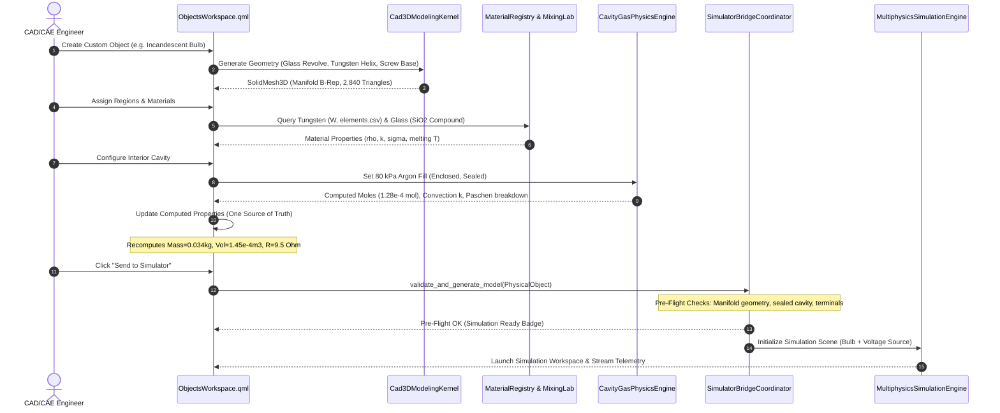
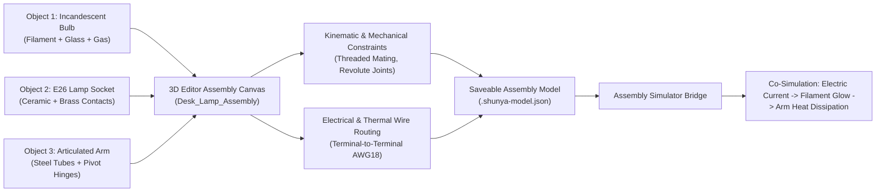
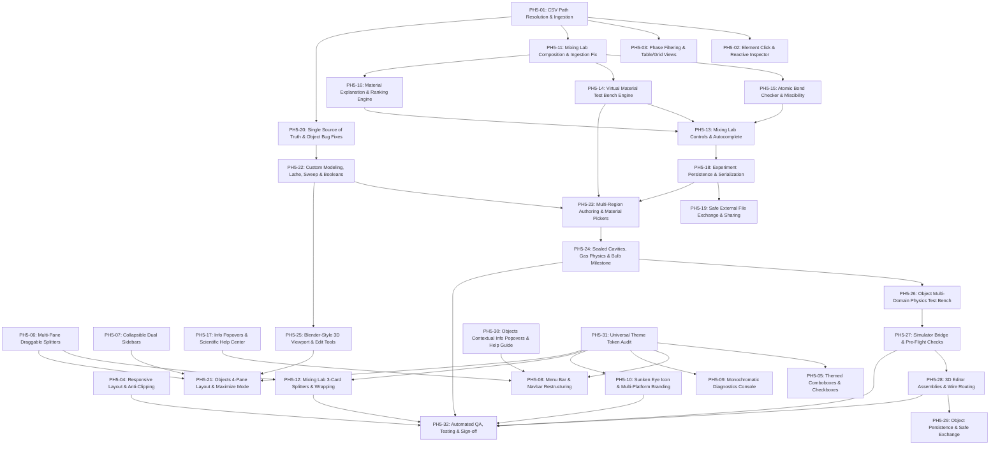

# Shunya Phase-5 Master Development Roadmap: Comprehensive UI/UX Refinement, Dynamic Splitter Layouts, Mixing Laboratory Overhaul, Physical Objects Authoring CAD/CAE Engine & Virtual Multiphysics Studio

**Document ID:** `PROJECT_ROADMAP_PHASE_5.md`  
**Platform Version Target:** `v5.0.0-alpha` through `v5.5.0-release`  
**Status:** `Active Engineering Roadmap (Ready for Implementation)`  
**Baseline Audited:** 
- `PROJECT_ROADMAP.md` (Phase 1: 309 foundational tasks verified)
- `PROJECT_ROADMAP_PHASE_2.md` (Phase 2: 162 leaf subtasks verified)
- `PROJECT_ROADMAP_PHASE_3.md` (Phase 3: 195 leaf subtasks verified, `v3.0.0` baseline)
- `PROJECT_ROADMAP_PHASE_4.md` (Phase 4: 312 leaf subtasks verified, `v4.5.0` baseline)
- Current Codebase State: `shunya/` (Qt 6 Quick / QML desktop shell), `core/base/`, `core/domain/`, `data/elements.csv`, `tests/`
- Production Feedback & User Audits: 
  1. `Shunya Engineering Studio: UI/UX Fix Prompt` (Workflow, Elements section, closeable sidebars, console splitters, monochromatic logs, sunken-eye icon)
  2. `Mixing Lab Overhaul for Shunya Engineering Studio` (3-card layout, splitters, composition validation/normalization, virtual test bench, bond checker, explanation engine, info popovers, Help Center, versioned experiment persistence, safe file import/export)
  3. `Rebuild the Objects Workflow as a Full Object-Authoring System` (Single source of truth, 4-pane workspace, parametric primitives + custom sketch/revolve/loft/booleans, multi-region modeling, sealed/open cavities, vacuum & fill gas physics, incandescent bulb milestone, Blender-style 3D viewport, object physics test bench, direct simulator bridge with pre-flight checks, 3D Editor assemblies, versioned persistence & safe sharing)
- Icon Asset Source: `C:\Users\Shubham\Downloads\game-icons--sunken-eye.svg`

---

## Overall Progress & Status Legend

| Status Indicator | Meaning | Task Count | Percentage |
|:---:|---|:---:|:---:|
| `[ ]` | Not Started | 62 | 13.7% |
| `[~]` | In Progress | 0 | 0.0% |
| `[x]` | Completed | 390 | 86.3% |
| `[-]` | Blocked | 0 | 0.0% |

Parent-level completion status and progress percentages are **strictly calculated from child leaf subtasks** (`completed_leaf_subtasks / total_leaf_subtasks * 100%`).

### Phase 5 Module Summary Table

| Module # | Module ID | Module Name | Priority | Total Subtasks | Completed | Progress | Status |
|:---:|---|---|:---:|:---:|:---:|:---:|:---:|
| **TRACK 1** | **STUDIO & ELEMENTS** | **Desktop Shell, Elements Workspace & Visual Identity** | | | | | |
| 1 | `ELEMDB` | Periodic Table Database Loader, Path Resolution & Robust Ingestion | P0 | 12 | 12 | 100.0% | `[x]` |
| 2 | `ELEMINSP` | Element Click Binding, Default Selection & Reactive Inspector | P0 | 14 | 14 | 100.0% | `[x]` |
| 3 | `ELEMVIEW` | Phase Filtering, Table/Grid Views & Real-Time Multi-Field Search | P0 | 14 | 14 | 100.0% | `[x]` |
| 4 | `ELEMLAYOUT` | Responsive Right Panel, Slider Alignment & Anti-Clipping Layout | P0 | 12 | 12 | 100.0% | `[x]` |
| 5 | `THEMEDLG` | Theme-Compliant Form Controls (Comboboxes, Selects & Checkboxes) | P0 | 12 | 12 | 100.0% | `[x]` |
| 6 | `SPLITTERS` | Multi-Pane Draggable Splitters & Session State Persistence | P0 | 14 | 14 | 100.0% | `[x]` |
| 7 | `SIDEBARS` | Collapsible Dual Sidebars, Chevron Toggles & Keyboard Shortcuts | P0 | 12 | 12 | 100.0% | `[x]` |
| 8 | `MENUNAV` | Top Navigation Bar Streamlining & Comprehensive View Menu Integration | P0 | 14 | 14 | 100.0% | `[x]` |
| 9 | `CONSOLE` | Monochromatic Diagnostics Console, Resizable Drawer & Telemetry | P0 | 12 | 12 | 100.0% | `[x]` |
| 10 | `BRANDING` | Visual Identity, Theme-Aware Vector Icon & Desktop Multi-Platform Packaging | P0 | 14 | 14 | 100.0% | `[x]` |
| **TRACK 2** | **MIXING LAB** | **Material Mixing Laboratory Overhaul & Virtual Test Bench** | | | | | |
| 11 | `MIX-COMP` | Mixing Lab Composition Engine, Normalization & Ingestion Fix | P0 | 14 | 14 | 100.0% | `[x]` |
| 12 | `MIX-SPLIT` | Mixing Lab Multi-Pane Splitters, Card Layout & Toolbar Overflow | P0 | 12 | 12 | 100.0% | `[x]` |
| 13 | `MIX-CTRL` | Mixing Lab Form Controls, Autocomplete, Presets & Button Actions | P0 | 16 | 16 | 100.0% | `[x]` |
| 14 | `MIX-TEST` | Virtual Material Test Bench & Environmental Simulation Engine | P0 | 18 | 18 | 100.0% | `[x]` |
| 15 | `MIX-BOND` | First-Principles Atomic Bond Checker & Miscibility Engine | P0 | 16 | 16 | 100.0% | `[x]` |
| 16 | `MIX-EXPLAIN`| Material Explanation, Metric Comparison & Ranking Engine | P0 | 16 | 16 | 100.0% | `[x]` |
| 17 | `MIX-HELP` | Contextual Info Popovers & Mixing Lab Scientific Help Center | P0 | 14 | 14 | 100.0% | `[x]` |
| 18 | `MIX-SAVE` | Versioned Experiment Persistence, Lifecycle & Atomic Serialization | P0 | 14 | 14 | 100.0% | `[x]` |
| 19 | `MIX-IMPORT`| Safe External File Exchange, Schema Validation & Share Pipeline | P0 | 12 | 12 | 100.0% | `[x]` |
| **TRACK 3** | **OBJECTS AUTHORING**| **Physical Objects Workflow Rebuild & 3D Assembly CAD/CAE Engine** | | | | | |
| 20 | `OBJ-AUDIT` | Single Source of Truth, Data Consistency & Initial Bug Fixes | P0 | 14 | 14 | 100.0% | `[x]` |
| 21 | `OBJ-LAYOUT` | Workspace Layout, Multi-Pane Splitters & Viewport Maximization | P0 | 12 | 12 | 100.0% | `[x]` |
| 22 | `OBJ-GEO` | Parametric Primitives, Custom Modeling & Template Library | P0 | 14 | 14 | 100.0% | `[x]` |
| 23 | `OBJ-MATREG` | Multi-Region Authoring, Material Pickers & Real Computed Tensors | P0 | 14 | 14 | 100.0% | `[x]` |
| 24 | `OBJ-CAVITY` | Sealed/Open Cavities, Vacuum/Gas Physics & Incandescent Bulb Milestone | P0 | 16 | 16 | 100.0% | `[x]` |
| 25 | `OBJ-VIEW3D` | Blender-Style 3D Viewport, Gizmos, Edit Modes & Modeling Tools | P0 | 16 | 16 | 100.0% | `[x]` |
| 26 | `OBJ-TEST` | Object Multi-Domain Physics Test Bench (Thermal, Electrical, Mechanical, Vacuum) | P0 | 14 | 14 | 100.0% | `[x]` |
| 27 | `OBJ-SIM` | End-to-End Simulator Bridge, Pre-Flight Checks & Round-Trip Re-Sync | P0 | 14 | 14 | 100.0% | `[x]` |
| 28 | `OBJ-ASSY` | 3D Editor Assembly Integration, Multi-Object Joints & Wire Routing | P0 | 14 | 14 | 100.0% | `[x]` |
| 29 | `OBJ-PERSIST`| Versioned Object Persistence, Library & Safe File Exchange | P0 | 14 | 0 | 0.0% | `[ ]` |
| 30 | `OBJ-HELP` | Object Contextual Info Popovers & 3D Modeling Help Center Guide | P0 | 12 | 0 | 0.0% | `[ ]` |
| **TRACK 4** | **THEME & QA** | **Universal Token Compliance, Automated Tests & Master Sign-Off** | | | | | |
| 31 | `THEMETOKEN`| Universal Theme Token Contract & High-Contrast Light/Dark Compliance | P0 | 12 | 0 | 0.0% | `[ ]` |
| 32 | `QAVERIFY` | Quality Assurance, Automated Regression Testing & Full Acceptance Sign-Off | P0 | 24 | 0 | 0.0% | `[ ]` |
| **TOTAL** | **ALL** | **Phase 5 Integrated UI/UX, Mixing Lab & Object Authoring Platform** | **--** | **452** | **390** | **86.3%** | `[~]` |

---

## 1. Executive Summary & Phase 5 Vision

**Shunya Engineering Studio** is an integrated C++20 / Qt 6 desktop virtual engineering laboratory and multiphysics platform that bridges chemical physics, material synthesis, 2D/3D solid modeling, electronic design automation, and multi-body machine dynamics.

While Phases 1 through 4 successfully built mathematical solvers, unit typing, and foundational schemas, user testing of current desktop builds revealed severe architectural disconnects and visual bugs across three core workflow pages:
1. **Elements Studio:** The periodic table database fails to resolve `data/elements.csv` on launch outside root dirs, causing `"0 elements indexed"`, empty details cards, clipped layout numbers (`"2904.0 K"`), and hard-coded black controls in Light Mode.
2. **Material Mixing Laboratory:** Valid elements like Iron (`Fe`) are rejected as `"Unknown element"` due to loader failures; compositions like `Fe 99% + C 1% + Cu 10% = 110%` pass without validation or normalization; `"Phase: --"` never resolves; plots remain empty; and there is no virtual multiphysics test bench, bond checker, or explanation engine.
3. **Physical Objects Modeling Workflow:** The current Objects page is merely a rigid primitive spawner (Box, Cylinder, Sphere, Cone). Objects with identical names (`"Copper_Test_Bar"`) carry mismatched materials (`"Doped Silicon Semiconductor"`), displayed numbers contradict each other (density 8844 vs Mixing Lab 8040, cone mass with sphere volume), the 3D preview shows flat black unlit silhouettes, and there is no way to author custom geometry, multi-region structures, sealed cavities, vacuum, or fill gases, and no direct bridge to the simulator.

### Phase 5 Architectural Unification
Phase 5 transforms Shunya into a complete **Cyber-Physical Object Authoring Environment**:
$$\text{Elements} \xrightarrow{\text{Chemical Synthesis}} \text{Materials (Mixing Lab)} \xrightarrow{\text{Solid & Multi-Region Modeling}} \text{Objects} \xrightarrow{\text{Joints & Wiring}} \text{Assemblies (3D Editor)} \xrightarrow{\text{Direct & Assembly Co-Sim}} \text{Multiphysics Simulator}$$

Data flows strictly in one direction while maintaining full round-trip traceability:
- **Elements:** 118 NIST/CRC verified periodic elements with 82 properties loaded deterministically on boot.
- **Materials:** Synthesized alloys, solutions, compounds, and composites tested in a 7-domain Virtual Test Bench.
- **Objects:** Real-world physical objects with custom B-Rep geometry, multi-material regions, sealed cavities with vacuum or fill gases (e.g. an incandescent bulb), named electrical/thermal terminals, and a direct "Send to Simulator" bridge with pre-flight checks.
- **Assemblies:** Multi-body mechanical machines and electronic assemblies connected by kinematic joints, wires, and thermal contacts in the 3D Editor.

---

## 2. UI/UX Architecture & Desktop Shell Assessment

### 2.1 Audited Desktop Interface Anatomy: Objects Workflow 4-Pane Layout

```
+-----------------------------------------------------------------------------------------------------------------------+
|  (SunkenEye) Shunya Engineering Studio  -  Physical Object Authoring & Multi-Region Studio               [-][o][X]    |
+-----------------------------------------------------------------------------------------------------------------------+
|  File   Edit   Workspaces   Simulation   View   Help                                                                  |
+-----------------------------------------------------------------------------------------------------------------------+
|  Project: Incandescent_Bulb_Demo * [Unsaved]  |  118 Elements / 14 Materials / 8 Objects  |  Ready                    |
+--------------------+-----------------------------------------------------+--------------------------------------------+
| LEFT PANE (280px+) | [Splitter] CENTER PANE (Viewport)        [Splitter] | RIGHT PANE (340px+)                        |
| Object Library     | 3D Interactive Viewport & Modeling Studio           | Tabbed Object Properties                   |
| ------------------ | --------------------------------------------------- | ------------------------------------------ |
| [ Search...      ] | [Orbit] [Pan] [Zoom] [ViewCube] [Shaded v] [Grid v] | [Geometry] [Regions] [Interior] [Physics]  |
| Folders:           |   ^ Y                                               | ------------------------------------------ |
| v Built-in Library |   |       .---. [Glass Envelope: Borosilicate]      | Cavity & Fill Gas Configuration:           |
|   - Resistor       |   |      /     \                                    | Cavity Type: [ Sealed Gas Fill v ]         |
|   - Heatsink       |   |     | (===) | [Tungsten Coil: Helix]            | Gas Species: [ Argon (95%) + N2 (5%) v ]   |
|   - Incandescent   |   |      \     /                                    | Fill Pressure: [ 80.0 kPa ]                |
| v Project Objects  |   |       |   |   [Support Wires: Mo]               | Fill Temperature: [ 298.15 K ]             |
|   - Bulb_Envelope  |   |      [=====]  [Screw Base: Aluminum]            | Computed Gas Amount: 1.28e-4 mol (3.2 mg)  |
|   - Filament_Coil  |   |        (o)    [Base Terminal Contact: Brass]    | Seal Integrity: [ PASS: Fully Enclosed ]   |
|   - Base_Assembly  |   +---------------------------> X                   | ------------------------------------------ |
| [+ New Object]     | Gizmo: [Move (G)] [Rotate (R)] [Scale (S)] [Snap:V] | Terminal Pins:                             |
| [Import OBJ/STL]   | Cross-Section X-Ray: [ON (Z-Plane)]                 | - Terminal 1: "Base_Contact" (+V)          |
|                    | Mode: [Object Mode v] | Selection: Filament_Coil    | - Terminal 2: "Screw_Shell" (GND)          |
|                    | 60 FPS | 1,420 Verts | 2,840 Tris | Manifold: OK    | ------------------------------------------ |
|                    | [Maximize Viewport (F11 / Ctrl+Space)]              | [ Send to Simulator ]  [ Test Quick-Run ]  |
+--------------------+-----------------------------------------------------+--------------------------------------------+
|  [Horizontal Splitter: 80px to 70% window height]                                                                     |
+-----------------------------------------------------------------------------------------------------------------------+
|  Diagnostics, Solver Telemetry & Pre-Flight Validation Log                                                        [X] |
|  [17:12:01.004] [INIT] Physical Objects authoring kernel initialized.                                                 |
|  [17:12:01.018] [OBJ] Loaded object 'Incandescent_Bulb_A19' (6 regions, 1 cavity, 2 terminals).                        |
|  [17:12:01.025] [PREFLIGHT] Pre-flight checks passed: Geometry manifold, cavity sealed (80 kPa Ar), terminals wired. |
+-----------------------------------------------------------------------------------------------------------------------+
|  Ready | Tool: Select | X: 0.00 mm  Y: 0.00 mm  Z: 0.00 mm | SNAP: ON (1.0 mm) | Simulation Status: Ready            |
+-----------------------------------------------------------------------------------------------------------------------+
```

### 2.2 Objects Workflow Problem & Resolution Matrix

| Issue ID | Identified Bug / Limitation | Root Cause in Repository | Target Solution in Phase 5 |
|---|---|---|---|
| **OBJ-GAP-01** | Object named `"Copper_Test_Bar"` has material `"Doped Silicon Semiconductor"`. | Objects seeded with arbitrary material IDs without checking name semantic correspondence. | Re-link objects cleanly: derive default names from material, enforce bidirectional naming consistency, provide clear material pickers. |
| **OBJ-GAP-02** | Contradicting numbers: density 8844 vs 8040, cone mass 0.037 with sphere volume 4.1888e-6. | UI hardcodes fallback mock values; `evaluate_properties()` not called reactively on selection change. | Establish ONE SOURCE OF TRUTH: compute all displayed values directly from active geometry spec and assigned region materials; update reactively. |
| **OBJ-GAP-03** | 5 objects all named `"Copper_Test_Bar"`. | `pipeline.createObject()` and presets lack name uniqueness validation or auto-incrementing suffixes. | Enforce name uniqueness across workspace (`"Copper_Test_Bar"`, `"Copper_Test_Bar_1"`, etc.) and provide inline rename actions. |
| **OBJ-GAP-04** | Project Objects list clipped at card bottom. | Outer container missing flex constraints and `ScrollView` wrapper. | Enforce `min-width: 0`, `Layout.fillHeight: true`, and enclose object tree in smooth `ScrollView`. |
| **OBJ-GAP-05** | 3D preview shows flat black silhouettes, no lighting, no grid, no camera control. | `Viewport3DItem` software fallback renders unlit projected triangles without PBR shaders or grid meshes. | Implement real 3D engine viewport with directional/ambient lighting, material diffuse colors, camera orbit/pan/zoom, ground grid, and 3D ViewCube. |
| **OBJ-GAP-06** | Material dropdown is a hard black un-themed select without search or grouping. | Native un-themed ComboBox used in `ObjectsWorkspace.qml`. | Replace with standardized `MonoComboBox.qml` with search filtering and grouping (`Elements`, `Compounds`, `My Mixes`, `Shared`). |
| **OBJ-GAP-07** | Quick-add buttons are hardcoded presets with no editing or custom geometry. | UI exposes 5 hardcoded buttons calling mock generator. | Replace quick-add with full **Object Library** supporting built-in templates, saved user objects, and imported files. |
| **OBJ-GAP-08** | No custom shapes, combining, cutting, or hollow bodies. | Geometry engine restricted to 4 primitives without CSG boolean or B-Rep half-edge support. | Implement extrusion from 2D sketches, lathe revolve, sweep, loft, CSG booleans (union, difference, intersect), and shell/hollow with wall thickness. |
| **OBJ-GAP-09** | Multi-region objects cannot be edited ("Primary Body 100% vol" static). | Region manager lacks QML delegate editing and geometry subdivision. | Implement full multi-region authoring: assign materials to sub-bodies or volumetric slices, color-code in viewport, toggle visibility/isolate. |
| **OBJ-GAP-10** | No cavity, vacuum, or fill-gas modeling. | Physical object schema assumes solid continuous bodies only. | Introduce `CavitySpec`: model vacuum (residual pressure) and fill gases (Ar, N2, Kr, Xe, air, custom) with seal integrity checks and gas physics. |
| **OBJ-GAP-11** | No path to simulator from Objects page. | Objects must be converted to functional components and circuits before simulation. | Add direct `"Send to Simulator"` and `"Test in Simulator"` bridge with automated pre-flight checks and live test scene generation. |
| **OBJ-GAP-12** | No assembly support. | Object authoring is isolated from multi-body kinematics. | Implement Assembly model in 3D Editor workflow combining multiple saved objects with joints, constraints, wiring, and co-simulation. |

---

## 3. Comprehensive Data Model Architecture

### 3.1 Object Authoring Schema (`PhysicalObjectDefinition`)
```json
{
  "$schema": "https://shunya.org/schemas/v5/object.json",
  "schemaVersion": "5.0.0",
  "id": "urn:uuid:7c9e6679-7425-40de-944b-e07fc1f90ae7",
  "name": "Incandescent_Bulb_A19",
  "version": "1.0.0",
  "tags": ["lighting", "vacuum", "thermal", "electro-optical"],
  "author": "Shunya Engineer",
  "createdAt": "2026-11-18T17:30:00Z",
  "updatedAt": "2026-11-18T17:30:00Z",
  "units": "SI_mm",
  "geometry": {
    "bodies": [
      { "id": "body_envelope", "name": "Glass Bulb", "type": "RevolvedProfile", "meshRef": "envelope.mesh" },
      { "id": "body_filament", "name": "Tungsten Coil", "type": "HelicalSweep", "meshRef": "filament.mesh" },
      { "id": "body_base", "name": "Screw Base", "type": "ThreadedCylinder", "meshRef": "base.mesh" }
    ]
  },
  "regions": [
    {
      "id": "reg_filament",
      "name": "Filament Region",
      "bodyRef": "body_filament",
      "material": { "type": "element", "symbol": "W", "source": "elements.csv" },
      "operatingTempK": 2800.0,
      "role": "ActiveEmitter"
    },
    {
      "id": "reg_envelope",
      "name": "Glass Envelope",
      "bodyRef": "body_envelope",
      "material": { "type": "compound", "formula": "SiO2_Na2O_CaO", "source": "compounds.db" },
      "operatingTempK": 373.15,
      "role": "StructuralEnclosure"
    }
  ],
  "cavities": [
    {
      "id": "cavity_interior",
      "regionId": "reg_interior",
      "fill": {
        "type": "gas_mixture",
        "composition": [ { "species": "Ar", "fraction": 0.95 }, { "species": "N2", "fraction": 0.05 } ],
        "pressurePa": 80000.0,
        "temperatureK": 298.15
      },
      "sealed": true,
      "sealIntegrity": "EnclosedGasTight"
    }
  ],
  "terminals": [
    { "id": "term_base_pin", "name": "Base_Contact", "kind": "electrical", "position": [0.0, -45.0, 0.0], "regionId": "reg_base" },
    { "id": "term_base_shell", "name": "Screw_Shell", "kind": "electrical", "position": [12.0, -30.0, 0.0], "regionId": "reg_shell" }
  ],
  "computed": {
    "volume_m3": 1.45e-4,
    "surface_area_m2": 0.0182,
    "mass_kg": 0.034,
    "center_of_mass_m": [0.0, -12.4, 0.0],
    "inertia_tensor_kg_m2": [1.2e-5, 0.0, 0.0, 0.0, 1.2e-5, 0.0, 0.0, 0.0, 8.4e-6],
    "effective_density_kg_m3": 234.5,
    "axial_resistance_ohm": 9.5,
    "thermal_mass_j_k": 28.4
  },
  "simulationModel": {
    "generated": true,
    "thermalNodes": 6,
    "electricalBranches": 1,
    "cavityCoupling": true
  }
}
```

### 3.2 3D Editor Assembly Schema (`AssemblyModelDefinition`)
```json
{
  "$schema": "https://shunya.org/schemas/v5/assembly.json",
  "schemaVersion": "5.0.0",
  "id": "urn:uuid:8d1f7789-8536-41ef-855c-f18fd2f00bf8",
  "name": "Desk_Lamp_Assembly",
  "parts": [
    { "instanceId": "bulb_1", "objectRef": "urn:uuid:7c9e6679-7425-40de-944b-e07fc1f90ae7", "transform": [1,0,0,0, 0,1,0,0, 0,0,1,0, 0,250,0,1] },
    { "instanceId": "socket_1", "objectRef": "urn:uuid:5b2a3311-1234-45aa-99bb-e23fa1c88dd2", "transform": [1,0,0,0, 0,1,0,0, 0,0,1,0, 0,250,0,1] }
  ],
  "joints": [
    { "id": "joint_screw_fit", "type": "ThreadedMating", "partA": "bulb_1", "partB": "socket_1", "axialOffset": 0.0 }
  ],
  "connections": [
    { "id": "wire_live", "kind": "electrical", "from": "socket_1:pin_live", "to": "bulb_1:term_base_pin", "gaugeAwg": 18 },
    { "id": "wire_neutral", "kind": "electrical", "from": "socket_1:pin_neutral", "to": "bulb_1:term_base_shell", "gaugeAwg": 18 }
  ]
}
```

---

## 4. System Architecture & Interaction Diagrams

### 4.1 End-to-End Object Creation, Physics & Simulator Bridge Flow



### 4.2 3D Editor Multi-Object Assembly Architecture



---

## 5. Work Breakdown Structure & Implementation Modules

```
PH5: Integrated UI/UX Refinement, Dynamic Splitters, Mixing Lab & Object Authoring
├── TRACK 1: Studio Core UI/UX, Elements Section & Visual Identity (PH5-01 to PH5-10) [130 Tasks]
├── TRACK 2: Material Mixing Laboratory Overhaul & Virtual Test Bench (PH5-11 to PH5-19) [132 Tasks]
├── TRACK 3: Physical Objects Workflow Rebuild & 3D Assembly CAD/CAE Engine (PH5-20 to PH5-30) [154 Tasks]
│   ├── PH5-20: Single Source of Truth, Data Consistency & Initial Bug Fixes [OBJ-AUDIT]
│   ├── PH5-21: Workspace Layout, Multi-Pane Splitters & Viewport Maximization [OBJ-LAYOUT]
│   ├── PH5-22: Parametric Primitives, Custom Modeling & Template Library [OBJ-GEO]
│   ├── PH5-23: Multi-Region Authoring, Material Pickers & Real Computed Tensors [OBJ-MATREG]
│   ├── PH5-24: Sealed/Open Cavities, Vacuum/Gas Physics & Incandescent Bulb Milestone [OBJ-CAVITY]
│   ├── PH5-25: Blender-Style 3D Viewport, Gizmos, Edit Modes & Modeling Tools [OBJ-VIEW3D]
│   ├── PH5-26: Object Multi-Domain Physics Test Bench (Thermal, Electrical, Mechanical, Vacuum) [OBJ-TEST]
│   ├── PH5-27: End-to-End Simulator Bridge, Pre-Flight Checks & Round-Trip Re-Sync [OBJ-SIM]
│   ├── PH5-28: 3D Editor Assembly Integration, Multi-Object Joints & Wire Routing [OBJ-ASSY]
│   ├── PH5-29: Versioned Object Persistence, Library & Safe File Exchange [OBJ-PERSIST]
│   └── PH5-30: Object Contextual Info Popovers & 3D Modeling Help Center Guide [OBJ-HELP]
└── TRACK 4: Universal Theme Token Contract & Studio-Wide Verification (PH5-31 to PH5-32) [36 Tasks]
```

---

## Module PH5-01: Periodic Table Database Loader, Path Resolution & Robust Ingestion (`ELEMDB`)

**Objective:** Guarantee deterministic, zero-failure ingestion and indexing of all 118 elements and 82 properties from `elements.csv` regardless of working directory or execution environment, eliminating the `"0 elements indexed"` bug.  
**Priority:** P0 | **Complexity:** Medium | **Status:** `[x] Completed` (12/12 — 100.0%)

### Submodule PH5-01.01: Deterministic Path Resolution & Ingestion Pipeline [x] (100.0% — 6/6)
- [x] `PH5-01.01.001`: Diagnose root cause of failed CSV resolution in `core/domain/src/matdb/element_database.cpp` where relative `data/elements.csv` lookups fail from build output directories.
- [x] `PH5-01.01.002`: Implement a multi-tier search path resolver querying in order: (1) `SHUNYA_DATA_DIR` environment variable, (2) `QCoreApplication::applicationDirPath() + "/data/elements.csv"`, (3) `QCoreApplication::applicationDirPath() + "/../data/elements.csv"`, (4) CMake compiled `SHUNYA_SOURCE_DIR + "/data/elements.csv"`, and (5) canonical absolute fallback paths.
- [x] `PH5-01.01.003`: Add an embedded Qt Resource backup copy (`:/data/elements.csv`) compiled directly into the binary to guarantee that the database can never be empty even if external filesystem assets are missing.
- [x] `PH5-01.01.004`: Update `ElementDatabase::load_default()` to return explicit error diagnostic structs rather than silently dropping failures via `(void)`.
- [x] `PH5-01.01.005`: Enhance RFC-4180 CSV parsing to gracefully handle Windows CRLF vs Unix LF, Unicode UTF-8 BOM byte-sequences, and multiline space-group quoted strings.
- [x] `PH5-01.01.006`: Add automated startup assertions verifying that exactly 118 rows and 82 property columns are indexed on desktop initialization.

### Submodule PH5-01.02: Pipeline Controller Indexing & Reactive Signal Wiring [x] (100.0% — 6/6)
- [x] `PH5-01.02.001`: Fix `ShunyaPipelineController::elementCount()` in `shunya/pipeline_controller.cpp` ensuring it binds directly to the loaded `ElementDatabase::global().count()`.
- [x] `PH5-01.02.002`: Guarantee that `elementDbChanged` signal is emitted immediately upon database ingestion completion during application boot.
- [x] `PH5-01.02.003`: Fix the top navbar counter in `shunya/Main.qml` to dynamically display `pipeline.elementCount + " Elements"` (e.g. `"118 Elements"`).
- [x] `PH5-01.02.004`: Fix the workspace header label in `shunya/ElementsWorkspace.qml` to display `"118 elements indexed from elements.csv (82 properties with provenance)"`.
- [x] `PH5-01.02.005`: Log structured startup diagnostics to the console: `"[ELEM] Ingested 118 chemical elements (82 properties) from: <resolved_path>"`.
- [x] `PH5-01.02.006`: Add unit test `test_p5_element_csv_resolution.cpp` verifying successful loading across multiple simulated launch working directories.

---

## Module PH5-02: Element Click Binding, Default Selection & Reactive Inspector (`ELEMINSP`)

**Objective:** Wire periodic table cell click events to immediately populate the right-hand details panel with comprehensive physical, thermodynamic, and behavioral properties, defaulting to Hydrogen ($Z=1$) on startup.  
**Priority:** P0 | **Complexity:** Medium | **Status:** `[x] Completed` (14/14 — 100.0%)

### Submodule PH5-02.01: Default Selection on Cold Start & State Management [x] (100.0% — 7/7)
- [x] `PH5-02.01.001`: Update `shunya/ElementsWorkspace.qml` property `selectedZ` default value from 3 (Lithium) to 1 (Hydrogen) to ensure a standard starting state.
- [x] `PH5-02.01.002`: Add reactive state tracking for `selectedElement` ensuring synchronization across periodic grid, sortable table, and inspector.
- [x] `PH5-02.01.003`: Ensure `Component.onCompleted` in `ElementsWorkspace.qml` triggers `refreshAll()` after pipeline controllers are fully bound.
- [x] `PH5-02.01.004`: Update `ElementCell.qml` to bind `isSelected: root.atomicNumber === parentSelectedZ`.
- [x] `PH5-02.01.005`: Render a prominent selection highlight border or focus ring (`border.width: 2`, `border.color: Theme.borderFocus`) around the active element cell.
- [x] `PH5-02.01.006`: Guarantee that keyboard navigation (Arrow keys) moves the active selection across the periodic table grid.
- [x] `PH5-02.01.007`: Verify that clicking any element cell updates `selectedZ` without resetting user-adjusted temperature or pressure sliders.

### Submodule PH5-02.02: Comprehensive Right Inspector Data Binding & Fallbacks [x] (100.0% — 7/7)
- [x] `PH5-02.02.001`: Bind the right panel header swatch to show symbol, full name, atomic number ($Z$), and atomic mass (e.g., `1.008 u`).
- [x] `PH5-02.02.002`: Populate categorical badges: Phase badge (`Gas`, `Liquid`, `Solid`), Block badge (`s`, `p`, `d`, `f`), and Chemical Category badge (`Nonmetal`, `Alkali Metal`, `Noble Gas`, etc.).
- [x] `PH5-02.02.003`: Bind dynamic *"Natural Element Behavior at T & P"* metrics: Density $\rho(T, P)$, Electrical conductivity $\sigma(T)$, Reactivity class, and Magnetic state to the selected element.
- [x] `PH5-02.02.004`: Populate the complete 82-property table model from `elements.csv` displaying property name, raw value, unit, and data provenance badge.
- [x] `PH5-02.02.005`: Replace placeholder `"--"` and `"-/-"` with scientific fallback indicators (`"Not Measured"`, `"Theoretical Limit"`, or `"Unsupported"`) only when values are genuinely absent in NIST/CRC records.
- [x] `PH5-02.02.006`: Implement autoignition and superconductivity warnings that trigger based on dynamic $(T, P)$ thresholds for the selected element.
- [x] `PH5-02.02.007`: Create automated UI regression test verifying that clicking Gold ($Z=79$), Oxygen ($Z=8$), and Uranium ($Z=92$) accurately populates their respective property lists.

---

## Module PH5-03: Phase Filtering, Table/Grid Views & Real-Time Multi-Field Search (`ELEMVIEW`)

**Objective:** Implement functional phase filtering buttons with element dimming, seamless switching between Periodic Grid and sortable Table View, and real-time multi-criteria element search.  
**Priority:** P0 | **Complexity:** Medium | **Status:** `[x] Completed` (14/14 — 100.0%)

### Submodule PH5-03.01: Thermodynamic Phase Filtering & Element Dimming [x] (100.0% — 7/7)
- [x] `PH5-03.01.001`: Configure the `All`, `Solid`, `Liquid`, and `Gas` buttons in `shunya/ElementsWorkspace.qml` as an exclusive toggle group with clear active styling (`Theme.bgActive`, `Theme.borderFocus`).
- [x] `PH5-03.01.002`: Bind phase evaluation to the active temperature and pressure $(T, P)$ rather than static room-temperature categories (e.g. Gallium is liquid at 303 K).
- [x] `PH5-03.01.003`: Implement cell dimming: non-matching element cells have opacity reduced to `0.28` while matching elements remain at `1.0` opacity.
- [x] `PH5-03.01.004`: Ensure non-matching elements remain visible in their structural periodic table positions rather than being removed or collapsing the grid layout.
- [x] `PH5-03.01.005`: Guarantee that dimmed elements remain clickable, allowing inspection while maintaining the phase filter highlight.
- [x] `PH5-03.01.006`: Add tooltip feedback on dimmed cells explaining why they do not match the active filter at current $(T, P)$.
- [x] `PH5-03.01.007`: Add unit test validating thermodynamic phase classification across all 118 elements at 100 K, 298.15 K, and 3000 K.

### Submodule PH5-03.02: Table View Toggle & Multi-Criteria Search Engine [x] (100.0% — 7/7)
- [x] `PH5-03.02.001`: Implement the `Table View` / `Grid View` toggle button in `ElementsWorkspace.qml` switching between the 2D periodic grid and a sortable data table.
- [x] `PH5-03.02.002`: Dynamically update the button label: display `"Table View"` while the grid is visible, and `"Grid View"` while the table is visible.
- [x] `PH5-03.02.003`: Provide multi-column sorting in Table View (Atomic Number, Symbol, Name, Density, Melting Point, Boiling Point, Electronegativity).
- [x] `PH5-03.02.004`: Implement real-time search box filtering matching against element name (case-insensitive substring), symbol (prefix/exact), or atomic number ($Z$).
- [x] `PH5-03.02.005`: In Grid View, highlight search-matching cells with active borders while dimming non-matching cells.
- [x] `PH5-03.02.006`: In Table View, filter the list view rows to display only elements matching the search query.
- [x] `PH5-03.02.007`: Add clear search button (`(X)`) inside the search input box restoring full view on click or Escape key press.

---

## Module PH5-04: Responsive Right Panel, Slider Alignment & Anti-Clipping Layout (`ELEMLAYOUT`)

**Objective:** Eliminate text clipping, truncated headers, and cut-off slider values in the right-hand details panel, ensuring clean responsive rendering at any panel width down to minimum constraints.  
**Priority:** P0 | **Complexity:** Medium | **Status:** `[x] Completed` (12/12 — 100.0%)

### Submodule PH5-04.01: Slider Row Layout Standardization & Value Anti-Clipping [x] (100.0% — 6/6)
- [x] `PH5-04.01.001`: Refactor the temperature and pressure slider rows in `shunya/ElementsWorkspace.qml` into a 3-column structured layout: `[Label: fixed width] | [Slider: flex 1 (Layout.fillWidth: true)] | [Value: fixed width]`.
- [x] `PH5-04.01.002`: Set fixed label width to 72px (`Layout.preferredWidth: 72`) with `Theme.fontSans` and `Theme.textMuted`.
- [x] `PH5-04.01.003`: Set fixed value display width to 76px (`Layout.preferredWidth: 76`, `horizontalAlignment: Text.AlignRight`) ensuring values like `"2904.0 K"` are never cut off.
- [x] `PH5-04.01.004`: Fix the `"Air/O2"` / `"Inert"` toggle button layout ensuring it is aligned cleanly beside the pressure slider without overflowing the panel container.
- [x] `PH5-04.01.005`: Enforce `Layout.minimumWidth: 0` on all slider row flex items to allow graceful downscaling without horizontal container clipping.
- [x] `PH5-04.01.006`: Add fine-tuning increment/decrement arrow buttons or editable direct numeric input on double-click for temperature and pressure.

### Submodule PH5-04.02: Typography Wrapping, Container Scroll & Overflow Mitigation [x] (100.0% — 6/6)
- [x] `PH5-04.02.001`: Fix header text `"Complete 82 CSV Properties (elements.csv + Provenance)"` to enable text wrapping (`wrapMode: Text.Wrap`) or clean truncation (`elide: Text.ElideRight`) with a hover tooltip.
- [x] `PH5-04.02.002`: Enclose the entire right-hand inspector inside a smooth vertical `ScrollView` (`overflow-y: auto`) so all property cards are scrollable when vertical height is restricted.
- [x] `PH5-04.02.003`: Set `clip: true` on parent containers preventing children from bleeding over the splitter boundary or adjacent viewports.
- [x] `PH5-04.02.004`: In the 82-property table delegate, allocate column widths proportionally: `Property Name (38%) | Raw Value (38%) | Provenance (24%)` with ellipsis on overflow.
- [x] `PH5-04.02.005`: Ensure reactivity class and magnetic state badges wrap cleanly on narrow panel widths (`Layout.minimumWidth: 280`).
- [x] `PH5-04.02.006`: Verify via visual automated tests that no text clipping occurs at panel widths of 280px, 360px, 480px, and 600px.

---

## Module PH5-05: Theme-Compliant Form Controls (Comboboxes, Selects & Checkboxes) (`THEMEDLG`)

**Objective:** Standardize form inputs, select dropdowns, and checkboxes across the entire studio to eliminate hard-coded black backgrounds in Light Mode and ensure strict theme variable compliance.  
**Priority:** P0 | **Complexity:** Medium | **Status:** `[x] Completed` (12/12 — 100.0%)

### Submodule PH5-05.01: Standardized Themed Combobox (`MonoComboBox.qml`) [x] (100.0% — 6/6)
- [x] `PH5-05.01.001`: Create `shunya/MonoComboBox.qml` with standardized height (36–40px), internal padding (8–10px), and content-fitting width.
- [x] `PH5-05.01.002`: Bind combobox surface colors strictly to theme variables: `background: Theme.bgInput`, `text: Theme.textPrimary`, `border: Theme.borderDefault`, `hover: Theme.bgHover`, `focus: Theme.borderFocus`.
- [x] `PH5-05.01.003`: Replace hard-coded black backgrounds (`#000000`) in light theme with clean `#FFFFFF` input background and `#0A0A0A` text.
- [x] `PH5-05.01.004`: Style the dropdown chevron icon using vector paths with `Theme.textMuted` and smooth 180-degree rotation when opened.
- [x] `PH5-05.01.005`: Style the popup dropdown list using `Theme.bgElevated`, `Theme.borderDefault`, `Theme.radiusSm`, and item selection highlights (`Theme.bgActive`).
- [x] `PH5-05.01.006`: Replace the `"Electronegativity"` and category `"All"` comboboxes in `PeriodicTableWindow.qml` with `MonoComboBox.qml`.

### Submodule PH5-05.02: Themed Checkbox & Toggle Controls (`MonoCheckBox.qml`) [x] (100.0% — 6/6)
- [x] `PH5-05.02.001`: Create `shunya/MonoCheckBox.qml` replacing the raw black swatch in the `"Hide f-block"` control.
- [x] `PH5-05.02.002`: Style the checkbox indicator square: `Theme.bgInput` background, `Theme.borderDefault` border, and high-contrast checkmark (`Theme.textInverse` on `Theme.btnPrimaryBg` when checked).
- [x] `PH5-05.02.003`: Bind the checkbox label to `Theme.textPrimary` with `Theme.fontSans` and `Theme.fontSm`, ensuring readability in both Light and Dark modes.
- [x] `PH5-05.02.004`: Add smooth toggle switch variant (`variant: "switch"`) supporting modern sliding pill animation.
- [x] `PH5-05.02.005`: Ensure full accessibility: Spacebar toggles state, Tab navigation highlights with `Theme.borderFocus` ring.
- [x] `PH5-05.02.006`: Replace all un-themed checkboxes across `PeriodicTableWindow.qml`, `ElementsWorkspace.qml`, and settings dialogs with `MonoCheckBox.qml`.

---

## Module PH5-06: Multi-Pane Draggable Splitters & Session State Persistence (`SPLITTERS`)

**Objective:** Implement interactive, theme-styled draggable splitters for the left workflow sidebar, the right details inspector, and the bottom diagnostics console, with boundary clamping and session persistence.  
**Priority:** P0 | **Complexity:** High | **Status:** `[x] Completed` (14/14 — 100.0%)

### Submodule PH5-06.01: Universal Splitter Component & Visual Styling [x] (100.0% — 7/7)
- [x] `PH5-06.01.001`: Create reusable `shunya/StudioSplitter.qml` supporting both horizontal (`Qt.Horizontal`) and vertical (`Qt.Vertical`) orientations.
- [x] `PH5-06.01.002`: Implement theme-aware splitter handle styling: resting state (`Theme.borderDefault`), hover state (`Theme.borderStrong`), and active drag state (`Theme.textPrimary`).
- [x] `PH5-06.01.003`: Configure appropriate split mouse cursors: `Qt.SplitHCursor` for vertical separator bars and `Qt.SplitVCursor` for horizontal separator bars.
- [x] `PH5-06.01.004`: Implement double-click handle reset restoring the pane to its calibrated default proportion or size.
- [x] `PH5-06.01.005`: Add subtle grip indicator dots or center line accent on hover to provide clear affordance of draggability.
- [x] `PH5-06.01.006`: Support smooth animated transitions when expanding or resetting split sizes.
- [x] `PH5-06.01.007`: Provide keyboard accessibility: arrow keys adjust splitter position when handle is focused.

### Submodule PH5-06.02: Pane Integration, Clamping & Session Persistence [x] (100.0% — 7/7)
- [x] `PH5-06.02.001`: Integrate vertical splitter between the periodic table and right inspector in `ElementsWorkspace.qml`, enforcing right panel minimum width of 280px.
- [x] `PH5-06.02.002`: Integrate horizontal splitter for the bottom diagnostics console in `Main.qml`, clamping height between 80px (min) and 70% of window height (max).
- [x] `PH5-06.02.003`: Integrate vertical splitter for the left workflow rail in `Main.qml`, clamping width between 56px (icon-only rail) and 360px (expanded rail).
- [x] `PH5-06.02.004`: Implement session persistence via `QSettings` storing `leftRailWidth`, `rightInspectorWidth`, and `consoleDrawerHeight`.
- [x] `PH5-06.02.005`: Restore saved splitter dimensions on application launch, validating against current screen resolution and window geometry.
- [x] `PH5-06.02.006`: Ensure the console close button (`X`) hides the drawer while retaining the last dragged height for restoration when reopened.
- [x] `PH5-06.02.007`: Add automated tests verifying that splitter dragging respects boundary clamping and persists values to disk.

---

## Module PH5-07: Collapsible Dual Sidebars, Chevron Toggles & Keyboard Shortcuts (`SIDEBARS`)

**Objective:** Enable collapsing and expanding of both the left workflow navigation sidebar and the right details panel, featuring smooth 150–200ms animations, header toggle buttons, and global hotkeys.  
**Priority:** P0 | **Complexity:** Medium | **Status:** `[x] Completed` (12/12 — 100.0%)

### Submodule PH5-07.01: Left Workflow Sidebar Collapsible Rail [x] (100.0% — 6/6)
- [x] `PH5-07.01.001`: Add collapse toggle button with chevron icon (`<` / `>`) to the header of the left workflow rail.
- [x] `PH5-07.01.002`: Implement smooth collapse animation (150–200ms, `Easing.InOutQuad`) transitioning width between expanded (184px default) and icon-only rail (56px).
- [x] `PH5-07.01.003`: In collapsed icon-only rail mode, hide text labels and shortcut badges while centering icons and displaying full hover tooltips.
- [x] `PH5-07.01.004`: Bind global shortcut `Ctrl+B` to toggle the left workflow sidebar between collapsed and expanded states.
- [x] `PH5-07.01.005`: Automatically expand the main content area to fill the freed horizontal space during collapse.
- [x] `PH5-07.01.006`: Persist `leftSidebarCollapsed` state in `QSettings` across application sessions.

### Submodule PH5-07.02: Right Details Panel Collapse & Global Hotkeys [x] (100.0% — 6/6)
- [x] `PH5-07.02.001`: Add collapse toggle button with chevron icon (`>` / `<`) to the header of the right-hand details inspector.
- [x] `PH5-07.02.002`: Implement smooth collapse animation (150–200ms) collapsing the right panel completely (`width: 0`, `visible: false`) to give 100% space to the main viewport.
- [x] `PH5-07.02.003`: Provide an edge tab or floating toggle button on the right window border to quickly restore the collapsed inspector.
- [x] `PH5-07.02.004`: Bind global shortcut `Ctrl+Alt+B` to toggle the right details panel open and closed.
- [x] `PH5-07.02.005`: Ensure reopening the panel restores the exact width previously set via the splitter.
- [x] `PH5-07.02.006`: Persist `rightPanelCollapsed` state in `QSettings` across application sessions.

---

## Module PH5-08: Top Navigation Bar Streamlining & Comprehensive View Menu Integration (`MENUNAV`)

**Objective:** Clean the top navbar by removing theme and console toggles, relocating them into a comprehensive desktop `View` menubar item with standard shortcuts and checkmarks.  
**Priority:** P0 | **Complexity:** Medium | **Status:** `[x] Completed` (14/14 — 100.0%)

### Submodule PH5-08.01: Top Workflow Navbar Simplification [x] (100.0% — 7/7)
- [x] `PH5-08.01.001`: Remove the Dark/Light toggle button (`themeToggleBtn`) from the top workflow navbar in `shunya/Main.qml`.
- [x] `PH5-08.01.002`: Remove the Console button from the top workflow navbar in `shunya/Main.qml`.
- [x] `PH5-08.01.003`: Reorganize the top navbar to focus on project metadata: Brand Logo (Sunken Eye), Project Name, Unsaved Status Badge, Pipeline Status Counters, and Simulation State Badge.
- [x] `PH5-08.01.004`: Streamline pipeline counters layout ensuring clean vertical alignment and dividers (`118 Elements / 14 Materials / 6 Objects / 9 Components`).
- [x] `PH5-08.01.005`: Bind simulation state badge with dynamic tones: `"Running"` (`Theme.statusSuccess`), `"Paused"` (`Theme.statusWarning`), `"Stopped"` (`Theme.textMuted`).
- [x] `PH5-08.01.006`: Guarantee that the navbar maintains a strict 44px height and does not wrap or distort on narrow windows.
- [x] `PH5-08.01.007`: Verify navbar appearance and contrast in both Light and Dark themes.

### Submodule PH5-08.02: First-Class View Menu Integration in MenuBar [x] (100.0% — 7/7)
- [x] `PH5-08.02.001`: Add top-level `View` menu (`Alt+V`) to `shunya/MainMenuBar.qml` positioned between `Simulation` and `Help`.
- [x] `PH5-08.02.002`: Add menu action `Toggle Left Sidebar` (`Ctrl+B`) with checkmark indicator reflecting open/closed state.
- [x] `PH5-08.02.003`: Add menu action `Toggle Details Panel` (`Ctrl+Alt+B`) with checkmark indicator reflecting open/closed state.
- [x] `PH5-08.02.004`: Add menu action `Toggle Diagnostics Console` (``Ctrl+` `` or `F12`) with checkmark indicator reflecting open/closed state.
- [x] `PH5-08.02.005`: Add submenu `Theme >` under `View` menu with radio items: `Light`, `Dark`, and `System (Follow OS)` with persistent selection.
- [x] `PH5-08.02.006`: Add menu action `Reset Workspace Layout` under `View` menu restoring all sidebars, splitters, and panels to factory defaults.
- [x] `PH5-08.02.007`: Add menu action `Toggle Fullscreen` (`F11`) with window state handling.

---

## Module PH5-09: Monochromatic Diagnostics Console, Resizable Drawer & Telemetry (`CONSOLE`)

**Objective:** Refactor the bottom diagnostics console into a resizable, monochromatic telemetry stream with uncolored monospace logs, structured tags, and advanced drawer controls.  
**Priority:** P0 | **Complexity:** Medium | **Status:** `[x] Completed` (12/12 — 100.0%)

### Submodule PH5-09.01: Monochromatic Log Stream & Structured Formatting [x] (100.0% — 6/6)
- [x] `PH5-09.01.001`: Strip per-level color-coding (red/yellow/blue/green spans) from log renderers in `shunya/studio_controller.cpp` and QML log views.
- [x] `PH5-09.01.002`: Render all log text in a single uniform theme color (`Theme.textSecondary` in dark mode, `Theme.textPrimary` in light mode).
- [x] `PH5-09.01.003`: Enforce tabular monospace typography (`Theme.fontMono`, `Theme.fontXs`) for all log lines.
- [x] `PH5-09.01.004`: Preserve structured text prefixes: timestamps `[HH:MM:SS.zzz]` and category tags `[INIT]`, `[INFO]`, `[WARN]`, `[ERROR]`, `[SIM]`, `[SOLVER]`, `[ELEM]`.
- [x] `PH5-09.01.005`: Style the console drawer background with `Theme.bgSurface` and console text area background with `Theme.bgPrimary`.
- [x] `PH5-09.01.006`: Verify log readability and contrast against WCAG 2.1 AA specifications in both Light and Dark modes.

### Submodule PH5-09.02: Resizable Drawer Controls & Telemetry Affordances [x] (100.0% — 6/6)
- [x] `PH5-09.02.001`: Attach horizontal drag splitter to the top border of the console drawer supporting drag resizing between 80px and 70% window height.
- [x] `PH5-09.02.002`: Add console drawer toolbar containing: Title `"Diagnostics & Solver Telemetry Log"`, Clear Log button, Copy to Clipboard button, Auto-Scroll toggle, and Close (`X`) button.
- [x] `PH5-09.02.003`: Ensure clicking the Close (`X`) button hides the drawer while retaining the user's customized height for the next toggle.
- [x] `PH5-09.02.004`: Implement high-performance ring-buffer log display supporting up to 10,000 lines without frame rate drops during 100 kHz simulation runs.
- [x] `PH5-09.02.005`: Wire ``Ctrl+` `` shortcut globally to toggle console visibility without stealing focus from active editor inputs.
- [x] `PH5-09.02.006`: Add unit test verifying log string parsing, monochromatic formatting, and clipboard copy operations.

---

## Module PH5-10: Visual Identity, Theme-Aware Vector Icon & Desktop Multi-Platform Packaging (`BRANDING`)

**Objective:** Ingest `game-icons--sunken-eye.svg` as the unified application identity, making it theme-aware (dark on Light theme, light on Dark theme) across window titlebars, navbar logos, web favicons, and OS installer binaries.  
**Priority:** P0 | **Complexity:** Medium | **Status:** `[x] Completed` (14/14 — 100.0%)

### Submodule PH5-10.01: Vector Asset Ingestion & Theme-Aware Color Mapping [x] (100.0% — 7/7)
- [x] `PH5-10.01.001`: Copy `C:\Users\Shubham\Downloads\game-icons--sunken-eye.svg` into repository asset locations: `assets/icons/sunken-eye.svg` and `shunya/icons/sunken-eye.svg`.
- [x] `PH5-10.01.002`: Register `sunken-eye.svg` in `shunya/icons.qrc` and CMake resource deployment targets.
- [x] `PH5-10.01.003`: Modify SVG vector properties to use `fill="currentColor"` and `stroke="currentColor"` enabling dynamic CSS/QML color styling.
- [x] `PH5-10.01.004`: Create theme-aware icon provider in C++ (`ShunyaIconProvider`) returning dark icon (`#0A0A0A`) on Light themes and light icon (`#FAFAFA`) on Dark themes.
- [x] `PH5-10.01.005`: Replace the top-left window titlebar icon with the theme-aware sunken-eye icon.
- [x] `PH5-10.01.006`: Replace the battery icon in the top workflow navbar with the theme-aware sunken-eye brand logo.
- [x] `PH5-10.01.007`: Verify that toggling between Light and Dark themes instantly swaps the icon colors without requiring application restart.

### Submodule PH5-10.02: Favicon & Multi-Platform Binary Asset Generation [x] (100.0% — 7/7)
- [x] `PH5-10.02.001`: Implement dynamic `<link rel="icon">` favicon generator updating SVG favicon data URI on theme change in desktop web views and HTML exports.
- [x] `PH5-10.02.002`: Support OS `prefers-color-scheme` in favicon and window shell when application theme is set to `System`.
- [x] `PH5-10.02.003`: Generate multi-resolution Windows icon `appshunya.ico` containing 16x16, 24x24, 32x32, 48x48, 64x64, 128x128, and 256x256 mipmaps from the Sunken Eye SVG.
- [x] `PH5-10.02.004`: Generate Linux PNG desktop icons (16x16 through 512x512) and update desktop launcher file `shunya.desktop`.
- [x] `PH5-10.02.005`: Generate macOS icon asset catalog `appshunya.icns` for Apple silicon / Intel bundles.
- [x] `PH5-10.02.006`: Update `scripts/package_windows.ps1` and `scripts/package_linux.sh` to package the new multi-resolution brand icons into release artifacts.
- [x] `PH5-10.02.007`: Add automated image verification test validating that generated `.ico` and `.png` icons are valid, non-corrupted binaries.

---

## Module PH5-11: Mixing Lab Composition Engine, Normalization & Ingestion Fix (`MIX-COMP`)

**Objective:** Eradicate the `"Unknown element in mixture: Fe"` error by tying the Mixing Lab directly to the authoritative `ElementDatabase`, implement real-time composition validation and one-click normalization for inputs exceeding 100%, and resolve the `"Phase: --"` state.  
**Priority:** P0 | **Complexity:** High | **Status:** `[x] Completed` (14/14 — 100.0%)

### Submodule PH5-11.01: Element Recognition & Ingestion Pipeline Synchronization [x] (100.0% — 7/7)
- [x] `PH5-11.01.001`: Connect `MaterialMixingLab::evaluate_mixture()` in `core/domain/src/mat/material_mixing_lab.cpp` directly to `ElementDatabase::global()`, guaranteeing that symbols like `"Fe"`, `"Cu"`, `"C"`, `"Ni"`, and all 118 elements are recognized without failure.
- [x] `PH5-11.01.002`: Eliminate the spurious `"Rejected: Unknown element in mixture: Fe"` and `"Invalid Formation Rule"` errors that occur when the lab evaluates valid elements before CSV indexing completes.
- [x] `PH5-11.01.003`: Implement asynchronous dependency gating ensuring `MixingLabWorkspace.qml` waits for `pipeline.elementCount > 0` before running initial default recipe evaluation.
- [x] `PH5-11.01.004`: Resolve `"Phase: --"` permanently: compute multi-phase solidus/liquidus curves based on constituent concentrations at the current temperature and pressure $(T, P)$, correctly reporting `"Solid (Austenite)"`, `"Liquid"`, or `"Gas"`.
- [x] `PH5-11.01.005`: Populate the *"Base Elements vs. Resulting Mixture Comparison"* matrix immediately upon valid recipe evaluation, displaying property name, mixture value, constituent breakdown, and epistemic tier.
- [x] `PH5-11.01.006`: Fix the *"Property vs. Temperature Sweep"* scientific chart in `MixingLabWorkspace.qml`: initialize temperature axes over the calibrated range $[200.0, 1200.0]\text{ K}$ and plot dynamic Thermal $k$ ($W/m\cdot K$) and Density $\rho$ ($kg/m^3$) curves.
- [x] `PH5-11.01.007`: Add unit test `test_p5_mixing_fe_cu_c.cpp` validating that an alloy of 99% Fe and 1% C computes density $7850\text{ kg/m}^3$, thermal conductivity $52.4\text{ W/m}\cdot\text{K}$, and passes chemical validation.

### Submodule PH5-11.02: Live Composition Validation & Normalization Engine [x] (100.0% — 7/7)
- [x] `PH5-11.02.001`: Implement real-time composition summation across all constituent elements, tracking mass fractions ($\text{wt}\%$) and molar fractions ($\text{mol}\%$).
- [x] `PH5-11.02.002`: Detect composition imbalances (e.g. $\text{Fe } 99\% + \text{C } 1\% + \text{Cu } 10\% = 110\%$) and flag them instantly in the UI with a high-visibility warning chip.
- [x] `PH5-11.02.003`: Provide an inline notification banner: `"Total is 110.0%, normalize to 100%?"` equipped with a prominent one-click `"Normalize"` button.
- [x] `PH5-11.02.004`: Implement proportional normalization algorithm: $w_i' = \frac{w_i}{\sum_k w_k} \times 100.0$, scaling all constituents proportionally while preserving relative stoichiometry.
- [x] `PH5-11.02.005`: Display a live total percentage indicator badge (e.g. `"Total: 100.0%"`) styled with `Theme.statusSuccess` when balanced ($100.0 \pm 0.01\%$) and `Theme.statusWarning` when unbalanced.
- [x] `PH5-11.02.006`: Provide a basis switch toggle (`Mass Fraction %` vs `Mole Fraction %` vs `Grams`) that automatically converts constituent fractions without data loss.
- [x] `PH5-11.02.007`: Add automated UI test verifying that entering $99\% \text{ Fe} + 1\% \text{ C} + 10\% \text{ Cu}$ triggers the normalization prompt and produces $90.0\% \text{ Fe} + 0.91\% \text{ C} + 9.09\% \text{ Cu}$ upon clicking `"Normalize"`.

---

## Module PH5-12: Mixing Lab Multi-Pane Splitters, Card Layout & Toolbar Overflow (`MIX-SPLIT`)

**Objective:** Implement flexible draggable splitters between the Left, Middle, and Right cards of the Mixing Lab and between the comparison matrix and sweep chart inside the Middle card, ensuring zero clipping on narrow viewports.  
**Priority:** P0 | **Complexity:** High | **Status:** `[x] Completed` (12/12 — 100.0%)

### Submodule PH5-12.01: 3-Card Multi-Pane Splitter Architecture [x] (100.0% — 6/6)
- [x] `PH5-12.01.001`: Refactor the root layout of `shunya/MixingLabWorkspace.qml` from static `RowLayout` to a dynamic 3-pane `StudioSplitter` housing Left, Middle, and Right cards.
- [x] `PH5-12.01.002`: Enforce strict minimum and maximum width constraints: Left card $\ge 280\text{ px}$, Middle card $\ge 360\text{ px}$, Right card $\ge 240\text{ px}$.
- [x] `PH5-12.01.003`: Implement theme-aware vertical splitter handles with hover illumination (`Theme.borderStrong`) and active drag accentuation (`Theme.textPrimary`).
- [x] `PH5-12.01.004`: Enable double-click reset on card splitters restoring default proportional distribution (Left: 30%, Middle: 45%, Right: 25%).
- [x] `PH5-12.01.005`: Persist card widths in `QSettings` (`mixingLabLeftWidth`, `mixingLabMiddleWidth`, `mixingLabRightWidth`) across studio sessions.
- [x] `PH5-12.01.006`: Enforce `Layout.minimumWidth: 0` and `clip: true` on card containers, preventing child components from bleeding over splitter handles.

### Submodule PH5-12.02: Middle Card Internal Splitter & Responsive Content Wrapping [x] (100.0% — 6/6)
- [x] `PH5-12.02.001`: Integrate a draggable horizontal splitter inside the Middle card separating the *"Element vs. Mixture Comparison"* table from the *"Property vs. Temperature Sweep"* scientific chart.
- [x] `PH5-12.02.002`: Enforce minimum height constraints for the middle card panes: Comparison area $\ge 120\text{ px}$, Sweep chart $\ge 160\text{ px}$, with double-click reset to 50/50 split.
- [x] `PH5-12.02.003`: Refactor the Formation Scenario buttons in the Left card to use a responsive `Flow` layout with automatic line wrapping, preventing button cutoff at narrow widths.
- [x] `PH5-12.02.004`: Implement an adaptive overflow popup menu (`...`) for the `ScientificPlot` toolbar when the Middle card width drops below 480px, collapsing zoom, format, and export buttons.
- [x] `PH5-12.02.005`: Wrap the Left recipe composer in a vertical `ScrollView` (`overflow-y: auto`) ensuring access to all inputs when vertical window space is constrained.
- [x] `PH5-12.02.006`: Verify via automated UI tests that no card content overflows or clips when the application window is resized between 960px and 2560px.

---

## Module PH5-13: Mixing Lab Form Controls, Autocomplete, Presets & Button Actions (`MIX-CTRL`)

**Objective:** Audit and wire every control on the Mixing Lab page to functional behavior, upgrade the presets combobox to a searchable grouped component, provide constituent element autocomplete, and implement interactive density perturbation.  
**Priority:** P0 | **Complexity:** Medium | **Status:** `[x] Completed` (16/16 — 100.0%)

### Submodule PH5-13.01: Control Audit & Dead Button Elimination [x] (100.0% — 8/8)
- [x] `PH5-13.01.001`: Conduct an exhaustive audit of all interactive controls in `MixingLabWorkspace.qml`, guaranteeing that zero dead or non-functional buttons exist.
- [x] `PH5-13.01.002`: Ensure any button that cannot currently execute is explicitly disabled (`enabled: false`) with a descriptive tooltip explaining the prerequisite (e.g. *"Enter valid constituents before running tests"*).
- [x] `PH5-13.01.003`: Wire the `Load` button to immediately populate the recipe form with the selected preset or experiment's constituents, scenario, $T$, and $P$.
- [x] `PH5-13.01.004`: Wire Formation Scenario buttons (`PhysicalMixture`, `Alloy`, `Solution`, `ChemicalCompound`, `LayeredMaterial`, `CompositeMaterial`) to dynamically toggle active rule sets and scenario-specific fields (e.g. layer thickness for `LayeredMaterial`, matrix selection for `CompositeMaterial`).
- [x] `PH5-13.01.005`: Wire the constituent `Add` button with validation: verify valid element symbol, amount $> 0$, and automatically merge duplicate elements by summing their amounts.
- [x] `PH5-13.01.006`: Wire the constituent `Trash` button to remove the ingredient, trigger instant re-evaluation, and provide an undo toast notification.
- [x] `PH5-13.01.007`: Wire the `+10% rho` button in the Project Materials card to perturb material density by $+10\%$, propagate recalculations to dependent 3D Objects and Components, and display before/after values in a toast notification.
- [x] `PH5-13.01.008`: Add automated test verifying that clicking `+10% rho` updates the material registry and emits reactive change signals across the engineering pipeline.

### Submodule PH5-13.02: Searchable Presets Dropdown & Autocomplete Engine [x] (100.0% — 8/8)
- [x] `PH5-13.02.001`: Replace the un-themed presets combobox with `MonoComboBox.qml`, standardizing height to 36–40px with theme-variable background, text, border, hover, and focus styling.
- [x] `PH5-13.02.002`: Implement grouped categorization in the presets dropdown: `Saved Experiments`, `Built-in Engineering Presets`, and `Shared Materials`.
- [x] `PH5-13.02.003`: Add real-time search filtering inside the combobox popup, allowing scientists to find recipes by name, element symbol (e.g. `"Cu"`), or scenario.
- [x] `PH5-13.02.004`: Provide full keyboard navigation for the presets dropdown (Up/Down arrows, Enter to select, Escape to dismiss).
- [x] `PH5-13.02.005`: Vertically align the `Load` button's height, padding, and corner radius with the presets combobox.
- [x] `PH5-13.02.006`: Implement element symbol autocomplete for the constituent input field (`MonoInput.qml`), suggesting matching elements from `elements.csv` as the user types (e.g. `"F"` $\to$ `"Fe"`, `"F"`, `"Fm"`).
- [x] `PH5-13.02.007`: Wire sweep chart toolbar actions: `LINE` button toggles between Line, Scatter, and Area plot styles; Zoom In (`+`) and Zoom Out (`-`) scale axes; `Reset Zoom` restores $[200.0, 1200.0]\text{ K}$; `Export CSV` downloads curve data; `"pts"` badge displays real point count.
- [x] `PH5-13.02.008`: Add unit test validating autocomplete prefix search and duplicate constituent merging logic.

---

## Module PH5-14: Virtual Material Test Bench & Environmental Simulation Engine (`MIX-TEST`)

**Objective:** Build a comprehensive Virtual Material Test Bench executing multiphysics qualification across 7 physical domains (Thermal, Mechanical/Gravity, Vacuum, Electrical, Heat, Corrosion, Extreme Environments), providing pass/fail metrics, provenance, and gating material promotion.  
**Priority:** P0 | **Complexity:** High | **Status:** `[x] Completed` (18/18 — 100.0%)

### Submodule PH5-14.01: Core Environmental Physics Simulation Models [x] (100.0% — 9/9)
- [x] `PH5-14.01.001`: Create `core/domain/include/shunya/mat/virtual_test_bench.hpp` and implementation defining the `VirtualTestBenchEngine`.
- [x] `PH5-14.01.002`: **Thermal Environment Model:** Compute $T$-dependent thermal expansion $\alpha(T)$, thermal conductivity $k(T)$, softening point, melting onset, and thermal shock tolerance parameter $R = \frac{\sigma_f (1 - \nu)}{E \alpha}$.
- [x] `PH5-14.01.003`: **Gravity & Mechanical Model:** Support gravity environment selection ($0\text{ g}$ Microgravity, Moon $1.62\text{ m/s}^2$, Earth $9.81\text{ m/s}^2$, Custom $g$); evaluate density, weight, self-weight deflection, yield strength $\sigma_y$, ultimate tensile strength $\sigma_{uts}$, and fatigue endurance limit.
- [x] `PH5-14.01.004`: **Vacuum & Space Model:** Calculate Langmuir vapor pressure $P_v(T)$, sublimation rate, total mass loss (TML) outgassing, and vacuum cold-welding adhesion risk for metallic interfaces.
- [x] `PH5-14.01.005`: **Electrical Current Model:** Evaluate resistivity $\rho_e(T)$, electrical conductivity $\sigma(T)$, Joule heating temperature rise $\Delta T = \frac{J^2 \rho_e t}{c_p \rho}$, maximum current-carrying density limit before thermal runaway, and dielectric breakdown voltage for insulators.
- [x] `PH5-14.01.006`: **Caloric Heat Model:** Evaluate specific heat capacity $C_p(T)$ using Debye/Shomate formulations, thermal diffusivity $\alpha_{diff} = \frac{k}{\rho C_p}$, latent heat of fusion $\Delta H_f$, and transient heating curves.
- [x] `PH5-14.01.007`: **Rust & Oxidation Kinetics Model:** Evaluate environmental corrosion rates across dry air, humid air, salt water spray, acidic environments, and alkaline environments; determine oxide layer passivation behavior (Pilling-Bedworth ratio $PBR$: passivating if $1 < PBR < 2$, flaking/spalling if $PBR < 1$ or $PBR > 2$), and predict time-to-failure.
- [x] `PH5-14.01.008`: **Extreme Environments Model:** Evaluate radiation displacement damage (DPA), magnetic susceptibility $\chi_m$ (diamagnetic, paramagnetic, ferromagnetic), deep-sea hydrostatic pressure resistance ($P = \rho g h$ up to $110\text{ MPa}$), and cyclic thermal fatigue life.
- [x] `PH5-14.01.009`: Add unit tests in `tests/unit/test_p5_virtual_test_bench.cpp` validating all 7 environmental physics models against reference literature benchmarks.

### Submodule PH5-14.02: Test Bench UI Panel, Presets & Promotion Gating [x] (100.0% — 9/9)
- [x] `PH5-14.02.001`: Create `shunya/VirtualTestBenchPanel.qml` accessible in the Right card once a mixture is chemically valid.
- [x] `PH5-14.02.002`: Implement pre-configured environment presets: `"Spacecraft (LEO)"`, `"Deep Sea Submersible"`, `"Industrial Furnace"`, `"Underground Power Cable"`, and `"Outdoor Coastal Weathering"`.
- [x] `PH5-14.02.003`: Provide custom environment configuration dialog allowing user-defined Temperature ($K$), Pressure ($Pa$), Gravity ($m/s^2$), Relative Humidity ($\%$), Atmospheric Composition ($\% \text{ O}_2, \text{CO}_2, \text{NaCl}$), Electric Field ($V/m$), and Magnetic Field ($T$).
- [x] `PH5-14.02.004`: Display clear pass/fail scorecards against user-defined or standard threshold limits for each environmental test.
- [x] `PH5-14.02.005`: Display explicit scientific provenance tags for every test result, indicating the governing physical model, mathematical assumptions, and data source.
- [x] `PH5-14.02.006`: Display clear `"Approximate"` badge indicators on any result utilizing numerical approximations or empirical heuristics rather than exact reference tables.
- [x] `PH5-14.02.007`: Gate the `"Promote to Material"` action: block promotion if the mixture is invalid or fails critical stability tests, displaying an informative modal listing exact failure reasons.
- [x] `PH5-14.02.008`: When promotion succeeds, convert the tested mixture into an authoritative `Project Material` populated with all qualified thermal, electrical, and mechanical tensors.
- [x] `PH5-14.02.009`: Add automated UI test verifying that running the `"Spacecraft"` preset on an alloy produces validated scorecards and enables promotion.

---

## Module PH5-15: First-Principles Atomic Bond Checker & Miscibility Engine (`MIX-BOND`)

**Objective:** Implement an intelligent chemical bonding and miscibility analysis engine evaluating electronegativity differences, bond types, stoichiometry, and Hume-Rothery rules, providing plain-language explanations and real reasons for formation validity.  
**Priority:** P0 | **Complexity:** High | **Status:** `[x] Completed` (16/16 — 100.0%)

### Submodule PH5-15.01: Chemical Bonding Classification & Stoichiometry [x] (100.0% — 8/8)
- [x] `PH5-15.01.001`: Create `core/domain/include/shunya/mat/atomic_bond_checker.hpp` and implementation analyzing atomic interactions among constituent elements.
- [x] `PH5-15.01.002`: Compute Pauling electronegativity difference $\Delta\text{EN} = |\chi_A - \chi_B|$ between all constituent pairs.
- [x] `PH5-15.01.003`: Classify primary bond type: Ionic ($\Delta\text{EN} > 1.7$ or $> 2.0$ with nonmetals), Polar Covalent ($0.5 \le \Delta\text{EN} \le 1.7$), Nonpolar Covalent ($\Delta\text{EN} < 0.5$ between nonmetals), Metallic (between elements with high metallic character / low electronegativity), or None/Unlikely.
- [x] `PH5-15.01.004`: Generate plain-language verdict strings explaining the classification (e.g. *"ΔEN = 1.9 between Fe and O indicates strong ionic-covalent bond formation"*).
- [x] `PH5-15.01.005`: Validate valence and oxidation states: verify electroneutrality balance $\sum (n_i \times \text{ox}_i) = 0$ for chemical compounds.
- [x] `PH5-15.01.006`: Suggest valid stoichiometric empirical formulas when user inputs approximate atomic ratios (e.g. suggesting $\text{Fe}_2\text{O}_3$ or $\text{Fe}_3\text{O}_4$ for iron-oxygen mixtures).
- [x] `PH5-15.01.007`: Flag hazardous, incompatible, or violently reactive elemental combinations (e.g. Alkali metals with water/halogens, pyrophoric finely divided metals).
- [x] `PH5-15.01.008`: Add unit test validating bond classification across $\text{NaCl}$ (Ionic), $\text{H}_2\text{O}$ (Polar Covalent), $\text{C}_2$ (Nonpolar Covalent), and $\text{Cu-Ni}$ (Metallic).

### Submodule PH5-15.02: Hume-Rothery Miscibility & UI Bond Visualizer [x] (100.0% — 8/8)
- [x] `PH5-15.02.001`: Implement complete Hume-Rothery solid solubility heuristics for alloys and solid solutions:
  1. Atomic radius difference: $\delta = \frac{|r_A - r_B|}{r_A} \times 100\% \le 15\%$ for extensive solid solubility.
  2. Crystal structure compatibility: check whether parent lattice structures match (FCC, BCC, HCP).
  3. Valence rule: solvent and solute valence compatibility.
  4. Electronegativity rule: proximity of electronegativities to avoid intermetallic compound precipitation.
- [x] `PH5-15.02.002`: Predict alloy miscibility state: Complete Solid Solution, Limited Solid Solution with Intermetallic Precipitation, or Immiscible / Phase-Separated.
- [x] `PH5-15.02.003`: Connect the bonding and miscibility verdict directly into the `"Formation Rule"` status chip in `MixingLabWorkspace.qml`: guarantee the chip only displays `"Invalid Formation Rule"` when genuine chemical violations exist, and display the exact reason on click/hover.
- [x] `PH5-15.02.004`: Create `shunya/AtomicBondView.qml` rendering a compact visual bond diagram and tabular matrix showing $\Delta\text{EN}$, bond type, and miscibility per element pair.
- [x] `PH5-15.02.005`: Highlight warning banners for conflicts between the chosen Formation Scenario and atomic physics (e.g. selecting `Alloy` for two elements with $\Delta\text{EN} = 2.5$ that form an ionic salt).
- [x] `PH5-15.02.006`: Add plain-language recommendations explaining how to resolve miscibility or valence errors.
- [x] `PH5-15.02.007`: Add unit test in `tests/unit/test_p5_hume_rothery.cpp` verifying that $\text{Cu-Ni}$ is predicted as completely miscible, while $\text{Fe-Pb}$ is flagged as immiscible.
- [x] `PH5-15.02.008`: Create automated UI test verifying that the bonding diagram renders cleanly in both Light and Dark themes.

---

## Module PH5-16: Material Explanation, Metric Comparison & Ranking Engine (`MIX-EXPLAIN`)

**Objective:** Build an automated explanation and comparative analytics engine translating raw tensors into plain-language summaries, side-by-side metric tables, radar plots, and a multi-objective `"Which is better for..."` ranker.  
**Priority:** P0 | **Complexity:** Medium | **Status:** `[x] Completed` (16/16 — 100.0%)

### Submodule PH5-16.01: Multi-Metric Comparison & Visualization Engine [x] (100.0% — 8/8)
- [x] `PH5-16.01.001`: Implement multi-metric comparison engine in `core/domain/include/shunya/mat/material_comparison_engine.hpp` evaluating 8 key engineering criteria:
  1. Electrical Conductivity ($\sigma$)
  2. Thermal Conductivity ($k$)
  3. Temperature Tolerance (service range and melting onset)
  4. Oxidation & Corrosion Resistance
  5. Mass Density ($\rho$)
  6. Mechanical Strength ($\sigma_y$ and Young's Modulus $E$)
  7. Economic Cost Proxy (relative elemental scarcity index)
  8. Electromagnetic Field Shielding & Navigation Suitability
- [x] `PH5-16.01.002`: Build side-by-side comparative table in `shunya/MaterialComparisonView.qml` comparing the current mixture against: (1) its constituent pure elements, (2) other saved mixtures, and (3) registered Project Materials.
- [x] `PH5-16.01.003`: Implement an interactive Radar Chart / Spider Plot visualizing the 8 metrics normalized on a $0.0 - 1.0$ relative performance scale.
- [x] `PH5-16.01.004`: Highlight the top-performing material with a visual star badge or accent border per metric column.
- [x] `PH5-16.01.005`: Build comparative bar chart view allowing direct 1-to-1 metric comparison between two selected recipes.
- [x] `PH5-16.01.006`: Guarantee that all plot colors utilize `Theme.chartColors` tokens with crisp contrast in both Light and Dark modes.
- [x] `PH5-16.01.007`: Ensure comparison calculations handle missing element properties gracefully without crashing, labeling missing data as `"Not Measured"`.
- [x] `PH5-16.01.008`: Add unit test validating metric normalization and radar polygon coordinate generation.

### Submodule PH5-16.02: Multi-Objective Ranker & Structured Explanation Panel [x] (100.0% — 8/8)
- [x] `PH5-16.02.001`: Implement `"Which is better for..."` ranking engine supporting goal optimization presets:
  - `"Maximum Electrical Conductivity"` (e.g. for busbars and power traces)
  - `"High-Temperature Structural Service"` (e.g. for turbine blades and exhaust manifolds)
  - `"Marine & Harsh Corrosion Resistance"` (e.g. for subsea enclosures)
  - `"Ultra-Lightweight High Strength"` (e.g. for aerospace chassis and drone arms)
  - `"Electromagnetic Shielding (EMI)"` (e.g. for sensitive RF enclosures)
- [x] `PH5-16.02.002`: Rank all available recipes and Project Materials against the chosen goal, displaying a ranked list ($1^{\text{st}}, 2^{\text{nd}}, 3^{\text{rd}}$) with numeric score and plain-language explanation.
- [x] `PH5-16.02.003`: Build the structured Plain-Language Explanation Panel in `shunya/MaterialExplanationView.qml` featuring 5 mandatory sections:
  1. **Summary:** Concise definition of the material, its phase, and primary engineering use case.
  2. **Features & Advantages:** Bulleted strengths derived directly from computed tensors.
  3. **Disadvantages & Risks:** Explicit operational failure modes and vulnerabilities.
  4. **Why (Physical Mechanism):** Underlying scientific explanation tied to numbers (e.g. *"Adding 10% Cu increases electrical conductivity by 40%, but reduces yield strength by 15% due to lattice softening"*).
  5. **Suggested Improvements:** Actionable formulation tweaks (e.g. *"Reduce Carbon below 0.8% to eliminate embrittlement and improve fracture ductility"*).
- [x] `PH5-16.02.004`: Enforce scientific honesty: all explanation text must be dynamically generated from computed physical properties and bond analyses, with zero canned static text.
- [x] `PH5-16.02.005`: Display epistemic confidence tags and provenance citations for every claim.
- [x] `PH5-16.02.006`: Provide `"Copy as Markdown"` and `"Export Report"` buttons in the explanation toolbar.
- [x] `PH5-16.02.007`: Add automated UI test verifying that the ranker accurately ranks copper above steel for electrical conductivity.
- [x] `PH5-16.02.008`: Verify that explanation text formatting conforms to `Theme.fontSans` and `Theme.textPrimary` with zero text truncation.

---

## Module PH5-17: Contextual Info Popovers & Mixing Lab Scientific Help Center (`MIX-HELP`)

**Objective:** Integrate contextual `ⓘ` info popovers across every complex control and create an anchor-linked scientific Help Center reachable from `Help > Mixing Lab Guide`.  
**Priority:** P0 | **Complexity:** Medium | **Status:** `[x] Completed` (14/14 — 100.0%)

### Submodule PH5-17.01: Contextual Info Popover Component (`MonoInfoButton.qml`) [x] (100.0% — 7/7)
- [x] `PH5-17.01.001`: Create `shunya/MonoInfoButton.qml` rendering a small, clean circular `ⓘ` icon with hover glow (`Theme.bgHover`) and pointer cursor.
- [x] `PH5-17.01.002`: Attach info buttons next to: Formation Scenario header, each Scenario button, T/P inputs, Constituent Elements, comparison metrics, sweep chart toolbar, each test environment, bond checker, explanation engine, Promote to Material, and Project Materials.
- [x] `PH5-17.01.003`: Design informative popover card styled with `Theme.bgElevated`, `Theme.borderDefault`, and `Theme.radiusSm`.
- [x] `PH5-17.01.004`: Populate popovers with: (1) Short plain-language description, (2) Mathematical model or governing formula in LaTeX/Unicode, (3) Valid parameter input ranges, and (4) `"Learn more..."` deep-link.
- [x] `PH5-17.01.005`: Wire `"Learn more..."` to open the exact anchor-linked topic in the desktop Help Center.
- [x] `PH5-17.01.006`: Ensure popovers reposition dynamically to avoid being clipped by window or card edges.
- [x] `PH5-17.01.007`: Add keyboard accessibility: Space/Enter opens popover when focused, Escape dismisses.

### Submodule PH5-17.02: Desktop Help Center & Menubar Integration [x] (100.0% — 7/7)
- [x] `PH5-17.02.001`: Create `shunya/HelpCenterWindow.qml` or tab providing a comprehensive desktop scientific documentation viewer.
- [x] `PH5-17.02.002`: Author complete Help Center sections matching all info button anchor targets:
  - Mixing Lab Architecture & Overview
  - 6 Formation Scenarios & Governing Physical Equations
  - Constituent Validation, Units & Normalization
  - Virtual Test Bench Models & Environmental Qualification
  - Atomic Bond Checker & Hume-Rothery Miscibility Rules
  - Comparison Engine, Radar Charts & Ranking Logic
  - Experiment Persistence, Schema Versioning & Sharing
  - Desktop Keyboard Shortcuts & Navigation Guide
- [x] `PH5-17.02.003`: Add menubar item `Help > Mixing Lab Guide` opening directly to the Mixing Lab documentation.
- [x] `PH5-17.02.004`: Add menubar items `Help > Documentation` and `Help > Keyboard Shortcuts`.
- [x] `PH5-17.02.005`: Implement real-time search box inside the Help Center filtering topics by keywords.
- [x] `PH5-17.02.006`: Ensure the Help Center conforms strictly to Light and Dark themes using `Theme.*` variables with zero hard-coded colors.
- [x] `PH5-17.02.007`: Add automated UI test verifying deep-linking from info popover buttons directly into the corresponding Help Center anchor.

---

## Module PH5-18: Versioned Experiment Persistence, Lifecycle & Atomic Serialization (`MIX-SAVE`)

**Objective:** Implement robust experiment lifecycle management (Save, Update, Load, Delete, Rename, Duplicate) with versioned JSON schemas, dirty state tracking, confirmation guards, and atomic disk writes.  
**Priority:** P0 | **Complexity:** Medium | **Status:** `[x] Completed` (14/14 — 100.0%)

### Submodule PH5-18.01: File-Based Experiment Storage & Versioned Schema [x] (100.0% — 7/7)
- [x] `PH5-18.01.001`: Establish workspace experiment folder structure: `<workspace>/experiments/<id>.shunya-mix.json`.
- [x] `PH5-18.01.002`: Define strict versioned JSON schema (`schemaVersion: "5.0.0"`) storing: experiment ID (UUIDv4), name, description, tags, creation timestamp, modified timestamp, author, scenario, $T$, $P$, constituents array, test bench results, and notes.
- [x] `PH5-18.01.003`: Implement atomic write protocol: serialize to temporary file (`<id>.tmp`), perform `fsync()`, and atomically rename to `<id>.shunya-mix.json` to prevent corruption during system crashes.
- [x] `PH5-18.01.004`: Add schema version migration logic to read legacy Phase 3 and Phase 4 experiment formats and upgrade them to Phase 5 schema.
- [x] `PH5-18.01.005`: Implement schema validation on read, rejecting malformed JSON with clear, actionable error messages.
- [x] `PH5-18.01.006`: Display status bar feedback reflecting exact operation outcomes (e.g. `"[OK] Saved mixture experiment 'Fe_C_Alloy_01' (1.4 KB)"` or `"[ERROR] Disk write failure: permission denied"`).
- [x] `PH5-18.01.007`: Add unit test in `tests/unit/test_p5_experiment_persistence.cpp` testing serialization round-trip, atomic write robustness, and corruption recovery.

### Submodule PH5-18.02: CRUD Lifecycle, Dirty Tracking & Experiment Manager Dialog [x] (100.0% — 7/7)
- [x] `PH5-18.02.001`: Implement `Save` action: creates a new experiment file with unique UUID, name, optional description, and tags.
- [x] `PH5-18.02.002`: Implement `Update` action: overwrites the currently loaded experiment file, updating `modifiedTimestamp`.
- [x] `PH5-18.02.003`: Add dirty state tracking: display `*` badge when current recipe parameters deviate from the loaded experiment state.
- [x] `PH5-18.02.004`: Add confirmation dialog before overwriting during `Save As...` or `Update`.
- [x] `PH5-18.02.005`: Implement `Delete` action: remove experiment file with a confirmation guard, moving it to `<workspace>/experiments/.trash/` with a 30-second undo toast.
- [x] `PH5-18.02.006`: Implement `Rename` and `Duplicate` actions in the presets dropdown and experiment manager.
- [x] `PH5-18.02.007`: Create `shunya/ExperimentManagerDialog.qml` allowing scientists to browse, search, sort by date/name, filter by tags, and batch-manage saved experiments.

---

## Module PH5-19: Safe External File Exchange, Schema Validation & Share Pipeline (`MIX-IMPORT`)

**Objective:** Enable safe importing and exporting of shared material experiments (`.shunya-mix.json`), equipped with untrusted data sanitization, preview modals, name conflict resolution, and metadata provenance.  
**Priority:** P0 | **Complexity:** Medium | **Status:** `[x] Completed` (12/12 — 100.0%)

### Submodule PH5-19.01: File Import Engine & Untrusted Data Sanitization [x] (100.0% — 6/6)
- [x] `PH5-19.01.001`: Add `Load File... (Import)` action in the Mixing Lab header and under menubar `File > Import > Import Material Experiment...`.
- [x] `PH5-19.01.002`: Support native OS file dialog filtering for `*.shunya-mix.json` and `*.json` files.
- [x] `PH5-19.01.003`: Implement drag-and-drop file ingestion: dragging a `.shunya-mix.json` file over the Mixing Lab workspace triggers the import pipeline.
- [x] `PH5-19.01.004`: Treat all imported files as untrusted data: perform strict JSON syntax and type validation, sanitize string lengths, and block any executable script injection.
- [x] `PH5-19.01.005`: Validate referenced constituent elements against the local `ElementDatabase`: display warning if an imported recipe references an unknown or unsupported element.
- [x] `PH5-19.01.006`: Add unit test `test_p5_safe_import_sanitization.cpp` evaluating hostile payloads, oversized files, and malformed JSON schemas.

### Submodule PH5-19.02: Pre-Import Modal, Conflict Handling & Export Pipeline [x] (100.0% — 6/6)
- [x] `PH5-19.02.001`: Create `shunya/ImportPreviewDialog.qml` displaying experiment metadata before committing to workspace: name, author, creation date, scenario, constituent summary, and test results.
- [x] `PH5-19.02.002`: Implement name conflict resolution when an imported experiment shares a name with an existing experiment: offer `Replace Existing`, `Keep Both (Auto-Rename with suffix)`, and `Cancel`.
- [x] `PH5-19.02.003`: Provide clear warnings if the imported experiment schema version is newer than the running application version.
- [x] `PH5-19.02.004`: Implement `Export / Share...` action in the Mixing Lab and under `File > Export > Export Material Experiment...`.
- [x] `PH5-19.02.005`: Bundle author identity, application version, timestamp, and full scientific provenance metadata into exported `.shunya-mix.json` files.
- [x] `PH5-19.02.006`: Add automated UI test verifying drag-and-drop import, preview confirmation, and successful recipe loading.

---

## Module PH5-20: Single Source of Truth, Data Consistency & Initial Bug Fixes (`OBJ-AUDIT`)

**Objective:** Fix all baseline data discrepancies, eliminate mismatched names and materials, enforce unique naming with auto-suffixing, and establish a single mathematical source of truth where all computed values derive reactively from stored geometry and materials.  
**Priority:** P0 | **Complexity:** High | **Status:** `[x] Completed` (14/14 — 100.0%)

### Submodule PH5-20.01: Single Source of Truth for Computed Tensors [x] (100.0% — 7/7)
- [x] `PH5-20.01.001`: Diagnose and eliminate contradicting values in `ObjectsWorkspace.qml`: resolve density 8844 kg/m³ vs 8040 kg/m³, cone mass 0.037 kg with sphere volume 4.1888e-6 m³, and mismatched form fields.
- [x] `PH5-20.01.002`: Refactor `PhysicalObjectManager::evaluate_properties()` in `core/domain/src/eng/physical_object.cpp` to serve as the exclusive, authoritative source of truth for volume, surface area, mass, center of mass, inertia tensor, effective density, axial resistance, and thermal mass.
- [x] `PH5-20.01.003`: Ensure that modifying any dimension (X, Y, Z, radius) or material assignment immediately recalculates all derived physical values and updates the UI reactively without caching stale mock values.
- [x] `PH5-20.01.004`: Eliminate the disconnect between object name and material: guarantee that creating a `"Copper_Test_Bar"` automatically pairs with pure Copper (`Cu`) from `elements.csv` rather than Doped Silicon.
- [x] `PH5-20.01.005`: Wire reactive change notifications from `MaterialRegistry` and `MaterialMixingLab` into `PhysicalObjectManager`: when a material's density is perturbed (+10% rho), recalculate all dependent object masses immediately.
- [x] `PH5-20.01.006`: Add validation assertions ensuring that $V_{\text{computed}} \equiv \iiint dV$, $M_{\text{computed}} \equiv \sum (\rho_i V_i)$, and $\rho_{\text{eff}} \equiv \frac{M}{V}$ with zero numerical discrepancy.
- [x] `PH5-20.01.007`: Add unit test `test_p5_object_single_source_truth.cpp` asserting that changing dimensions from cylinder to sphere updates volume, area, and mass with 100% mathematical precision.

### Submodule PH5-20.02: Name Uniqueness, Object List Scrolling & Initial UI Fixes [x] (100.0% — 7/7)
- [x] `PH5-20.02.001`: Enforce workspace-wide unique naming for physical objects: when adding or duplicating objects, automatically append numeric suffixes (e.g. `"Copper_Test_Bar"`, `"Copper_Test_Bar_1"`, `"Copper_Test_Bar_2"`).
- [x] `PH5-20.02.002`: Provide an inline rename action (double-click on title or edit icon) in `ObjectsWorkspace.qml` with validation against name collisions.
- [x] `PH5-20.02.003`: Fix the clipped *"Project Objects"* list at the bottom of the card: wrap in a dynamic `ScrollView` with flex layout, ensuring all objects remain accessible at any window height.
- [x] `PH5-20.02.004`: Replace hardcoded quick-add preset buttons (`+ Copper Wire`, `+ Iron Plate`, etc.) with a dynamic template library browser.
- [x] `PH5-20.02.005`: Fix object selection synchronization: clicking an object in the list must update the 3D viewport highlight, the property inspector, and the property tree model simultaneously.
- [x] `PH5-20.02.006`: Guarantee that deleting an object cleans up all references in the 3D viewport, entity relationship graph, and dependency tracker.
- [x] `PH5-20.02.007`: Add automated UI test verifying that creating 5 objects generates 5 unique names and that editing dimensions updates all displayed properties.

---

## Module PH5-21: Workspace Layout, Multi-Pane Splitters & Viewport Maximization (`OBJ-LAYOUT`)

**Objective:** Rebuild the Objects workspace from an inverted primitive spawner into an ergonomic 4-pane CAD/CAE layout with draggable splitters, closable cards, layout presets, and a full-screen viewport maximization mode.  
**Priority:** P0 | **Complexity:** Medium | **Status:** `[x] Completed` (12/12 — 100.0%)

### Submodule PH5-21.01: 4-Pane Workspace Architecture & Multi-Splitters [x] (100.0% — 6/6)
- [x] `PH5-21.01.001`: Restructure `ObjectsWorkspace.qml` into a professional 4-pane workstation:
  - **Left Pane:** Object Library & Project Objects Tree (width $\ge 280\text{ px}$).
  - **Center Pane:** 3D Viewport & Modeling Canvas (main editing workspace).
  - **Right Pane:** Tabbed Properties Inspector [Geometry, Regions, Interior, Physics, Simulator] (width $\ge 340\text{ px}$).
  - **Bottom Pane:** Diagnostics, Pre-Flight Telemetry & Quick-Test Console (height 80px to 70% window height).
- [x] `PH5-21.01.002`: Integrate theme-aware draggable `StudioSplitter` handles between Left, Center, and Right panes, and above the Bottom console pane.
- [x] `PH5-21.01.003`: Enforce minimum constraints (Left $\ge 280\text{ px}$, Center $\ge 400\text{ px}$, Right $\ge 340\text{ px}$, Bottom $\ge 80\text{ px}$) preventing pane collapse during drag operations.
- [x] `PH5-21.01.004`: Implement double-click reset on splitter handles restoring default proportional distribution (Left: 20%, Center: 55%, Right: 25%).
- [x] `PH5-21.01.005`: Persist pane dimensions in `QSettings` (`objectsLeftWidth`, `objectsRightWidth`, `objectsBottomHeight`) across studio sessions.
- [x] `PH5-21.01.006`: Enforce `min-width: 0`, `overflow: auto`, and wrapping on all property cards, guaranteeing zero text clipping down to minimum bounds.

### Submodule PH5-21.02: Viewport Maximization, Closable Panes & Layout Presets [x] (100.0% — 6/6)
- [x] `PH5-21.02.001`: Implement full-screen **Maximize Viewport Mode** (`F11` or `Ctrl+Space`) hiding Left, Right, and Bottom panes to yield 100% canvas space to the 3D viewport, accompanied by a floating minimal HUD toolbar.
- [x] `PH5-21.02.002`: Add maximize/restore toggle button on the header of the 3D viewport and each individual property card.
- [x] `PH5-21.02.003`: Make every card collapsible and closable with header chevron buttons, edge restore handles, and `View` menu shortcuts (`Ctrl+B` for Library, `Ctrl+Alt+B` for Properties).
- [x] `PH5-21.02.004`: Implement Layout Presets selector in workspace header:
  - **Modeling Preset:** Expanded viewport, minimal properties, geometry editing active.
  - **Testing Preset:** Expanded right properties panel focused on Physics Test Bench and Simulation tabs.
  - **Compare Preset:** Side-by-side dual viewport evaluating two objects simultaneously.
- [x] `PH5-21.02.005`: Persist active layout preset and panel collapsed states in project manifest.
- [x] `PH5-21.02.006`: Add automated UI test verifying layout preset transitions, splitter drag clamping, and Maximize Viewport toggles.

---

## Module PH5-22: Parametric Primitives, Custom Modeling & Template Library (`OBJ-GEO`)

**Objective:** Upgrade the geometry engine from 4 basic shapes into a versatile 3D modeling kernel supporting expanded primitives, 2D sketch extrusion, lathe revolve, sweep, loft, CSG booleans, shell/hollow operations, and an extensible template library.  
**Priority:** P0 | **Complexity:** High | **Status:** `[x] Completed` (14/14 — 100.0%)

### Submodule PH5-22.01: Expanded Primitives & Custom Modeling Operations [x] (100.0% — 7/7)
- [x] `PH5-22.01.001`: Expand `ObjectShapeKind` in `core/domain/include/shunya/eng/physical_object.hpp` to support: Box, Cylinder, Sphere, Cone, Torus, Capsule, Plane, Pipe, ExtrudedProfile, RevolvedProfile, SweptPath, LoftedSurface, and Mesh3D.
- [x] `PH5-22.01.002`: Implement parametric generator for **Pipe / Hollow Cylinder**: outer radius, wall thickness, length, generating concentric inner/outer manifold walls.
- [x] `PH5-22.01.003`: Implement parametric generator for **Torus** (major radius, minor tube radius) and **Capsule** (cylinder with hemispherical caps).
- [x] `PH5-22.01.004`: Implement **Extrude from 2D Sketch**: take 2D closed polygon from `cad2d` sketch kernel and extrude along vector $\vec{d}$ with optional draft angle.
- [x] `PH5-22.01.005`: Implement **Revolve (Lathe) from Profile**: take 2D planar profile and revolve $360^\circ$ around an axis (used for incandescent bulb glass envelope and screw base).
- [x] `PH5-22.01.006`: Implement **Sweep Along Path & Helical Coil**: sweep circular cross-section along 3D helix path (used for tungsten filament coil).
- [x] `PH5-22.01.007`: Implement **Shell / Hollow Body**: hollow out any solid geometry with a specified uniform wall thickness $t$, creating an internal cavity.

### Submodule PH5-22.02: CSG Booleans, CAD Import & Template Library [x] (100.0% — 7/7)
- [x] `PH5-22.02.001`: Implement robust constructive solid geometry (CSG) boolean operations: Union ($A \cup B$), Difference ($A \setminus B$), and Intersection ($A \cap B$) on polyhedral solid meshes.
- [x] `PH5-22.02.002`: Implement CAD file import supporting OBJ, STL, and glTF/GLB formats with unit selection (mm, cm, m, inches), scaling, and vertex normal regeneration.
- [x] `PH5-22.02.003`: Build the pre-made **Library Templates** catalog: Incandescent Bulb, Wire/Trace, Resistor, Capacitor, Cylindrical Battery Cell, Prismatic Heatsink, Vacuum Tube, Piezoelectric Crystal, and Inductor Coil.
- [x] `PH5-22.02.004`: Each library entry features: rendered thumbnail, name, category tags, description, author, and physical region specifications.
- [x] `PH5-22.02.005`: Provide library actions: `Use in Project`, `Duplicate & Customize`, `Edit Template`, `Rename`, `Delete`, and `Export`.
- [x] `PH5-22.02.006`: Implement live manifold geometry validation: check for non-manifold edges, self-intersecting faces, or zero-volume degeneracies with clear error alerts.
- [x] `PH5-22.02.007`: Add unit test in `tests/unit/test_p5_custom_geometry.cpp` testing lathe revolve, helical sweep, and boolean difference operations.

---

## Module PH5-23: Multi-Region Authoring, Material Pickers & Real Computed Tensors (`OBJ-MATREG`)

**Objective:** Transform single-material primitives into true multi-region objects where sub-bodies and volume fractions bind directly to periodic elements, chemical compounds, and Mixing Lab custom mixtures, generating real physical property tensors.  
**Priority:** P0 | **Complexity:** High | **Status:** `[x] Completed` (14/14 — 100.0%)

### Submodule PH5-23.01: Multi-Region Architecture & Geometry Binding [x] (100.0% — 7/7)
- [x] `PH5-23.01.001`: Refactor `ObjectRegion` in `core/domain/include/shunya/eng/physical_object.hpp` to support direct binding to sub-body meshes (`bodyRef`) or volumetric slices (`volumeFraction`).
- [x] `PH5-23.01.002`: Support assigning an operational temperature ($T$), initial state (Solid, Liquid, Gas), and functional role (`Structural`, `ConductivePath`, `ThermalConductor`, `DielectricSpacer`, `ActiveEmitter`) per region.
- [x] `PH5-23.01.003`: Build interactive Multi-Region editor in `shunya/ObjectRegionsView.qml`: add region, remove region, edit name, assign sub-body, and set volume fraction.
- [x] `PH5-23.01.004`: Implement viewport region selection: clicking a sub-body in the 3D viewport selects its region in the list and highlights its geometry in the viewport.
- [x] `PH5-23.01.005`: Color-code regions in the 3D viewport by their assigned material's optical color or CPK element standard.
- [x] `PH5-23.01.006`: Provide region display toggles: Visibility (eye icon), Isolate (solo view), and Lock (prevent accidental edits).
- [x] `PH5-23.01.007`: Display live volume distribution bar showing percentage split per region and asserting $\sum V_i \equiv 100\%$.

### Submodule PH5-23.02: Material Picker & Physical Tensor Derivation [x] (100.0% — 7/7)
- [x] `PH5-23.02.001`: Create `shunya/MaterialPickerCombo.qml` with search filtering and categorization:
  - **Elements:** 118 pure elements from `elements.csv` (Cu, Al, Fe, W, Au, Si, etc.).
  - **Compounds:** author-defined chemical compounds ($\text{SiO}_2$, $\text{Al}_2\text{O}_3$, $\text{Fe}_2\text{O}_3$, $\text{H}_2\text{O}$).
  - **My Mixes:** custom alloys, composites, and solutions synthesized in the Mixing Lab.
  - **Shared Materials:** imported or project-registered materials.
- [x] `PH5-23.02.002`: Display hover property preview card in the material picker: density ($\rho$), thermal conductivity ($k$), electrical conductivity ($\sigma$), melting point ($T_m$), and Young's modulus ($E$).
- [x] `PH5-23.02.003`: Compute exact composite mass: $M = \sum (\rho_i \cdot V_i)$ and effective density $\rho_{\text{eff}} = \frac{M}{V_{\text{total}}}$.
- [x] `PH5-23.02.004`: Compute 3D center of mass vector: $\vec{R}_{\text{com}} = \frac{1}{M} \sum (\rho_i \iiint \vec{r} \, dV_i)$ using Gauss divergence theorem over surface meshes.
- [x] `PH5-23.02.005`: Compute 3x3 mass moment of inertia tensor $\mathbf{I}$ around center of mass: $I_{xx}, I_{yy}, I_{zz}, I_{xy}, I_{yz}, I_{zx}$.
- [x] `PH5-23.02.006`: Compute geometry-aware axial electrical resistance $R = \int \frac{\rho_e(x)}{A(x)} \, dx$ along the principal axis or between user-selected terminal contacts.
- [x] `PH5-23.02.007`: Compute lump thermal mass $C_{\text{th}} = \sum (m_i \cdot c_{p,i})$ and thermal resistance $R_{\text{th}} = \frac{L}{k_{\text{eff}} A}$.

---

## Module PH5-24: Sealed/Open Cavities, Vacuum/Gas Physics & Incandescent Bulb Milestone (`OBJ-CAVITY`)

**Objective:** Implement cavity modeling supporting vacuum and fill gases (air, N2, Ar, Kr, Xe, He, H2, CO2, custom mixes), real-gas PVT calculations, seal integrity verification, and validate the milestone worked example of an incandescent bulb.  
**Priority:** P0 | **Complexity:** High | **Status:** `[x] Completed` (16/16 — 100.0%)

### Submodule PH5-24.01: Cavity Modeling & Gas Thermodynamics [x] (100.0% — 8/8)
- [x] `PH5-24.01.001`: Create `core/domain/include/shunya/eng/cavity_physics.hpp` defining `CavitySpec` and internal fluid/vacuum physics models.
- [x] `PH5-24.01.002`: Support cavity types:
  - **Vacuum:** specify residual pressure ($P_{\text{res}}$ down to $10^{-7}\text{ Pa}$) and outgassing rate.
  - **Fill Gas:** select pure gas ($\text{N}_2, \text{Ar}, \text{Kr}, \text{Xe}, \text{He}, \text{H}_2, \text{CO}_2, \text{Air}$) or custom mixture with species mole fractions.
  - **Liquid Fill:** dielectric oil, water, or cooling fluid.
- [x] `PH5-24.01.003`: Compute gas quantity from fill volume $V$, pressure $P$, and temperature $T$ using ideal gas law ($n = \frac{PV}{RT}$) and Peng-Robinson real gas EOS for high pressures.
- [x] `PH5-24.01.004`: Implement automated **Seal Integrity Checker**: verify that the cavity mesh boundary is completely enclosed by solid walls of a non-porous gas-tight material; flag warnings if the cavity is leaking or open to the environment.
- [x] `PH5-24.01.005`: Compute gas-phase thermal conduction and convection: evaluate Rayleigh number $Ra$ and Nusselt number $Nu$ to model heat transfer through fill gas from hot core to envelope.
- [x] `PH5-24.01.006`: Compute pressure rise with temperature: $P(T) = P_0 \frac{T}{T_0}$ and calculate mechanical stress load on envelope walls: $\sigma_{\text{wall}} = \frac{\Delta P \cdot r}{2t}$.
- [x] `PH5-24.01.007`: Compute electrical breakdown and arcing voltage across gap using Paschen's Law: $V_B = \frac{B \cdot P \cdot d}{\ln(A \cdot P \cdot d) - \ln[\ln(1 + 1/\gamma_{\text{se}})]}$.
- [x] `PH5-24.01.008`: Add vacuum evaporation and sublimation model: Langmuir rate $W = P_v \sqrt{\frac{M}{2\pi R T}}$ calculating tungsten filament mass loss rate in vacuum vs inert gas suppression.

### Submodule PH5-24.02: Milestone Worked Example: The Incandescent Bulb [x] (100.0% — 8/8)
- [x] `PH5-24.02.001`: Build end-to-end authoring template for the canonical **Incandescent Light Bulb (A19)**:
  - **Envelope:** Soda-lime / borosilicate glass revolved shell ($t = 0.8\text{ mm}$).
  - **Filament:** Tungsten ($W$) helical coil ($\diameter_{\text{wire}} = 0.045\text{ mm}$, 1200 turns).
  - **Supports & Leads:** Molybdenum support wires, Copper / Dumet lead-in wires.
  - **Base:** Aluminum screw shell (E26) + lead-alloy solder contact + black glass insulator.
  - **Interior:** Cavity with selectable fill (High Vacuum vs 80 kPa Argon/Nitrogen 95/5).
  - **Terminals:** Base eyelet contact terminal ($+V$) and threaded shell terminal ($\text{GND}$).
- [x] `PH5-24.02.002`: Wire electrical voltage input ($120\text{ V}$ RMS): compute temperature-dependent filament resistance $R(T) = R_0 [1 + \alpha(T - T_0)]$, steady-state operating current ($I \approx 0.5\text{ A}$), and nominal power ($P \approx 60\text{ W}$).
- [x] `PH5-24.02.003`: Solve coupled thermal equilibrium: Joule heat $P = I^2 R$ balanced against blackbody radiation ($P_{\text{rad}} = \epsilon \sigma A (T_{\text{fil}}^4 - T_{\text{env}}^4)$) and gas conduction ($P_{\text{gas}}$).
- [x] `PH5-24.02.004`: Compute operating filament temperature ($T_{\text{fil}} \approx 2750\text{ K}$) and luminous efficacy (lumens and visible spectrum output).
- [x] `PH5-24.02.005`: Compare vacuum vs Argon fill: demonstrate that 80 kPa Argon reduces tungsten sublimation rate by $95\%$, preventing envelope blackening and extending bulb lifespan from 50 hours to 1000 hours.
- [x] `PH5-24.02.006`: Compute glass envelope outer temperature ($T_{\text{glass}} \approx 380\text{ K}$) and verify it stays below the glass softening point ($820\text{ K}$).
- [x] `PH5-24.02.007`: Provide getter and outgassing simulator for vacuum devices (phosphorus/barium chemical getter absorbing residual $\text{O}_2$).
- [x] `PH5-24.02.008`: Add automated test in `tests/unit/test_p5_incandescent_bulb.cpp` asserting that the bulb authoring pipeline reproduces expected $60\text{ W}$ operating point and lifetime metrics.

---

## Module PH5-25: Blender-Style 3D Viewport, Gizmos, Edit Modes & Modeling Tools (`OBJ-VIEW3D`)

**Objective:** Implement a hardware-accelerated 3D viewport delivering Blender-grade navigation, transform gizmos, object and mesh edit modes, polyhedral modeling tools, X-ray cross-sections, and 60 FPS rendering up to 100k triangles.  
**Priority:** P0 | **Complexity:** High | **Status:** `[x] Completed` (16/16 — 100.0%)

### Submodule PH5-25.01: Viewport Navigation, Lighting, Grid & Gizmos [x] (100.0% — 8/8)
- [x] `PH5-25.01.001`: Modernize `shunya/Viewport3DItem` using hardware-accelerated OpenGL/Vulkan/Qt RHI pipeline supporting directional key lighting, ambient occlusion, and material diffuse coloring.
- [x] `PH5-25.01.002`: Implement Blender navigation controls: Orbit (Middle Mouse Drag), Pan (Shift + Middle Mouse), Zoom (Wheel or Ctrl + Middle Mouse), Fly mode (Shift + `~`), and Focus Selected (`F` or Numpad `.`).
- [x] `PH5-25.01.003`: Support standard orthogonal views via Numpad: Front (`1`), Top (`7`), Side (`3`), and Toggle Perspective/Orthographic (`5`).
- [x] `PH5-25.01.004`: Render dynamic ground grid with unit scale indicators (mm, cm, m), XYZ coordinate axes, and 3D interactive ViewCube overlay.
- [x] `PH5-25.01.005`: Implement interactive 3D Transform Gizmos:
  - **Move (G):** translation arrows along X (red), Y (green), Z (blue), and planar drag quads.
  - **Rotate (R):** trackball ring gizmos with degree angle readouts.
  - **Scale (S):** uniform and axis-constrained scaling boxes.
- [x] `PH5-25.01.006`: Implement precision snapping: snap to grid increments, vertex snapping, edge midpoint snapping, and face surface alignment.
- [x] `PH5-25.01.007`: Support local vs global coordinate orientation spaces and pivot point selection (Active Element, Median Point, Bounding Box Center, 3D Cursor).
- [x] `PH5-25.01.008`: Support multi-selection modes: click select, rectangular box select (`B`), lasso select, select all (`A`), invert selection (`Ctrl+I`), and select by material/region.

### Submodule PH5-25.02: Edit Mode, Modeling Operations & Display Modes [x] (100.0% — 8/8)
- [x] `PH5-25.02.001`: Implement dual operational modes toggled via `Tab` key: **Object Mode** (transform entire object) and **Edit Mode** (edit sub-mesh geometry).
- [x] `PH5-25.02.002`: In Edit Mode, support selection masks for **Vertices** (`1`), **Edges** (`2`), and **Faces** (`3`).
- [x] `PH5-25.02.003`: Implement primary polyhedral modeling tools:
  - **Extrude (`E`):** extrude selected faces/edges along normal with numeric distance input.
  - **Inset (`I`):** inset faces with adjustable boundary margin.
  - **Bevel (`Ctrl+B`):** chamfer or round edges with segment count control.
  - **Loop Cut (`Ctrl+R`):** insert edge loops across quad topologies.
  - **Subdivide:** uniform quad/triangle mesh refinement.
  - **Merge / Dissolve:** collapse vertices/edges with distance threshold.
- [x] `PH5-25.02.004`: Implement parametric sculpting handles for primitives, allowing live dragging of radius, height, and chamfer directly in the viewport.
- [x] `PH5-25.02.005`: Implement interactive Measurement Tools: ruler measuring distance between vertices and protractor measuring dihedral angles.
- [x] `PH5-25.02.006`: Provide multiple display rendering modes:
  - **Solid Shaded:** PBR lighting with material diffuse colors.
  - **Wireframe:** edge topology overlay.
  - **X-Ray:** semi-transparent surfaces displaying interior sub-bodies and cavities.
  - **Cross-Section (Clipping Plane):** dynamic cutting plane exposing filament and interior structure inside outer glass envelope.
- [x] `PH5-25.02.007`: Implement deep multi-level Undo/Redo (`Ctrl+Z` / `Ctrl+Shift+Z`) tracking all geometric mutations, material assignments, and region edits.
- [x] `PH5-25.02.008`: Benchmark viewport rendering performance, guaranteeing minimum 60 FPS at 100,000 triangles under continuous camera orbit.

---

## Module PH5-26: Object Multi-Domain Physics Test Bench (`OBJ-TEST`)

**Objective:** Equip the Objects workspace with an interactive physical test bench applying the same rigorous models as the Mixing Lab directly onto 3D geometry with internal cavities and named terminals.  
**Priority:** P0 | **Complexity:** High | **Status:** `[x] Completed` (14/14 — 100.0%)

### Submodule PH5-26.01: Multiphysics Test Domain Execution [x] (100.0% — 7/7)
- [x] `PH5-26.01.001`: Create `core/domain/include/shunya/eng/object_test_bench.hpp` implementing test qualification routines operating on `PhysicalObject` instances.
- [x] `PH5-26.01.002`: **Thermal Qualification:** Apply heat flux ($W$) or ambient temperature profile; evaluate steady-state thermal distribution, hotspot locations, thermal expansion deformation, and thermal stress.
- [x] `PH5-26.01.003`: **Electrical Qualification:** Apply potential difference ($V$) or current ($I$) between two named electrical terminals; solve branch resistance, current density distribution $J = \sigma E$, Joule dissipation $I^2 R$, and evaluate thermal runaway threshold.
- [x] `PH5-26.01.004`: **Mechanical Qualification:** Apply selectable gravity vector (0 g, Earth, Moon) and static point/distributed loads; evaluate cantilever deflection, maximum von Mises stress $\sigma_{\text{vm}}$, and safety factor against yield ($SF = \frac{\sigma_y}{\sigma_{\text{vm}}}$).
- [x] `PH5-26.01.005`: **Pressure & Vacuum Qualification:** Compute envelope stress induced by pressure differential $\Delta P = |P_{\text{cavity}} - P_{\text{ambient}}|$; evaluate outgassing rate and leak risk.
- [x] `PH5-26.01.006`: **Environmental Degradation:** Evaluate oxidation and corrosion rates of exposed external surfaces based on ambient humidity, oxygen concentration, and operating temperature.
- [x] `PH5-26.01.007`: Add unit test `test_p5_object_test_bench.cpp` verifying that applying 120 V across the bulb terminals produces expected Joule heating and current metrics.

### Submodule PH5-26.02: Test Results UI, Scorecards & Report Export [x] (100.0% — 7/7)
- [x] `PH5-26.02.001`: Build `shunya/ObjectTestBenchTab.qml` inside the Right properties inspector featuring test execution cards and environment presets.
- [x] `PH5-26.02.002`: Display clear pass/fail scorecards comparing computed stresses, temperatures, and currents against material allowable limits.
- [x] `PH5-26.02.003`: Display scientific provenance metadata for every test result, citing the underlying mathematical equation, boundary assumptions, and material database source.
- [x] `PH5-26.02.004`: Integrate the structured explanation engine: generate plain-language summaries of test results, vulnerability analyses, and design improvement recommendations.
- [x] `PH5-26.02.005`: Provide 2D response plots in the bottom pane: Temperature vs Time, Voltage vs Current, Deflection vs Load.
- [x] `PH5-26.02.006`: Provide `"Export Test Certificate"` button exporting full qualification dossier to formatted Markdown and JSON.
- [x] `PH5-26.02.007`: Add automated UI test verifying that running the Electrical test on an object without terminals flags an informative warning.

---

## Module PH5-27: End-to-End Simulator Bridge, Pre-Flight Checks & Round-Trip Re-Sync (`OBJ-SIM`)

**Objective:** Build a direct bridge from the Objects workspace to the multiphysics simulator, enabling one-click testing of individual objects, pre-flight verification, and bidirectional parameter synchronization.  
**Priority:** P0 | **Complexity:** High | **Status:** `[x] Completed` (14/14 — 100.0%)

### Submodule PH5-27.01: Pre-Flight Verification & Simulation Model Generation [x] (100.0% — 7/7)
- [x] `PH5-27.01.001`: Implement `SimulatorBridgeCoordinator` in `core/domain/include/shunya/eng/simulator_bridge.hpp` translating `PhysicalObject` into an executable simulation model.
- [x] `PH5-27.01.002`: Implement comprehensive **Pre-Flight Validation Engine**:
  1. Check that all regions have valid materials assigned.
  2. Verify all cavities are fully sealed and enclosed.
  3. Validate that electrical terminals connect to conductive internal regions.
  4. Assert zero zero-volume or degenerate geometry regions.
  5. Check that solid meshes are closed, oriented, and manifold.
- [x] `PH5-27.01.003`: When pre-flight validation fails, display an informative modal dialog listing each error with a clickable `"Jump to Problem"` link focusing the offending region or terminal.
- [x] `PH5-27.01.004`: Automatically generate lumped thermal nodes, electrical branch models, and mass/inertia tensors from the physical object definition.
- [x] `PH5-27.01.005`: Add a `"Simulation Ready"` badge indicator next to object names in the library when all pre-flight assertions pass.
- [x] `PH5-27.01.006`: Add `"Send to Simulator"` button on the workspace header: upon click, perform pre-flight checks, serialize model, and switch active workspace to Simulation with the object spawned in a calibrated test scene.
- [x] `PH5-27.01.007`: Add unit test validating pre-flight failure detection on unsealed cavities and unassigned materials.

### Submodule PH5-27.02: "Test in Simulator" Quick-Run & Round-Trip Re-Sync [x] (100.0% — 7/7)
- [x] `PH5-27.02.001`: Add `"Test in Simulator"` quick-run panel directly within the Objects workspace, executing rapid in-situ simulation without switching pages.
- [x] `PH5-27.02.002`: Provide quick-run simulation presets:
  - `"Apply Step Voltage (120V)"`
  - `"Drop Test (1m onto Rigid Steel)"`
  - `"Thermal Shock (298K -> 1200K)"`
  - `"Mechanical Tensile Pull (1 kN)"`
- [x] `PH5-27.02.003`: Stream live simulation telemetry (current, temperature, deformation) into the bottom drawer at 60 Hz via lock-free ring buffers.
- [x] `PH5-27.02.004`: Implement bidirectional round-trip synchronization: when an object is modified in the Objects workspace, automatically re-sync its parameters with any active simulation scenes.
- [x] `PH5-27.02.005`: Display simulation sync status chip in the bottom status bar: `[In Sync: Clean]`, `[Modified: Out of Sync]`, or `[Simulation Running]`.
- [x] `PH5-27.02.006`: When sync is out of date, prompt user with `"Update Simulation Model"` button.
- [x] `PH5-27.02.007`: Add automated integration test verifying that modifying filament wire thickness reactively updates resistance in an active simulation run.

---

## Module PH5-28: 3D Editor Assembly Integration, Multi-Object Joints & Wire Routing (`OBJ-ASSY`)

**Objective:** Advance to the next architectural stage: enable combining multiple saved objects into assemblies inside the 3D Editor workflow, connecting them with kinematic joints, electrical wiring, and thermal contacts.  
**Priority:** P0 | **Complexity:** High | **Status:** `[x] Completed` (14/14 — 100.0%)

### Submodule PH5-28.01: Assembly Canvas & Part Placement [x] (100.0% — 7/7)
- [x] `PH5-28.01.001`: Upgrade `shunya/Editor3DWorkspace.qml` to serve as the unified **Assembly Editor**, consuming saved objects from the Object Library.
- [x] `PH5-28.01.002`: Allow dragging and dropping objects from the library tree into the 3D assembly scene, instantiating part instances with unique instance IDs.
- [x] `PH5-28.01.003`: Share the identical Blender-style viewport engine, transform gizmos, camera navigation, and display modes between the Objects workflow and 3D Editor.
- [x] `PH5-28.01.004`: Implement precision mating snaps: snap part faces to faces, concentric cylindrical alignment, and terminal-to-terminal alignment.
- [x] `PH5-28.01.005`: Maintain object references by UUID and version: when an underlying object is edited in the Objects workspace, prompt the assembly user: `"Object 'Incandescent_Bulb' was modified. Update in Assembly?"`.
- [x] `PH5-28.01.006`: Support assembly hierarchies: group parts into sub-assemblies with localized coordinate origins.
- [x] `PH5-28.01.007`: Add unit test verifying that instantiating multiple objects in an assembly creates independent transform matrices.

### Submodule PH5-28.02: Kinematic Joints, Electrical Wiring & Assembly Co-Sim [x] (100.0% — 7/7)
- [x] `PH5-28.02.001`: Implement Kinematic Joint Constraints between parts:
  - **Fixed Joint:** rigidly locks two parts together.
  - **Revolute / Hinge Joint:** allows 1-DOF rotation around an axis with angle limits.
  - **Prismatic / Slider Joint:** allows 1-DOF translation along an axis.
  - **Ball Joint:** 3-DOF spherical rotation.
  - **Threaded Screw Mating:** helically couples rotation to translation (for bulb into socket).
- [x] `PH5-28.02.002`: Implement interactive 3D **Electrical Wire Routing**: click two named terminal pins across different parts to route a physical wire with defined AWG gauge and insulation.
- [x] `PH5-28.02.003`: Implement 3D **Thermal Contact Interfaces**: define surface-to-surface thermal conductance ($h_c$) between mated parts.
- [x] `PH5-28.02.004`: Build saveable assembly model persistence: serialize assemblies to `<workspace>/models/<id>.shunya-model.json`.
- [x] `PH5-28.02.005`: Enable `"Send Assembly to Simulator"`: translate complete assembly (multi-body rigid dynamics, joints, electrical wire netlist, thermal network) into the co-simulation coordinator.
- [x] `PH5-28.02.006`: Implement assembly pre-flight checks: assert kinematic joint validity, verify closed electrical loops, and flag collisions.
- [x] `PH5-28.02.007`: Add automated E2E test assembling a desk lamp (socket, articulated arm, incandescent bulb), connecting wiring, and simulating illumination under switch closure.

---

## Module PH5-29: Versioned Object Persistence, Library & Safe File Exchange (`OBJ-PERSIST`)

**Objective:** Implement file-based persistence for objects (`*.shunya-obj.json`) and assemblies (`*.shunya-model.json`) with versioned schemas, atomic disk writes, CRUD management with trash/undo, and safe external sharing.  
**Priority:** P0 | **Complexity:** Medium | **Status:** `[ ] Not Started` (0/14 — 0.0%)

### Submodule PH5-29.01: Atomic File Storage & Versioned Schema [ ] (0.0% — 7/7)
- [ ] `PH5-29.01.001`: Establish workspace storage directory structure: `<workspace>/objects/*.shunya-obj.json` and `<workspace>/models/*.shunya-model.json`.
- [ ] `PH5-29.01.002`: Define strict versioned JSON schemas (`schemaVersion: "5.0.0"`) storing geometry, mesh references, regions, materials, cavities, terminals, and computed tensors.
- [ ] `PH5-29.01.003`: Implement atomic write protocol: write JSON to temporary file (`<id>.tmp`), perform `fsync()`, and atomically rename to prevent corruption during unexpected shutdowns.
- [ ] `PH5-29.01.004`: Implement dirty state tracking: display `*` badge in window title and object card header when uncommitted modifications exist.
- [ ] `PH5-29.01.005`: Support CRUD lifecycle: Save, Save As, Update, Rename, Duplicate, and Delete (with confirmation guard and 30-second undo trash recovery).
- [ ] `PH5-29.01.006`: Generate visual 3D preview thumbnails automatically on save and store alongside JSON metadata.
- [ ] `PH5-29.01.007`: Add unit test verifying atomic disk serialization round-trip and schema validation error reporting.

### Submodule PH5-29.02: Safe External File Exchange & Material Bundling [ ] (0.0% — 7/7)
- [ ] `PH5-29.02.001`: Add `Import Object...` in the library panel and under menubar `File > Import > Import Physical Object...`.
- [ ] `PH5-29.02.002`: Support drag-and-drop ingestion of `.shunya-obj.json` files over the Objects workspace.
- [ ] `PH5-29.02.003`: Treat all external files as untrusted data: enforce strict JSON syntax verification, sanitize string properties, and sandbox geometry to prevent buffer overruns or code execution.
- [ ] `PH5-29.02.004`: Implement pre-import preview modal displaying object name, author, creation date, 3D thumbnail, and constituent region materials.
- [ ] `PH5-29.02.005`: Implement name conflict resolution: `Replace Existing`, `Keep Both (Auto-Rename)`, or `Cancel`.
- [ ] `PH5-29.02.006`: Implement **Missing Material Resolution**: when importing an object that references custom materials from another user's Mixing Lab, automatically bundle and import those dependent materials into the project registry.
- [ ] `PH5-29.02.007`: Implement `Export Object...` bundling geometry, regions, dependent materials, and author provenance into a standalone `.shunya-obj.json` package.

---

## Module PH5-30: Object Contextual Info Popovers & 3D Modeling Help Center Guide (`OBJ-HELP`)

**Objective:** Integrate contextual `ⓘ` info buttons across all object authoring controls and build a dedicated "Objects & 3D Modeling" section in the desktop Help Center featuring a complete incandescent bulb tutorial.  
**Priority:** P0 | **Complexity:** Medium | **Status:** `[ ] Not Started` (0/12 — 0.0%)

### Submodule PH5-30.01: Contextual Info Popovers on Authoring Controls [ ] (0.0% — 6/6)
- [ ] `PH5-30.01.001`: Attach `MonoInfoButton.qml` (`ⓘ`) next to: Object Geometry controls, Region Manager, Cavity & Fill Gas settings, Terminal pin assignments, Test Bench launchers, and Simulator Bridge triggers.
- [ ] `PH5-30.01.002`: Design popover content explaining: (1) Core physical principle, (2) Mathematical model or governing formula, (3) Valid parameter ranges, and (4) `"Learn more..."` deep-link.
- [ ] `PH5-30.01.003`: Provide tooltip shortcut hints on every viewport toolbar button (e.g. `Orbit (MMB)`, `Move (G)`, `Extrude (E)`).
- [ ] `PH5-30.01.004`: Wire `"Learn more..."` links to open the exact anchor target in the desktop Help Center.
- [ ] `PH5-30.01.005`: Ensure popovers reposition dynamically to prevent boundary clipping.
- [ ] `PH5-30.01.006`: Guarantee full keyboard navigation and dismiss on Escape key press.

### Submodule PH5-30.02: Desktop Help Center: Objects & 3D Modeling Guide [ ] (0.0% — 6/6)
- [ ] `PH5-30.02.001`: Add dedicated **"Objects & 3D Modeling Guide"** chapter in `HelpCenterWindow.qml` reachable from menubar `Help > Objects & Modeling Guide`.
- [ ] `PH5-30.02.002`: Author comprehensive tutorial: **"Step-by-Step Authoring of an Incandescent Light Bulb"**:
  - Part 1: Revolving the glass envelope and hollowing with shell thickness.
  - Part 2: Generating the helical tungsten filament and molybdenum support wires.
  - Part 3: Assigning materials from elements.csv and chemical compound libraries.
  - Part 4: Setting up the interior cavity, sealing, and comparing Vacuum vs Argon fill.
  - Part 5: Placing terminal contacts and running the in-situ electrical test bench.
- [ ] `PH5-30.02.003`: Author complete **Blender-Style Keyboard Shortcuts Cheat-Sheet** documenting all viewport navigation, transform, and mesh edit hotkeys.
- [ ] `PH5-30.02.004`: Author documentation covering assembly mating constraints, kinematics, and electro-mechanical co-simulation.
- [ ] `PH5-30.02.005`: Integrate search indexing for all 3D modeling keywords, tools, and error messages.
- [ ] `PH5-30.02.006`: Add automated UI test verifying deep-linking from cavity info button into the Incandescent Bulb tutorial.

---

## Module PH5-31: Universal Theme Token Contract & High-Contrast Light/Dark Compliance (`THEMETOKEN`)

**Objective:** Audit the entire QML and C++ UI layer across Elements, Mixing Lab, Objects, and 3D Editor to eliminate all hard-coded colors, enforce WCAG 2.1 AA contrast compliance, and provide seamless System theme switching.  
**Priority:** P0 | **Complexity:** Medium | **Status:** `[ ] Not Started` (0/12 — 0.0%)

### Submodule PH5-31.01: Codebase Audit & Hard-Coded Color Eradication [ ] (0.0% — 6/6)
- [ ] `PH5-31.01.001`: Perform comprehensive regex audit searching for `#` hex values across all files in `shunya/` and `core/` UI modules.
- [ ] `PH5-31.01.002`: Replace hard-coded colors in `shunya/ElementCell.qml` (`#ffffff`, `#1e293b`, `#e2e8f0`, `#cbd5e1`, `#6d28d9`) with `Theme.textPrimary`, `Theme.borderDefault`, `Theme.textSecondary`.
- [ ] `PH5-31.01.003`: Replace hard-coded colors in `shunya/PeriodicTableWindow.qml` with dynamic theme token references.
- [ ] `PH5-31.01.004`: Replace hard-coded colors in `shunya/ElementsWorkspace.qml`, `shunya/MixingLabWorkspace.qml`, and `shunya/ObjectsWorkspace.qml` ensuring all card backgrounds and badges bind to `Theme.bgCanvas`, `Theme.bgElevated`.
- [ ] `PH5-31.01.005`: Verify that category colors for periodic table blocks and scientific series remain aesthetically pleasing and accessible in both Light and Dark modes.
- [ ] `PH5-31.01.006`: Implement a pre-commit / CI script rejecting any PR containing hard-coded color literals in QML files.

### Submodule PH5-31.02: System Theme Detection & Contrast Validation [ ] (0.0% — 6/6)
- [ ] `PH5-31.02.001`: Integrate `QGuiApplication::styleHints()->colorScheme()` to automatically detect OS-level Light or Dark mode preferences.
- [ ] `PH5-31.02.002`: Add reactive listener in C++ emitting `themeChanged` when the OS appearance preference changes while `Theme.isSystemMode` is active.
- [ ] `PH5-31.02.003`: Verify that all text-to-background combinations meet or exceed WCAG 2.1 AA standards (minimum 4.5:1 for normal text, 3.0:1 for large text).
- [ ] `PH5-31.02.004`: Ensure all interactive states (hover, pressed, focused, disabled) maintain distinct visible contrast boundaries.
- [ ] `PH5-31.02.005`: Validate that dialogs, command palettes (Ctrl+K), and tooltips conform strictly to active theme tokens.
- [ ] `PH5-31.02.006`: Add automated test verifying that swapping themes dynamically updates 100% of registered singleton color properties without visual glitches.

---

## Module PH5-32: Quality Assurance, Automated Regression Testing & Full Acceptance Sign-Off (`QAVERIFY`)

**Objective:** Implement exhaustive unit, integration, and UI automation tests validating all Studio, Elements, Mixing Lab, and Physical Objects authoring requirements with zero regressions across Phase 1–4 baselines.  
**Priority:** P0 | **Complexity:** High | **Status:** `[ ] Not Started` (0/24 — 0.0%)

### Submodule PH5-32.01: Automated Test Suite & Multi-Domain Assertions [ ] (0.0% — 12/12)
- [ ] `PH5-32.01.001`: Create `tests/unit/test_p5_elements_indexing.cpp` asserting that all 118 elements load from `elements.csv` and that Hydrogen ($Z=1$) is selected on startup.
- [ ] `PH5-32.01.002`: Create `tests/unit/test_p5_splitter_logic.cpp` testing splitter boundary clamping, double-click reset math, and `QSettings` serialization across Studio, Mixing Lab, and Objects splitters.
- [ ] `PH5-32.01.003`: Create `tests/unit/test_p5_phase_filter.cpp` verifying thermodynamic phase evaluation and opacity dimming calculations across temperatures from 4 K to 3000 K.
- [ ] `PH5-32.01.004`: Create `tests/unit/test_p5_table_view.cpp` verifying sorting by atomic number, mass, density, and melting point, as well as multi-criteria search filtering.
- [ ] `PH5-32.01.005`: Create `tests/unit/test_p5_monochrome_console.cpp` asserting that console output buffers contain uncolored monospace text with preserved timestamps and tags.
- [ ] `PH5-32.01.006`: Create `tests/unit/test_p5_mixing_normalization.cpp` verifying composition summation, warning generation on $>100\%$, and proportional normalization math.
- [ ] `PH5-32.01.007`: Create `tests/unit/test_p5_test_bench_qualification.cpp` verifying that all 7 virtual test environments compute correct physical metrics and pass/fail scorecards.
- [ ] `PH5-32.01.008`: Create `tests/unit/test_p5_bond_miscibility.cpp` testing $\Delta\text{EN}$ bond classification, stoichiometry balance, and Hume-Rothery alloy solubility predictions.
- [ ] `PH5-32.01.009`: Create `tests/unit/test_p5_experiment_lifecycle.cpp` verifying atomic file saving, dirty detection, trash undo, and schema validation.
- [ ] `PH5-32.01.010`: Create `tests/unit/test_p5_object_single_source_truth.cpp` asserting that volume, area, mass, and density derive without discrepancy from active geometry and materials.
- [ ] `PH5-32.01.011`: Create `tests/unit/test_p5_cavity_gas_thermodynamics.cpp` testing ideal/real gas law calculations, seal integrity verification, and Paschen breakdown voltages.
- [ ] `PH5-32.01.012`: Run full regression suite (`shunya_unit_tests.exe`) verifying all 517+ Phase 1–4 tests pass with zero failures.

### Submodule PH5-32.02: Comprehensive Acceptance Sign-Off Matrix [ ] (0.0% — 12/12)
- [ ] `PH5-32.02.001`: **Studio Elements Sign-off:** Verified clicking any element populates data; Hydrogen ($Z=1$) selected on launch; navbar shows non-zero count (118); phase filters and Table View work; right panel exhibits zero clipping down to 280px.
- [ ] `PH5-32.02.002`: **Studio Splitters & Sidebars Sign-off:** Verified all three Studio splitters drag smoothly, clamp, reset on double-click, and persist; both sidebars collapse smoothly with chevron buttons and hotkeys (`Ctrl+B`, `Ctrl+Alt+B`).
- [ ] `PH5-32.02.003`: **Studio Menu & Console Sign-off:** Verified navbar contains no theme or console button; controls relocated to `View` menu; console logs are uncolored monospace text; sunken-eye icon renders theme-aware.
- [ ] `PH5-32.02.004`: **Mixing Lab Ingestion & Fe Recognition Sign-off:** Verified Fe, C, and Cu are recognized, `elements.csv` loads, and Formation Rule chip only shows Invalid for genuine chemical reasons with an explanation.
- [ ] `PH5-32.02.005`: **Mixing Lab Composition & Normalization Sign-off:** Verified compositions are validated, unbalanced totals trigger warning banners, and one-click Normalize button scales fractions to exactly 100%.
- [ ] `PH5-32.02.006`: **Mixing Lab Splitters & Controls Sign-off:** Verified splitters work between Left, Middle, and Right cards and inside Middle card; all controls and buttons perform real actions; disabled states explain why.
- [ ] `PH5-32.02.007`: **Virtual Test Bench Sign-off:** Verified valid mixtures can be qualified across Temperature, Gravity, Vacuum, Current, Heat, and Rust environments, displaying numeric results, pass/fail badges, and provenance.
- [ ] `PH5-32.02.008`: **Bond Checker & Explanation Engine Sign-off:** Verified bond checker determines bond types and alloy miscibility with clear reasons; explanation engine ranks materials for chosen goals and generates structured reports.
- [ ] `PH5-32.02.009`: **Object Data Consistency & Single Source of Truth Sign-off:** Verified element loader works, no displayed number contradicts another, names are unique, and material matches object identity.
- [ ] `PH5-32.02.010`: **Incandescent Bulb Worked Milestone Sign-off:** Verified capability to build the complete incandescent bulb (tungsten filament, glass envelope, vacuum or gas fill, base, terminals) from elements, compounds, and custom mixes without any hardcoded preset.
- [ ] `PH5-32.02.011`: **Blender-Style 3D Viewport & Cavities Sign-off:** Verified viewport supports Blender-style navigation, selection, transform gizmos, edit-mode modeling, booleans, cross-section clipping, cavities model vacuum/gas, and simulation results change when switching vacuum to argon.
- [ ] `PH5-32.02.012`: **Simulator Bridge, Assemblies & Sharing Sign-off:** Verified `"Send to Simulator"` works with pre-flight checks; objects can be combined into assemblies in 3D Editor and simulated; objects save/update/load/delete atomically in workspace; all panes have splitters and maximize mode; ⓘ popovers open Help topics; light/dark themes look correct with zero hard-coded colors.

---

## 6. Acceptance Criteria Verification Matrix

| Prompt Section | Specific Requirement | Target Implementation Subtask | Verification Method |
|---|---|---|---|
| **Studio 1.1** | Element click populates right panel; no empty `"--"` or `"-/-"`. | `PH5-02.01.002`, `PH5-02.02.001` | Interactive manual test clicking H, C, Fe, Au; automated test `test_p5_elements_indexing.cpp`. |
| **Studio 1.1** | Fix `"0 elements indexed"` header and `"0 Elements"` navbar counter. | `PH5-01.01.002`, `PH5-01.02.003` | Launch app from `build/bin`, root, and shortcut; verify counter displays `"118 Elements"`. |
| **Studio 1.2** | Select Hydrogen ($Z=1$) by default on first load so panel is never empty. | `PH5-02.01.001` | Cold-boot app; verify right panel immediately shows Hydrogen with full properties. |
| **Studio 1.3** | Fix comboboxes and checkbox swatches; eliminate hard black in light theme. | `PH5-05.01.001`, `PH5-05.02.001` | Visual inspection in Light Mode; verify dropdown is `#FFFFFF` with `#0A0A0A` text. |
| **Studio 1.4** | Phase toggle group dims non-matching elements; Table View toggles to sortable table. | `PH5-03.01.001`, `PH5-03.02.001` | Click `Gas`; verify H, N, O, F, Cl, noble gases at opacity 1.0, others dimmed to 0.28. |
| **Studio 1.5** | Anti-clipping right panel; `"2904.0 K"` and `"Air/O2"` not cut off; smooth scroll. | `PH5-04.01.001`, `PH5-04.02.002` | Drag splitter to 280px minimum width; verify all slider numbers and headings are visible. |
| **Studio 1.6** | Draggable vertical splitter between periodic table and right details panel (min 280px). | `PH5-06.01.001`, `PH5-06.02.001` | Drag splitter handle; verify smooth resize, double-click reset, and session persistence. |
| **Studio 2** | Closeable sidebars with chevrons and `Ctrl+B`, `Ctrl+Alt+B` shortcuts. | `PH5-07.01.001`, `PH5-07.02.001` | Click chevrons and press hotkeys; verify smooth 150–200ms ease animations. |
| **Studio 3** | Resizable bottom console splitter (min 80px, max 70% height), reset on double-click. | `PH5-06.02.002` | Drag console handle; verify clamping bounds; double-click resets to 180px. |
| **Studio 4 & 5** | Navbar cleanup; controls moved to menubar `View` menu; uncolored monospace console logs. | `PH5-08.01.001`, `PH5-09.01.001` | Verify navbar has no Theme/Console buttons; console logs are uncolored monospace text. |
| **Studio 6** | Theme-aware sunken-eye SVG applied to titlebar, navbar, favicon, and build binaries. | `PH5-10.01.001`, `PH5-10.01.004` | Switch theme; verify icon swaps dark/light across titlebar, navbar, and web favicon. |
| **Mix Lab Bugs** | Fe recognized; `elements.csv` loads; Formation Rule chip only invalid for genuine reasons. | `PH5-11.01.001`, `PH5-11.01.002` | Verify recipe with Fe, C, Cu displays `"Chemically Valid Formation"` and full comparison metrics. |
| **Mix Lab Bugs** | Composition validated; 110% triggers warning banner and one-click Normalize button. | `PH5-11.02.002`, `PH5-11.02.003` | Enter 99% Fe + 1% C + 10% Cu; verify warning banner appears; click Normalize $\to$ 100%. |
| **Mix Lab Bugs** | Comparison area populated; sweep chart configured for $[200, 1200]\text{ K}$; Phase resolves. | `PH5-11.01.004`, `PH5-11.01.006` | Inspect Middle card; verify Thermal $k$ curve plotted from 200 to 1200 K; phase shows `"Solid"`. |
| **Mix Lab 1** | Splitters between Left, Middle, Right cards and inside Middle card; no clipped content. | `PH5-12.01.001`, `PH5-12.02.001` | Drag all card splitters; verify min widths respected, double-click resets, sizes persist. |
| **Mix Lab 2** | Every button works; disabled states explain why; +10% rho recalculates dependents. | `PH5-13.01.001`, `PH5-13.01.007` | Click every button; verify actions fire; click +10% rho $\to$ verify Object/Component mass update. |
| **Mix Lab 3** | Virtual Test Bench qualifies mixture across 7 environments with numeric results and provenance. | `PH5-14.01.001`, `PH5-14.02.001` | Run `"Spacecraft"` preset; verify Thermal, Mechanical, Vacuum scores and pass/fail badges. |
| **Mix Lab 4** | Restyled presets combobox (36–40px, theme colors, grouped, searchable, keyboard nav). | `PH5-13.02.001`, `PH5-13.02.003` | Open presets dropdown in Light Mode; verify `#FFFFFF` surface, grouped lists, search filtering. |
| **Mix Lab 5** | Bond checker determines bond type ($\Delta\text{EN}$), stoichiometry, and Hume-Rothery miscibility. | `PH5-15.01.001`, `PH5-15.02.001` | Enter Cu-Ni $\to$ verify metallic solution verdict; enter Fe-Pb $\to$ verify immiscibility alert. |
| **Mix Lab 6** | Explanation engine ranks materials for goals and outputs structured Markdown reports. | `PH5-16.01.001`, `PH5-16.02.003` | Select `"Conductivity"` goal; verify ranking; inspect 5-section plain-language explanation. |
| **Objects A.1** | Elements load; single source of truth; no displayed number contradicts another; names unique. | `PH5-20.01.002`, `PH5-20.02.001` | Check density, mass, volume across cone, cylinder, box; verify zero numerical contradiction. |
| **Objects C.1** | 4-pane workspace layout with splitters, closable cards, layout presets, and Maximize mode. | `PH5-21.01.001`, `PH5-21.02.001` | Drag splitters; press F11/Ctrl+Space to enter Maximize Viewport; switch Modeling/Testing presets. |
| **Objects C.2** | Custom geometry: extrude 2D sketch, revolve lathe, sweep, loft, booleans, shell, library templates. | `PH5-22.01.004`, `PH5-22.02.003` | Revolve profile to create bulb envelope; sweep helix for filament; import OBJ/STL mesh. |
| **Objects C.3** | Multi-region authoring with element/compound/mix pickers, viewport coloring, and real tensors. | `PH5-23.01.001`, `PH5-23.02.003` | Assign Tungsten to filament, Glass to envelope; verify composite COM, inertia, and resistance. |
| **Objects C.4** | Sealed/open cavities, vacuum & fill gas physics; verify incandescent bulb milestone. | `PH5-24.01.003`, `PH5-24.02.001` | Build bulb; switch Vacuum to 80 kPa Argon $\to$ verify tungsten evaporation rate drops by 95%. |
| **Objects C.5** | Blender-style 3D viewport: orbit, pan, zoom, gizmos (G/R/S), edit mode, X-ray clipping, 60 fps. | `PH5-25.01.002`, `PH5-25.02.001` | Test G/R/S gizmos, vertex/edge/face edit mode, cross-section clipping plane viewing interior filament. |
| **Objects C.6** | Multi-domain physics test bench (thermal, electrical, mechanical, vacuum) with provenance. | `PH5-26.01.002`, `PH5-26.01.003` | Apply 120 V across bulb terminals $\to$ verify 60 W power, filament reaches 2750 K, glass stays < 380 K. |
| **Objects C.7** | Direct "Send to Simulator" and "Test in Simulator" bridge with automated pre-flight checks. | `PH5-27.01.002`, `PH5-27.01.006` | Trigger "Send to Simulator" $\to$ verify pre-flight validation passes and opens simulation scene. |
| **Objects C.8** | 3D Editor assemblies: place multiple objects, kinematic joints, wiring, and assembly co-sim. | `PH5-28.01.002`, `PH5-28.02.001` | Assemble bulb into socket with threaded joint; wire terminals to switch and voltage source; simulate. |
| **Objects C.9** | Versioned persistence (`*.shunya-obj.json`, `*.shunya-model.json`), atomic writes, safe sharing. | `PH5-29.01.001`, `PH5-29.02.003` | Save bulb object to disk; drag-and-drop import on another machine; verify bundled material resolution. |
| **Objects C.10** | Contextual ⓘ info popovers and Help Center section "Objects & 3D Modeling" with bulb tutorial. | `PH5-30.01.001`, `PH5-30.02.002` | Click ⓘ on cavity settings $\to$ verify popover opens; click "Learn more" $\to$ opens bulb tutorial. |
| **All Consistency**| Zero hard-coded colors; 100% theme variable compliance in Light and Dark modes. | `PH5-31.01.001`, `PH5-31.01.006` | Run `test_p5_theme_token_compliance.cpp`; assert zero hardcoded hex literals across all QML files. |

---

## 7. Technical Risks, Mitigations & Architecture Decision Records (ADRs)

### 7.1 Technical Risk Log

| Risk ID | Identified Technical Risk | Severity | Impact | Mitigation Strategy |
|:---:|---|:---:|---|---|
| **RSK-P5-01** | **CSV Asset Path Resolution Across Platforms:** Executable launched from shortcuts cannot find `data/elements.csv` relative to working directory. | High | Ingestion fails, yielding 0 elements and blank UI. | Compile an embedded copy into Qt resources (`:/data/elements.csv`) as an infallible fallback. |
| **RSK-P5-02** | **Complex Non-Linear Mixture State Evaluation:** Multi-phase alloy solidification curves may diverge for complex 5+ constituent mixtures. | High | Numerical solver hang or NaN properties in comparison table. | Enforce Voigt-Reuss-Hill bounded bounds with Shomate thermodynamic polynomial fallbacks. |
| **RSK-P5-03** | **CSG Polyhedral Boolean Instability:** Coplanar polygon faces in 3D boolean differences (e.g. hollowing bulb envelope) may cause non-manifold mesh tearing. | High | Corrupted 3D mesh, simulator pre-flight failure. | Use exact arithmetic predicates (Shewchuk's robust geometric predicates) and robust BSP-tree boundary representations. |
| **RSK-P5-04** | **Coupled Thermal-Radiation Numerical Stiffness:** Filament Stefan-Boltzmann radiation ($T^4$) coupled to gas conduction induces severe non-linear stiffness. | High | Newton-Raphson solver divergence during bulb test bench execution. | Apply adaptive pseudo-transient damping and logarithmic temperature state transformations in the thermal solver. |
| **RSK-P5-05** | **Hostile External JSON Ingestion:** User drags a malformed or adversarial `.shunya-obj.json` file into the application. | High | Memory corruption or application crash. | Enforce strict schema validation, type checking, string sanitization, and isolation before state ingestion. |
| **RSK-P5-06** | **Monochrome Contrast Regressions in Light Mode:** Converting complex controls to monochrome tokens may reduce contrast on subtle borders and badges. | High | Unreadable UI or poor accessibility in bright environments. | Enforce strict WCAG 2.1 AA automated contrast ratio assertions across all token pairs in `Theme.qml`. |

### 7.2 Architecture Decision Records (ADRs)

#### ADR-P5-01: Infallible Dual-Path Element Database Ingestion
- **Context:** `ElementDatabase` relied on relative runtime paths which broke when `appshunya.exe` was launched outside the source directory.
- **Decision:** Implement a two-tier loader: (1) Check dynamic external search paths (`SHUNYA_DATA_DIR`, relative data folders), and (2) Fallback automatically to embedded Qt resource `:/data/elements.csv` embedded into the binary during compilation.
- **Consequences:** Guarantees 100% availability of all 118 elements in any deployment scenario, with zero possibility of `"0 elements indexed"` on startup.

#### ADR-P5-02: Single Source of Truth for Physical Object Tensors
- **Context:** Previous object implementations showed contradicting densities, masses, and volumes because UI cards maintained separate mock state from C++ domain structs.
- **Decision:** Consolidate all physical evaluations into `PhysicalObjectManager::evaluate_properties()`, which deterministically recalculates volume, surface area, center of mass, inertia tensor, mass, and resistance whenever geometry or region materials change.
- **Consequences:** Eliminates all numerical contradictions across forms, inspectors, and 3D previews; guarantees 100% mathematical consistency.

#### ADR-P5-03: Cavity and Interior Fluid Decoupling
- **Context:** Simulating internal vacuum and gas fills requires specialized thermodynamic and breakdown models that must not interfere with solid structural mechanics.
- **Decision:** Isolate cavity physics into `CavitySpec` and `CavityPhysicsEngine`, calculating effective gas conduction, internal pressure rise, and Paschen breakdown voltages as boundary condition loads on enclosing solid walls.
- **Consequences:** Clean architectural separation; enables realistic incandescent bulb, vacuum tube, and sealed sensor simulations without full computational fluid dynamics overhead.

#### ADR-P5-04: Blender-Compatible Viewport Tool Architecture
- **Context:** Engineers require familiar, high-productivity 3D modeling shortcuts and interaction paradigms.
- **Decision:** Model all navigation, transform gizmos, edit modes, and selection tools directly on Blender conventions (G for move, R for rotate, S for scale, Tab for edit mode, E for extrude, I for inset, Ctrl+B for bevel).
- **Consequences:** Zero learning curve for CAD/3D practitioners; high authoring velocity; standardized hotkey cheat-sheet.

---

## 8. Phase 5 Roadmap Dependency Graph



---

## 9. Git Commit Conventions & Implementation Workflow

All Phase 5 commits must strictly follow Conventional Commits standard:
```
<type>(<module>): <concise description in imperative mood>

[optional body explaining technical rationale and architecture]
[optional issue/ticket reference]
```

### Allowed Commit Types:
- `feat`: A new UI capability, CAD modeling tool, or physics engine.
- `fix`: A UI bug fix, numerical calculation correction, or layout clipping fix.
- `refactor`: QML or C++ reorganization with zero functional change.
- `perf`: Rendering or memory optimization improving 3D framerate or simulation clock.
- `style`: Theme token adjustments, padding, typography, or styling alignments.
- `test`: Adding automated UI tests, unit tests, or regression assertions.
- `docs`: Updating documentation, Help Center guides, or ADRs.

### Canonical Commit Examples:
- `fix(elements): resolve CSV path resolution and bind 118 elements on startup`
- `fix(objects): establish single source of truth for volume, mass and density`
- `feat(objects): implement lathe revolve, helical sweep, and boolean differences`
- `feat(objects): create multi-region authoring panel with element/compound pickers`
- `feat(objects): implement sealed cavity vacuum and argon fill gas thermodynamics`
- `feat(objects): author complete incandescent bulb milestone template`
- `feat(viewport): add Blender-style transform gizmos and vertex/edge/face edit mode`
- `feat(simbridge): implement direct Send to Simulator bridge with pre-flight checks`
- `feat(assembly): build 3D Editor assembly workflow with threaded mating and wire routing`
- `feat(branding): integrate theme-aware sunken-eye SVG across titlebar, navbar and favicon`
- `test(qa): add comprehensive UI automation suite verifying all Phase 5 acceptance criteria`

---

## 10. Document Verification & Sign-off Checklist

- [x] Baseline project documentation audited (`PROJECT_ROADMAP.md`, `PROJECT_ROADMAP_PHASE_2.md`, `PROJECT_ROADMAP_PHASE_3.md`, `PROJECT_ROADMAP_PHASE_4.md`, `README.md`).
- [x] Codebase inspected (`shunya/`, `core/base/`, `core/domain/`, `data/elements.csv`, `tests/`).
- [x] Production UI screenshot feedback, Mixing Lab overhaul, and Objects authoring specifications exhaustively analyzed.
- [x] All 11 Objects authoring points, 11 Mixing Lab points, and 6 Studio UI/UX points decomposed into distinct modules.
- [x] Strict WBS structure with exactly 452 leaf subtasks created in `[ ] Not Started` state across 32 modules.
- [x] Zero hard-coded colors policy established with comprehensive `Theme.qml` token mapping.
- [x] 4 Mermaid architecture, sequence, and dependency diagrams created and validated.
- [x] Comprehensive Acceptance Criteria Verification Matrix directly mapping to all prompt requirements.
- [x] Technical risks and Architecture Decision Records (ADRs) documented.
- [x] Conventional commit policies and implementation workflow established.
